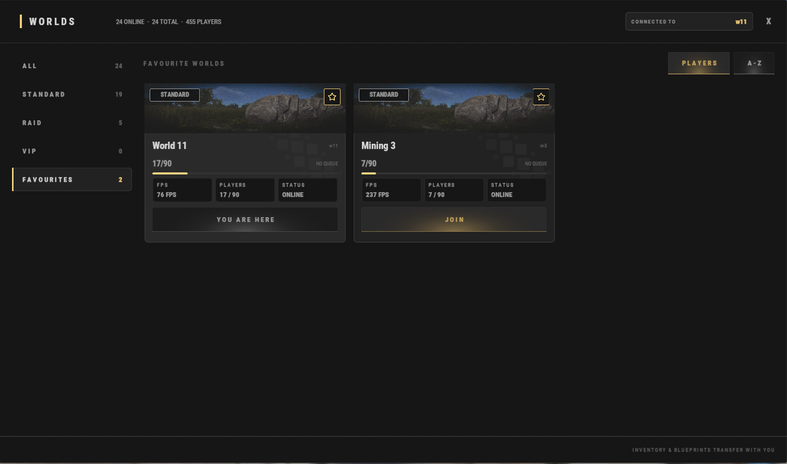

# Einsteigerleitfaden

Willkommen auf **Brits PvE Worlds**! Dieser Leitfaden deckt alles ab, was ein neuer Spieler zum Start braucht, damit du in den ersten Minuten auf dem Server nicht verloren bist.

> **Schnellüberblick:**
>
> - **Geschätzte Zeit**: 10-20 Minuten.
> - **Schwierigkeit:** ⭐☆☆☆☆
> - **Hauptziel:** Bau deine erste Base, schließe die Starter-Quests ab und schalte deinen eigenen Recycler frei.

---

## Erste Schritte

Wenn du zum ersten Mal beitrittst, spawnt du entweder in einer der normalen Welten oder im HUB.

Alle Welten gehören zum selben Servernetz, und du wechselst jederzeit mit **`/w`** zwischen ihnen:

| Welt | Wofür sie da ist |
|---|---|
| **HUB** | Zentraler Treffpunkt: Spielerläden, der Markt und die Portale zu den Raid Worlds |
| **World 1-15** | Die normalen Welten. Such dir eine aus und bau dort deine Base |
| **Mining World 1-3** | Kleinere Maps **ohne Bauen und ohne Monumente**. Weil nichts Spawn-Platz wegnimmt, spawnen Erz-Nodes und Bäume viel dichter. Der empfohlene Ort, um Nodes und Bäume zu farmen |
| **Raid World 1-5** | Raidbare Basen, Dungeons und je sechs Bradley-Inseln (**Brad 1-6**) |

### Der HUB

Der HUB ist der zentrale Treffpunkt des Servers.

Von hier aus kannst du:

- In den Läden anderer Spieler kaufen (siehe **[Spielerläden](/wiki/player-shops)**).
- Den großen Spielermarkt mit **`/s`** nutzen.
- Die Raid Worlds über die roten Portale erreichen (oder jede Welt mit **`/w`**).

Mit **`/hub`** kommst du jederzeit zurück in den HUB.

---

### Wähl deine Welt

Wähl die Welt, in der du deine Hauptbase bauen willst. Alle Welten nutzen dieselbe Map, deine Wahl ändert das Spiel also kaum. Jede Welt fasst bis zu **90 Spieler**.

**Vergiss nicht, die gewählte Welt zu favorisieren (der Stern oben rechts auf ihrer Karte), damit du sie unter Favourites leicht wiederfindest.**

> 💡 **Inventar und Blueprints kommen mit**, wenn du die Welt wechselst. Du kannst in einer Mining World farmen und alles mit zurück in deine Base-Welt nehmen.

---

### Schließe die Starter-Quests ab

Öffne das Quest-Menü mit **`/q`** oder **`/quest`** (auf der Seite **[Quests](/wiki/quests)** steht jede Questreihe) und nimm diese Quests an:

- **Getting Started 1**.
- **Getting Started 2**.
- **Getting Started 3**.

Diese Quests verlangen, dass du sammelst:

- 5,000 Stone.
- 5,000 Wood.
- 1,000 Metal Ore.

Dafür bekommst du frühe Baumaterialien, XP und RP.

---

### Bau deine erste Base

Nach den Starter-Quests solltest du genug Ressourcen für eine kleine Startbase haben.

Mit **`/sethome <name>`** (oder **`/home add <name>`**) legst du einen Teleportpunkt zurück zu deiner Base an, und mit **`/home <name>`** kehrst du dorthin zurück.

Um Türen und Schlösser musst du dich nicht kümmern: Nur du und deine Teammates kommen an das, was du platzierst. Wenn jemand anders Zugriff bekommen soll, nutze die Share-Befehle auf der Seite **[Befehle](/wiki/commands)**.

---

### Spiel weiter

Wenn deine Base steht, geh zurück ins Quest-Menü und nimm an:

- **Virtual Oil Baron**.
- **Barrel Basher**.

Diese Quests verlangen:

- **10 Diesel** sammeln.
- **75 Yellow or Blue Barrels** zerstören.

Wenn du fertig bist, **hol deine Quest-Belohnungen ab**.

Du solltest jetzt genug RP haben, um dir im **`/s`** einen eigenen **[Recycler](/wiki/recyclers)** zu kaufen. Der ist über den ganzen Wipe hinweg extrem nützlich. Am Anfang recycelst du damit ungewollte Items und schaltest wertvolle Blueprints frei.

Mit **`/sell`** kannst du wertvolle Items, zum Beispiel Components, gegen weiteres RP tauschen.

---

## Tipps für den Anfang

> 💡 **Starter-Kits**
>
> Mit **`/kit`** holst du dir kostenlose Startressourcen wie Medizin, Wood, Stone und mehr. Wenn du dein Konto über Discord verknüpfst oder authentifizierst, schaltest du weitere Kits frei.

> 💡 **Kostenloses Gear**
>
> Du suchst deine ersten Waffen oder Sprengstoff? Geh mit **`/hub`** in die Raid Worlds und nimm eines der roten Portale (**Raid World 1-5**). Drinnen liegen sechs Bradley-Inseln (**Brad 1-6**). Erfahrene Spieler lassen oft ungewolltes Gear liegen, das neuere Spieler aufheben können. 

> 💡 **Nützliche Befehle**
>
> - **`/w`** zeigt alle verfügbaren Welten.
> - **`/wa`** öffnet dein Stash und deine Achievements.
>
> Die volle Liste steht auf der Seite **[Befehle](/wiki/commands)**.

---

## Weiterlesen

Wenn du diese Schritte erledigt hast, lies den Guide **[Fortschritt und Level](/wiki/progression-levels)**. Dort stehen die schnellsten Wege zum Leveln, zum Freischalten von Skills und zum Vorankommen auf dem Server.
