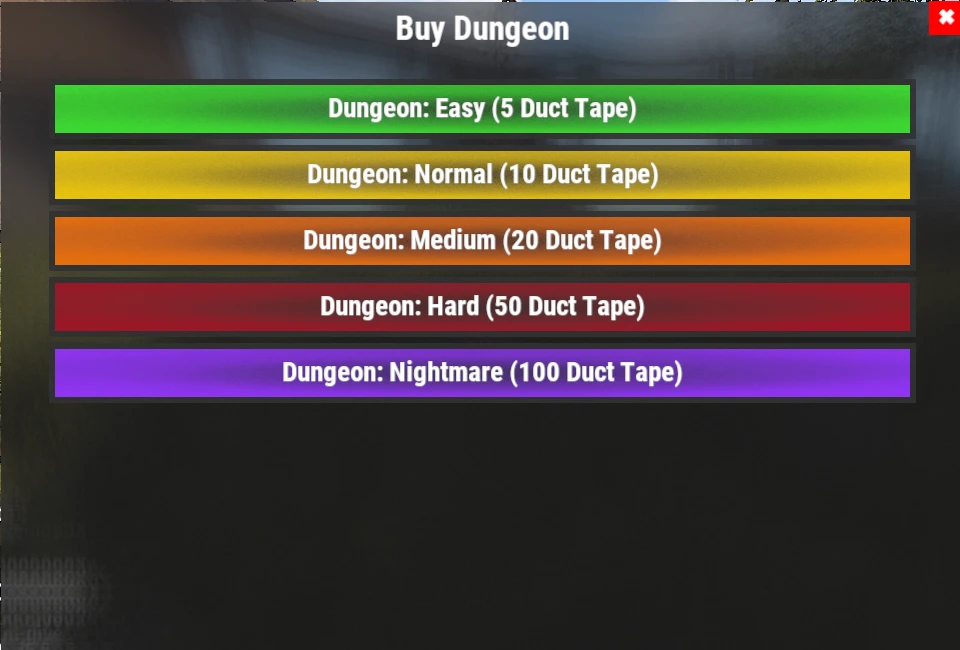

# Dungeon-Leitfaden

Dungeons sind zufällig erzeugte PvE-Herausforderungen voller eigener Gegner, automatischer Verteidigung und wertvollem Loot. Jeder Lauf ist anders. Deshalb gehören sie zu den lohnendsten wiederholbaren Aktivitäten auf dem Server.

## Kurzüberblick

- **Empfohlen für:** Mitte bis Endgame
- **Schwierigkeit:** ⭐⭐⭐⭐☆
- **Hauptziel:** Räum den Dungeon, besiege die Bosse und hol die Belohnungen.

---

## Empfohlenes Gear

### Unverzichtbar

- Viel Medical Supplies
- HV Rockets
- Rocket Launcher
- M249 (M2)
  
### Sehr empfohlen

- **[Ashmaker](/wiki/legendary-weapons)**
- HQM oder **[Leviathan Armor](/wiki/legendary-sets)**
- Skill **Extra Rounds** (größere Magazine, Baum Combat in **[`/st`](/wiki/skills)**)

> 💡 **Tipp**
>
> Der **Ashmaker** ist eine der besten Waffen für Dungeons. Seine HV Rockets räumen Gegnergruppen schnell weg und zerstören Turrets aus sicherer Distanz.

---

## Einen Dungeon starten

1. Nutze **`/worlds`**.
2. Betritt eine der **Raid Worlds (1-5)**.
3. Betritt das **Dungeon**-Portal.
4. Nutze **`/buydungeon`**.
5. Wähl eine Schwierigkeit und bezahle sie mit **Duct Tape** (Preise unten).
6. Sobald er spawnt, interagiere mit der Eingangstür (**E**), um hineinzugehen.

### Dungeon-Preise

| Schwierigkeit | Preis |
|---|---:|
| **Easy** | 5 Duct Tape |
| **Normal** | 10 Duct Tape |
| **Medium** | 20 Duct Tape |
| **Hard** | 50 Duct Tape |
| **Nightmare** | 100 Duct Tape |

Der Loot wird mit der Schwierigkeit besser (siehe **[Item Drops](/loot-tables)**).

> ⚠ **Achtung**
>
> Wenn du während deines Dungeon-Laufs stirbst, keine Sorge: Dein Körper wird vor die Dungeon-Tür teleportiert.
>
> Du kannst ihn looten und ganz normal wieder hineingehen.

---

## So funktionieren Dungeons

Jeder Dungeon wird **zufällig erzeugt**. Keine zwei Läufe sind genau gleich.

Drinnen triffst du auf:

- Eigene NPCs mit Schusswaffen.
- Automated Turrets.
- Mehrere Kampfräume, getrennt durch Garage Doors.
- Wertvollen Loot im ganzen Dungeon.

Jede Garage Door führt in einen neuen Abschnitt. Räum jeden Raum, bevor du die nächste öffnest.

---

## Kampfstrategie

Am sichersten kommst du langsam voran.

1. Öffne eine Garage Door.
2. Beseitige jeden Gegner im Raum.
3. Zerstöre alle Turrets, bevor du weitergehst.
4. Loote den Raum.
5. Geh in den nächsten Abschnitt.

> 💡 **Tipp**
>
> Loote während du durch den Dungeon gehst, statt bis zum Ende zu warten.

---

## Loot-Phase

Wenn jeder Raum geräumt ist, geht der Dungeon in seine letzte Loot-Phase.

Du hast ungefähr **5 Minuten**, bevor der Dungeon schließt und dich rauswirft.

> ⚠ **Wichtig**
>
> Fünf Minuten reichen meist nicht, um jedes Item einzusammeln.
>
> Am besten lootest du jeden Raum direkt nach dem Räumen, statt alles bis zum Ende aufzuheben.

---

## Cooldowns

Wenn du einen Dungeon beendet hast, interagiere wieder mit der Eingangstür, um zu gehen.

Wie bei **[Raids](/wiki/tackling-raiding)** und **[Bradleys](/wiki/tackling-bradleys)** werden Dungeon-Cooldowns für jede Raid World getrennt gezählt.

> 💡 **Tipp**
>
> Wechsel zwischen den **Raid Worlds 1-5**, um Dungeons weiter zu laufen, ohne auf deine Cooldowns zu warten.

---

## Weiterlesen

Du brauchst Hilfe bei der Gear-Wahl für deinen nächsten Dungeon?

Lies als Nächstes **[Legendäre Waffen](/wiki/legendary-weapons)** und **[Legendäre Sets](/wiki/legendary-sets)**, um das Gear zu finden, das zu schweren PvE-Kämpfen passt, oder sieh auf der Seite **[Quests](/wiki/quests)** nach der Questreihe Dungeon Crawler.
