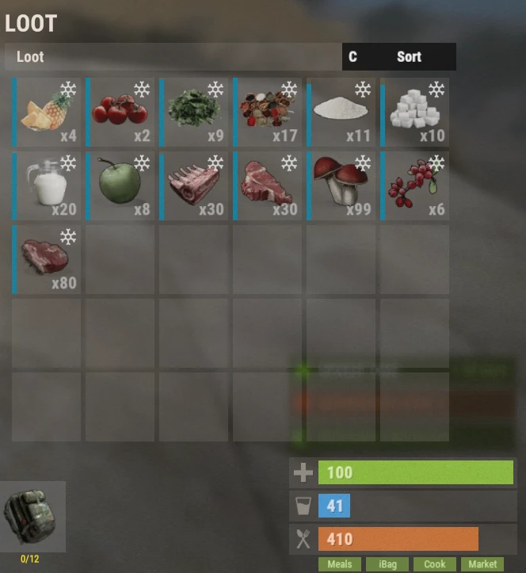

# Nahrungssystem (Food System)

Das Nahrungssystem bringt Dutzende eigener Mahlzeiten und Zutaten mit starken Boni fürs Sammeln, den Kampf, das Farmen, Angeln, Herstellen und viele andere Aktivitäten. Die richtige Mahlzeit kann deine Effizienz stark erhöhen und ist ein wichtiger Teil des Fortschritts auf Brits PvE Worlds.

## Kurzüberblick

- **Empfohlen für:** Alle Spieler
- **Hauptziel:** Nutze Mahlzeiten für zeitlich begrenzte Boni bei verschiedenen Aktivitäten.
- **Wichtig:** Mahlzeiten verderben mit der Zeit, außer sie liegen in einem Kühlschrank oder in deiner **iBag**.

> 💡 **Tipp**
>
> Food-Boni stapeln sich mit vielen Boni aus dem **[Skillbaum](/wiki/skills)**. Mahlzeiten sind deshalb ein wichtiger Teil des Fortschritts.

---

## Grundlagen des Nahrungssystems

Wenn du dein Inventar öffnest, siehst du unten rechts vier grüne Buttons:

| Button | Was er tut | Befehl |
|---|---|---|
| **Meals** | Zeigt deine aktiven Food-Buffs | (kein Befehl) |
| **iBag** | Deine Zutaten-Tasche (funktioniert auch als Kühlschrank) | `/ibag` |
| **Cook** | Das Kochmenü, in dem du Mahlzeiten herstellst | `/cook` |
| **Market** | Der Farmers Market, auf dem Spieler Zutaten kaufen und verkaufen | `/fmarket` |

Jeder wird unten erklärt.

### Meals

Das Menü **Meals** zeigt alle aktiven Food-Buffs, die deinen Charakter gerade betreffen.

Dieser Button ist nur verfügbar, solange du mindestens eine gekochte Mahlzeit dabei hast.

### iBag

Die **iBag** lagert Food-Zutaten wie Milk, Gemüse, Fleisch und andere Kochmaterialien automatisch.

Vorteile:

- Lagert Zutaten, die du sammelst, automatisch.
- Funktioniert als Kühlschrank.
- Verhindert, dass Zutaten verderben.

### Cook

Im Menü **Cook** erstellst du eigene Mahlzeiten. Es hat vier Abschnitte:

**Recipes** zeigt jede Mahlzeit, die du herstellen kannst. Wenn du eine Mahlzeit wählst, siehst du:

- Benötigte Zutaten
- Herstellungskosten
- Effekte der Mahlzeit
- Buff-Dauer

**Ingredients** zeigt jede Zutat auf dem Server und erklärt, wo du sie bekommst.

**Favourites** listet die Mahlzeiten, die du für den schnellen Zugriff mit einem Stern markiert hast. Klicke auf den ⭐ in einem Rezept, um es zu favorisieren.

**Settings** enthält verschiedene Optionen zum Kochen. Alle Einstellungen sind standardmäßig an.

### Market

Auf dem **Farmers Market** kaufen und verkaufen Spieler Kochzutaten, zum Beispiel:

- Bread
- Sugar
- Cloth
- Andere Kochmaterialien

Kaufen kostet **Scrap**, und der Verkauf von Zutaten belohnt dich mit **Scrap**.

> 💡 **Wichtig**
>
> Der Farmers Market hat nur Bestand, wenn andere Spieler Items an ihn verkauft haben.

---

## Welche Mahlzeit für welche Aktivität

Kurzreferenz für die häufigsten Aktivitäten auf dem Server.

| Aktivität | Empfohlene Mahlzeit |
|-----------|------------------|
| Quartermaster (Stone, Metal, Sulfur) / Mining | Bangers and Mash |
| Quartermaster (Wood) / Wood farmen | Grilled Pork Kebab |
| Herstellen | Pork Omelette |
| Farmen (von Spielern gezogene Pflanzen) | Mushroom Soup |
| Tiere farmen / Bone Fragments | Succulent Chicken Sandwich |
| Bradley | Chocolate Calzone |
| Patrol Helis | Steak Dinner |
| Harbinger | French Toast |
| Deep Sea | Pumpkin Pie |
| Angeln | Baked Trout |
| Raiden | Pancakes |
| Heilen | Pumpkin Pie |
| Strahlung | Chernobyl Casserole |
| Gruppen-Bosse | Berry Cobbler |

> 💡 **Tipp**
>
> Der Skill **Skilled Chef** (Baum Survivalcraft, Abschnitt Farming) verdoppelt das Kochtempo und die **Dauer der Mahlzeiten-Buffs**. Deine Buffs halten also doppelt so lange.

---

## Empfohlene Mahlzeiten

Das sind die Mahlzeiten, die du über deinen Fortschritt hinweg am häufigsten nutzt.

<strong>⏬ Empfohlene Mahlzeiten anzeigen ⏫</strong>

### Sammeln und Fortschritt

Beste Mahlzeit für Quartermaster-Quests mit Stone, Metal und Sulfur.

---

Beste Mahlzeit für Quartermaster-Quests mit Wood.

---

Beste Mahlzeit für Crafting-Quests.

---

Beste Mahlzeit zum Ernten von Pflanzen, die Spieler gezogen haben.

---

Beste Mahlzeit zum Farmen von Tieren und Bone Fragments.

---

Beste Mahlzeit, wenn du Bradleys angehst.

---

## Nützliche Mahlzeiten

Diese Mahlzeiten nutzt du seltener, aber in bestimmten Situationen sind sie extrem wertvoll.

<strong>🔽 Nützliche Mahlzeiten anzeigen 🔼</strong>

Beste Mahlzeit zum Angeln.

---

Sehr gut für Patrol Helis und schwere PvE-Kämpfe.

---

Gibt außergewöhnlich starke Heilung.

---

Die einzige Mahlzeit, die Schutz vor Strahlung gibt.

---

Gute Vorbereitung vor schwerem Inhalt.

---

Sehr gut zum Raiden.

---

Gute Vorbereitung vor Harbinger oder Patrol Helis.

---

Sehr gute Unterstützungs-Mahlzeit für Gruppen-Aktivitäten, dank ihrer Heilung.

---

## Zutaten

Jede Mahlzeit braucht Zutaten, die du auf dem Server sammelst.

Wo jede Zutat herkommt, siehst du im Abschnitt **Ingredients** im Kochmenü.

<strong>🔽 Alle Zutaten anzeigen 🔼</strong>

---

---

---

---

---

---

---

---

---

---

---

---

---

---

---

---

---

---

---

---

---

---

---

---

---

---

---

## Andere Mahlzeiten

Die Mahlzeiten unten haben speziellere Einsätze und werden allgemein seltener hergestellt, aber jede hat ihren Zweck.

<strong>⤵️ Alle anderen Mahlzeiten anzeigen ⤴️</strong>

---

---

---

---

---

---

---

---

---

---

---

---

---

---

---

---

---

---

---

---

---

---

---

---

---

---

---

---

---

---

---

---

---

---

---

---

## Weiterlesen

Mahlzeiten werden noch stärker, wenn du sie mit dem **Skillbaum** kombinierst.

Lies als Nächstes die Seite **[Skills](/wiki/skills)**, um zu sehen, welche Perks am besten mit Kochen und Food-Buffs zusammenspielen.
