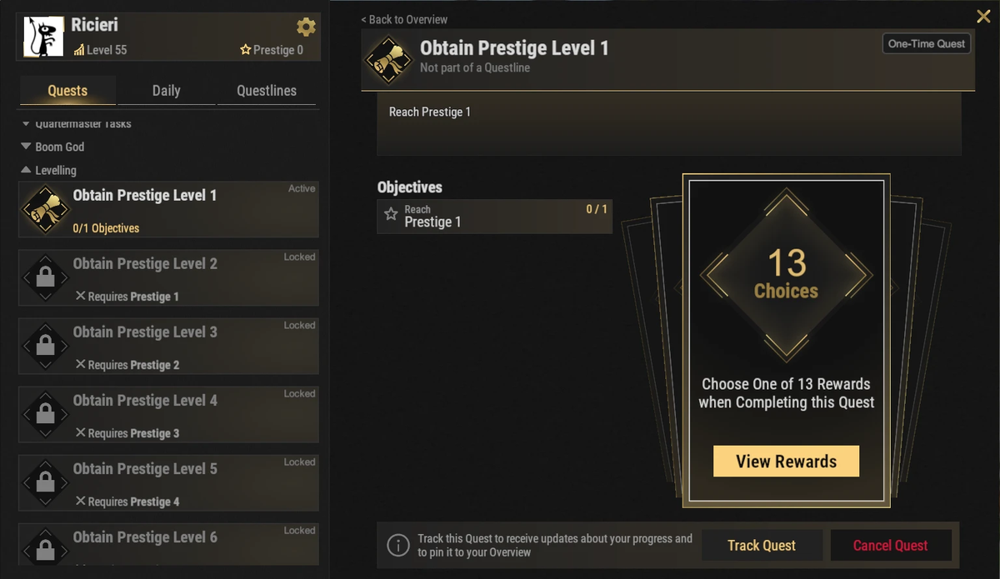
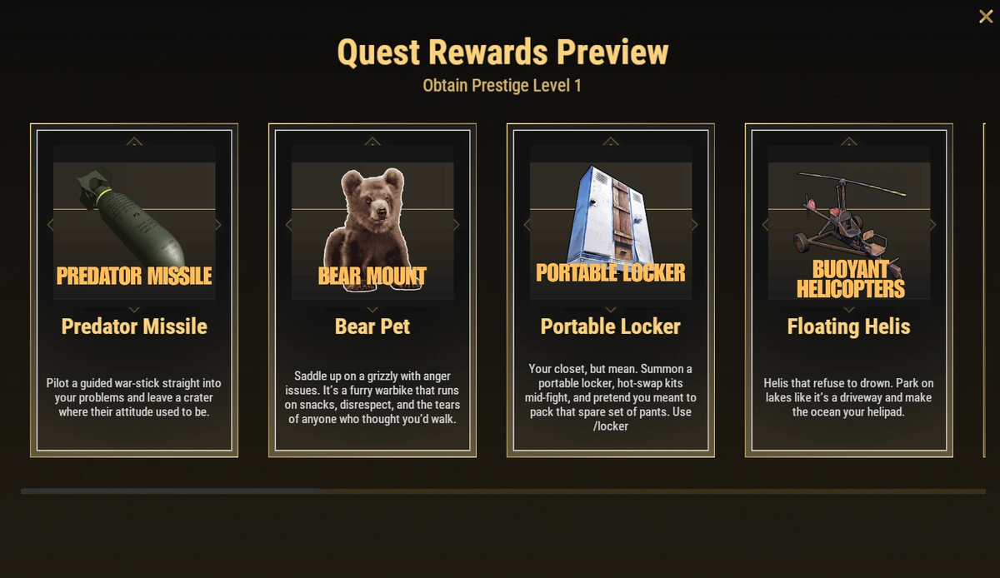

# Prestige-Perks

Prestige-Perks sind besondere Freischaltungen. Sie bringen starken Komfort, Fortschritts-Boosts, Automatisierung und eigene Spielmechaniken. Keiner davon ist Pflicht, aber viele verbessern dein Spiel auf Brits PvE Worlds deutlich.

## Kurzüberblick

- **Empfohlen für:** Mitte bis Endgame
- **Hauptziel:** Wähl die Perks, die am besten zu deiner Spielweise passen

> 💡 **Empfohlene Perks**
>
> - 5 Starting SP
> - Nightvision
> - 20% XP Boost

---

## So funktionieren Prestige-Perks

- Du kannst Prestige, sobald dein Spieler-Level **100** erreicht (siehe **[Fortschritt und Level](/wiki/progression-levels)**). Es gibt **10 Prestige-Level**.
- Jedes Prestige-Level hat eine Quest in der Questreihe **Levelling** in **`/q`**. Wenn du sie abschließt, darfst du **einen Perk** aus der Liste unten wählen.
- Es gibt **13 Perks**, aber nur 10 Prestige-Level. Du kannst also nicht alle freischalten. Wähl die, die zu deiner Spielweise passen.
- Prestige-Perks bleiben den ganzen XP-Zyklus über. Bei Map-Wipes verlierst du sie nicht.

---

## Fortschritts-Perks

Diese Perks helfen dir, schneller zu leveln und effizienter durch den Server zu kommen.

### Five Starting Skill Points

Du startest jedes Prestige mit **5 zusätzlichen globalen Skill Points**. Damit schaltest du nützliche Skills viel früher frei. Dieser Bonus wird **einmal zu deinem gemeinsamen Pool** addiert, und du kannst ihn über alle Bäume ausgeben.

---

### 20% XP Boost

Erhöht alle gewonnenen XP um **20%**. Leveln und Vorankommen werden dadurch deutlich schneller.

---

## Komfort-Perks

Diese Perks machen den Alltag leichter und verkürzen Leerlauf.

### Portable Recycler

Ruf mit **`/rec`** einen persönlichen Recycler dorthin, wo du ihn brauchst.

Gut für Monument-Läufe, Farm-Touren und lange Sessions weg von der Base.

---

### Portable Locker

Ruf mit **`/locker`** überall einen tragbaren Locker, um Kits mitten im Kampf zu wechseln.

Sehr nützlich bei Raids und PvE-Events.

---

### 5 Second Teleport

Senkt den Teleport-Countdown von **20 Sekunden** auf **5 Sekunden**.

Sehr gut für Spieler, die oft zwischen Basen und Events reisen.

> ⚠ Die Beschreibung im Spiel warnt: **Wähl das nicht, wenn dein Teleport-Countdown schon 0 ist** (manche Ränge haben schon keinen Countdown).

---

## Automatisierungs-Perks

### Auto Sell to Server

Schaltet die Item Bank und das Auto-Sell-System frei. Ressourcen in deiner Item Bank werden automatisch verkauft. Du kannst bis zu **4 verschiedene Server-Verkaufs-Items pro Welt** lagern, mit bis zu **6 Stacks von jedem**.

Die komplette Einrichtung steht auf der Seite **[Item Bank und Auto-Sell](/wiki/auto-sell)**.

---

### Terminal

Schaltet das Terminal-System frei, mit erweiterter Lager-Ausrüstung und industrieller Automatisierung.

Mehr dazu auf der Seite **[Terminal](/wiki/terminal)**.

---

## Kampf und Bewegung

### Predator Missile

Steuere eine gelenkte Rakete für verheerende Angriffe.

---

### Double Jump

Du kannst in der Luft einen zweiten Sprung machen.

Nützlich für Bewegung, Erkundung und Orte, die du sonst nicht erreichst.

---

### Nightvision

Setzt deine persönliche Zeit auf **12:00**. Du siehst Tageslicht auch um Mitternacht, ohne Grünstich. Umschalten mit **`/nv`**.

Besonders nützlich zum Farmen und für PvE in der Nacht.

---

### Pilot Assistance

Fügt mehrere Hilfe-Funktionen für Helikopter hinzu, darunter:

- Auto-hover
- Auto-land
- Flug-Hilfe
- Absturz-Schutz

Einer der besten Perks für Spieler, die oft fliegen.

---

### Floating Helis

Helikopter können auf dem Wasser landen und dort schweben bleiben.

Gut für die Erkundung von **[Deep Sea](/wiki/deep-sea)** und Meeres-Monumenten.

---

## Begleiter-Perks

### Bear Pet

Schaltet einen Begleit-Bären frei (im Spiel als **Bear Mount** angezeigt), der:

- Ressourcen sammeln kann
- geritten werden kann
- Items in seinem eigenen Inventar tragen kann

Sehr gut zum Farmen und für lange Ressourcen-Läufe.

---

## Weiterlesen

Viele dieser Perks schalten ganz neue Mechaniken frei.

Lies als Nächstes die Guides **[Terminal](/wiki/terminal)** und **[Item Bank und Auto-Sell](/wiki/auto-sell)**, um aus diesen beiden Perks das Meiste zu holen.
