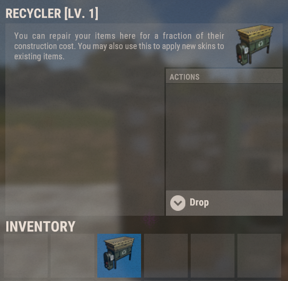
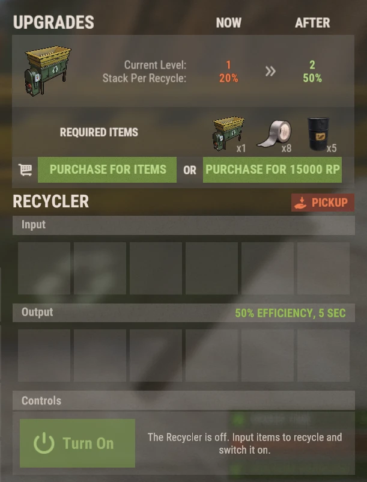

# Recycler

Recycler auf Brits PvE Worlds sind **platzierbare Items** mit eigenen Upgrade-Leveln. Du musst also nicht jedes Mal zu einem Monument laufen, wenn du recyceln willst.

## Kurzüberblick

- **Empfohlen für:** Alle Spieler
- **Hauptziel:** Recycle ungewollten Loot zu Hause, schneller und mit größeren Stacks, je weiter du upgradest.

> 💡 **Tipp**
>
> Einen eigenen Recycler zu kaufen ist das Ziel der Starter-Quests im **[Einsteigerleitfaden](/wiki/beginner-guide)**. Am Anfang macht er aus ungewolltem Loot Scrap für Blueprints. Später füttert er die RP-Methoden auf **[Die besten RP-Methoden](/wiki/best-rp-methods)**.

---

## Einen Recycler bekommen

- Kauf einen mit RP über **`/s`**.
- Sie droppen auch als Loot an manchen Stellen.

Der Recycler ist ein Inventar-Item: Platzier ihn wie jedes andere Deployable. Die Item-Beschreibung im Spiel ist der Vanilla-Text der Repair Bench. Ignorier den. Er recycelt.

> ⚠ **Recycle nicht am Outpost oder im Bandit Camp**, wenn du die Methode mit Tactical Gloves machst (siehe **[Die besten RP-Methoden](/wiki/best-rp-methods)**). Nutze einen Monument-Recycler oder deinen eigenen.

---

## Benutzung

Öffne den platzierten Recycler:

- Leg Items in die Slots **Input**.
- Drück **Turn On**. Recyceltes Material erscheint in den Slots **Output**.
- **Pickup** nimmt den Recycler zurück ins Inventar.

Ein Recycler auf Level 1 läuft mit **50% Effizienz**, einem Zyklus von **5 Sekunden**, und verarbeitet **20% eines Stacks pro Zyklus**.

> 💡 **Skillbaum**
>
> Der Skill **Rapid Recycle** (Baum Gathercraft, Abschnitt Gathering & Fishing, 1 SP) verkürzt die Zykluszeit um 2.5 Sekunden. Siehe **[Skills](/wiki/skills)**.

---

## Upgraden

Recycler haben Level. Jedes Level erhöht den **Stack pro Recycle**, also wie viel von einem Stack pro Zyklus verarbeitet wird. Das Upgrade-Panel sitzt oben in der Recycler-UI und lässt sich **mit Items oder mit RP** bezahlen.

| Level | Stack pro Recycle | Upgrade-Kosten, um dieses Level zu erreichen |
|---|---:|---|
| 1 | 20% | Startlevel |
| 2 | 50% | 1 Recycler + 8 Duct Tape + 5 Barrels (siehe Screenshot), **oder 15,000 RP** |
| 3+ | ? | ? |

Kosten und Werte für die höheren Level sind noch nicht dokumentiert. Wenn du einen Recycler auf Level 2 oder höher hast, mach einen Screenshot vom Upgrade-Panel und füge ihn hier ein (siehe **[Mitmachen](/contribute/contribute)**).

---

## Weiterlesen

Lies als Nächstes **[Die besten RP-Methoden](/wiki/best-rp-methods)**, um zu sehen, wie ein Recycler aus Tactical Gloves Cloth und RP macht, oder **[Virtuelle Steinbrüche](/wiki/virtual-quarry)** für das andere große System für passive Ressourcen.
