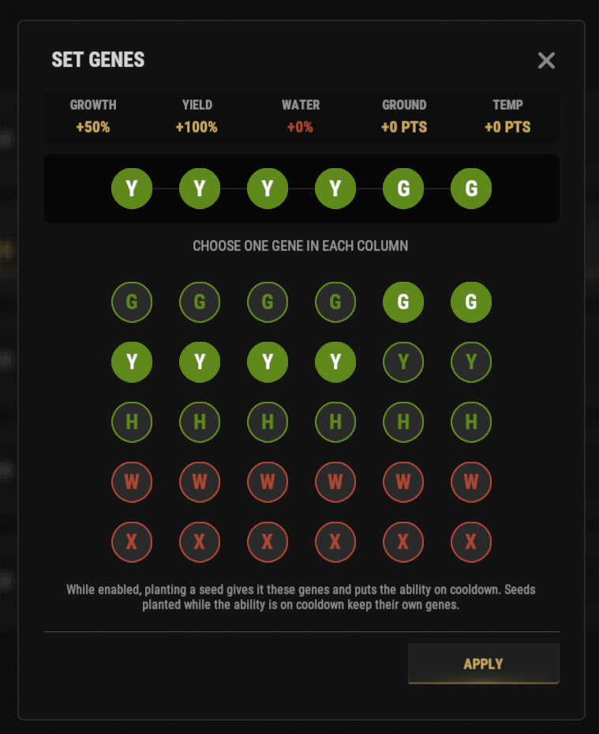

# Geneticist-Guide

Der Skill Geneticist lässt dich die genaue Gen-Kombination für ein Seed wählen. Farmen wird dadurch viel schneller und stetiger.

## Kurzüberblick

- **Empfohlen für:** Spieler, die den Skill **Geneticist** freigeschaltet haben (Baum Survivalcraft, Abschnitt Farming, 5 SP).
- **Hauptziel:** Setze genau die Gen-Kombination, die du willst, ohne auf Zufallsgene zu setzen.

> 💡 **Tipp**
>
> Dieser Skill ist besonders nützlich, wenn du große Farmen für die **[besten RP-Methoden](/wiki/best-rp-methods)** aufbaust, die an anderer Stelle im Wiki stehen.

---

## Video-Guide

@[youtube](https://www.youtube.com/watch?v=E7c142tDCtQ){width=960 height=540}

---

## Bevor du anfängst

Bevor du den Skill nutzt, brauchst du:

- Ein normales Seed in deiner Hotbar.
- Den Skill Geneticist nicht auf Cooldown (er hat einen Cooldown von **3 Stunden**).

> ⚠ **Wichtig**
>
> Wenn du die Schritte unten nicht in der richtigen Reihenfolge machst, kann der Skill auf Cooldown gehen, ohne deine gewählten Gene anzuwenden.

---

## Schritt für Schritt

1. Leg ein **normales Seed** in deine Hotbar.
2. Öffne den Skillbaum mit **`/st`**.
3. Klicke auf das Leucht-Symbol oben rechts.
4. Suche das **geneticist ultimate** und klicke auf **activate**.
5. Wähl die gewünschte Gen-Kombination aus dem Menü.

6. Schließ das Menü mit dem **X** oben rechts.
7. Pflanz **ein Seed** in eine Planter Box. *Hinweis: **SHIFT-KLICKE DEINE SEEDS NICHT***
8. Dein gepflanztes Seed sollte jetzt die gewählte Gen-Kombination haben.

---

## Fehlersuche

Wenn es nicht klappt:

- Prüf, ob ein normales Seed in deiner Hotbar liegt.
- Prüf, ob du die richtige Gen-Kombination gewählt hast.
- Schließ das Menü, bevor du das Seed pflanzt.

---

## Weiterlesen

Du willst das Meiste aus deinen Pflanzen holen?

Lies als Nächstes **[Die besten RP-Methoden](/wiki/best-rp-methods)**, um zu lernen, wie du perfekte Gene für große Farmen und RP-Erzeugung nutzt.
