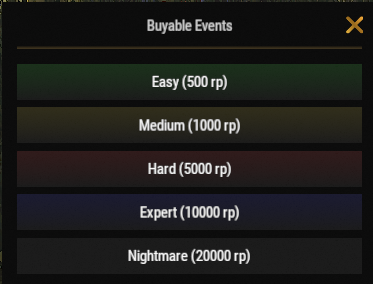

# Raiden angehen

Raiden ist eine der lohnendsten Aktivitäten auf Brits PvE Worlds. Mit vorgebauten Raid-Basen holst du wertvollen Loot und viel RP und testest dabei dein Raid-Können.

## Kurzüberblick

- **Empfohlen für:** Mitte bis Endgame
- **Schwierigkeit:** ⭐⭐⭐☆☆
- **Hauptziel:** Schaff Raid-Basen effizient und hol so viel Gewinn wie möglich.

---

## Empfohlenes Gear

### Unverzichtbar

- Viele Rockets oder C4
- Die Skills aus **Explosives** im Baum Combat (**[`/st`](/wiki/skills)**)

### Sehr empfohlen

- **[Brits Boom Stick](/wiki/legendary-weapons)**
- **[Ashmaker](/wiki/legendary-weapons)**

> 💡 **Tipp**
>
> Legendäre Launcher verkürzen die Zeit für härtere Raid-Basen stark und machen das Leeren viel sicherer.

---

## Einen Raid starten

1. Nutze **`/worlds`**.
2. Betritt eine der **Raid Worlds (1-5)**.
3. Nutze **`/buyraid`**, wähl eine Schwierigkeit und kauf die Raid-Base mit RP.

---

## Raid-Schwierigkeiten

Raid-Basen kaufst du mit RP im Menü **Buyable Events** (`/buyraid`). Die XP pro abgeschlossenem Raid kommen von der Seite **[Fortschritt und Level](/wiki/progression-levels)** und gehen in dein gemeinsames Spieler-Level.

| Schwierigkeit | Preis | Basismaterial | XP | Empfohlen für |
|------------|------:|---------------|---:|-----------------|
| **Easy** | 500 RP | Wood | 1,000 | Neue Spieler |
| **Medium** | 1,000 RP | Metal | 2,500 | Mittleres Spiel |
| **Hard** | 5,000 RP | HQM | 5,000 | Erfahrene Spieler |
| **Expert** | 10,000 RP | HQM | 7,000 | Endgame |
| **Nightmare** | 20,000 RP | HQM | 12,000 | Endgame |

Höhere Schwierigkeiten brauchen deutlich mehr Sprengstoff, bieten aber viel bessere Belohnungen.

---

## Kampfstrategie

Bevor du härtere Raid-Basen versuchst, schalte den Abschnitt **Explosives** im Baum Combat über **`/st`** frei (Shockwave, Chain Reaction, Reliable Fuses, Aerodynamically Sound, Blastproof und Orbital Strike).

Während du einen Raid leerst:

- Geh langsam und prüfe jeden Raum.
- Achte auf versteckte Fallen.
- Nimm genug Sprengstoff mit, um fertig zu werden, bevor der Raid-Timer abläuft.
- Wenn du stirbst, ist es wegen der Fallen oft schwer, dein Gear zurückzuholen.

> ⚠ **Wichtig**
>
> Raid-Basen sind zeitlich begrenzt. Wenn du sie nicht fertig machst, bevor der Timer abläuft, despawnt die Base.

---

## Orbital Strike

Wenn du den Skill **Orbital Strike** aus dem Baum Combat nutzt (er spawnt eine Flare in deiner Hotbar; wirf sie dorthin, wo der Schlag landen soll):

> ⚠ **Wichtig**
>
> Zerstöre immer die **SAM Sites**, bevor du die Flare wirfst.
>
> Sobald Rauch aus den SAM Sites kommt, sind sie aus, und dein Schlag kann die Base sicher treffen.

---

## Gewinnpotenzial

Raiden ist aktuell eine der besten RP-Aktivitäten auf dem Server.

Ein **Nightmare Raid** kostet **20,000 RP** im Kauf, kann aber beim Abschluss **ungefähr 100,000 RP** bringen. Damit gehört er zu den PvE-Aktivitäten mit dem höchsten Gewinn. Die Raid-Questreihe auf der Seite **[Quests](/wiki/quests)** zahlt obendrauf.

---

## Cooldowns

Raid-Cooldowns werden für jede Raid World getrennt gezählt.

> 💡 **Tipp**
>
> Wie bei den **[Bradley-Inseln](/wiki/tackling-bradleys)** kannst du zwischen den **Raid Worlds 1-5** wechseln und weiter raiden, ohne auf deinen Cooldown zu warten.

---

## Weiterlesen

Du brauchst Hilfe oder willst einen Bug während eines Raids melden?

Lies als Nächstes **[Support-Tickets](/wiki/support-tickets)**, um zu erfahren, wann und wie du das Team kontaktierst.
