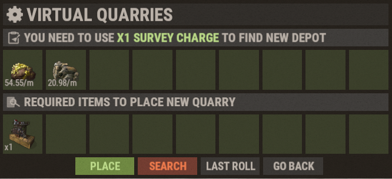

# Virtuelle Steinbrüche (Virtual Quarries)

Virtuelle Steinbrüche sind eines der besten Systeme für passive Ressourcen auf Brits PvE Worlds. Du erzeugst Ressourcen, während du offline bist oder weg von deiner Base.

## Kurzüberblick

- **Empfohlen für:** Frühes Spiel bis Endgame
- **Hauptziel:** Erzeuge passive Ressourcen mit wenig Wartung.

| Quarry | Produziert | Am besten für |
|--------|----------|----------|
| Mining Quarry | HQM, Metal Ore, Sulfur Ore | Ressourcen farmen |
| Pump Jack | Crude Oil | Treibstoff-Produktion |
| Wood Generator | Wood | Bauen und Schmelzen |

---

## Einstieg

1. Öffne den Shop mit **`/s`**.
2. Kauf **Survey Charges**.
3. Kauf den Virtual Quarry, den du willst.
4. Öffne das Menü Virtual Quarry mit **`/vq`** (oder **`/qr`**).
5. Survey nach einem Depot, bis du einen guten Wurf hast (siehe unten).
6. Platzier deinen Quarry.
7. Halt ihn mit **Diesel Fuel** versorgt.

### Nach einem Depot surveyen

Jeder Quarry steht auf einem **Depot**, und jedes Depot findest du, indem du **eine Survey Charge** ausgibst. Ein Wurf zeigt, welche Ressourcen das Depot enthält und ihren **Basis-Ertrag pro Minute** (im Screenshot: zwei Ressourcen bei 54.55/min und 20.98/min). Die Erträge sind zufällig. Würfle weiter, bis du einen hast, mit dem du zufrieden bist:

- **Search** gibt eine weitere Survey Charge aus und würfelt ein neues Depot.
- **Last Roll** holt den vorherigen Wurf zurück.
- **Place** baut den Quarry auf dem aktuellen Wurf (es kostet auch das Quarry-Item, das unter *Required items* steht).

Die Level-Multiplikatoren in den Tabellen unten gelten für den Basis-Ertrag, den du gewürfelt hast. Ein guter Wurf zahlt sich also auf jedem Level aus. Erfahrene Spieler zielen vor dem Platzieren auf ungefähr **48 HQM/min** bei einem Mining Quarry und **53 bis 55 Crude Oil/min** bei einem Pump Jack (siehe **[Die besten RP-Methoden](/wiki/best-rp-methods)**).

> 💡 **Wichtig**
>
> Jeder Virtual Quarry verbraucht im Betrieb **Diesel Fuel**. Diesel kannst du am **Outpost** mit Low Grade Fuel kaufen, und die Starter-Quest **Virtual Oil Baron** verlangt, dass du 10 davon sammelst.

---

## Quarry-Typen

### Mining Quarry

Der Mining Quarry produziert die drei wertvollsten Erze im Spiel und ist für die meisten Spieler langfristig die beste Wahl.

Die Ausgaben unten gehen von einem guten Wurf von ungefähr **49 HQM, 75 Metal Ore und 75 Sulfur Ore pro Minute** auf Level 1 aus. Deine eigenen Zahlen skalieren von dem, was du gewürfelt hast.

**Maximale Ausgabe (Level 6, 8.5x):**

- HQM: 416.5/min
- Metal Ore: 637.5/min
- Sulfur Ore: 637.5/min

**Produktion nach Level:**

| Level | Multiplikator | Ausgabe pro Minute |
|---|---:|---|
| 1 | 1.0x | 49 HQM, 75 Metal Ore, 75 Sulfur Ore |
| 2 | 2.25x | 110.25 HQM, 168.75 Metal Ore, 168.75 Sulfur Ore |
| 3 | 3.75x | 183.75 HQM, 281.25 Metal Ore, 281.25 Sulfur Ore |
| 4 | 5.0x | 245 HQM, 375 Metal Ore, 375 Sulfur Ore |
| 5 | 7.0x | 343 HQM, 525 Metal Ore, 525 Sulfur Ore |
| 6 | 8.5x | 416.5 HQM, 637.5 Metal Ore, 637.5 Sulfur Ore |

**Upgrade-Kosten:**

| Level | Kosten |
|---|---|
| 1 | 1 Mining Quarry |
| 2 | 6,000 Metal Ore + 1 Duct Tape + 1 Quarry |
| 3 | 1,000 HQM + 1 Bleach + 1 Quarry |
| 4 | 2,000 HQM + 5 Bleach + 2 Quarries |
| 5 | 3,000 HQM + 7 Bleach + 3 Quarries |
| 6 | 5,000 HQM + 5 Batteries + 3 Quarries |

---

### Pump Jack

Der Pump Jack produziert Crude Oil. Damit betreibst du deine anderen Virtual Quarries und baust eine sich selbst tragende Ressourcen-Schleife.

Die Ausgaben unten gehen von einem guten Wurf von ungefähr **55 Crude Oil pro Minute** auf Level 1 aus.

**Maximale Ausgabe (Level 6, 8.5x):**

- Crude Oil: 467.5/min

**Produktion nach Level:**

| Level | Multiplikator | Ausgabe pro Minute |
|---|---:|---|
| 1 | 1.0x | 55 Crude Oil |
| 2 | 2.25x | 123.75 Crude Oil |
| 3 | 3.75x | 206.25 Crude Oil |
| 4 | 5.0x | 275 Crude Oil |
| 5 | 7.0x | 385 Crude Oil |
| 6 | 8.5x | 467.5 Crude Oil |

**Upgrade-Kosten:**

| Level | Kosten |
|---|---|
| 1 | 1 Pumpjack |
| 2 | 1 Duct Tape + 1 Pumpjack |
| 3 | 1,000 HQM + 2 Bleach + 2 Pumpjacks |
| 4 | 2,000 HQM + 5 Bleach + 2 Pumpjacks |
| 5 | 3,000 HQM + 2 Batteries + 3 Pumpjacks |
| 6 | 5,000 HQM + 5 Batteries + 3 Pumpjacks |

---

### Wood Generator

Der Wood Generator liefert einen stetigen Vorrat an Wood. Er eignet sich für Furnaces, Bau und Schmelzen in großem Maßstab.

**Maximale Ausgabe (Level 6, 5x):**

- Wood: 5,000/min

**Produktion nach Level:**

| Level | Multiplikator | Ausgabe pro Minute |
|---|---:|---|
| 1 | 1.0x | 1,000 Wood |
| 2 | 1.25x | 1,250 Wood |
| 3 | 1.5x | 1,500 Wood |
| 4 | 2.0x | 2,000 Wood |
| 5 | 3.0x | 3,000 Wood |
| 6 | 5.0x | 5,000 Wood |

**Upgrade-Kosten:**

| Level | Kosten |
|---|---|
| 1 | 5 Chainsaws |
| 2 | 2,000 Metal + 15 Metal Blades + 1 Duct Tape + 5 Chainsaws |
| 3 | 4,000 Metal + 25 Metal Blades + 5 Duct Tape + 10 Chainsaws |
| 4 | 200 HQM + 35 Metal Blades + 1 Bleach + 15 Chainsaws |
| 5 | 1,000 HQM + 50 Metal Blades + 5 Bleach + 20 Chainsaws |
| 6 | 5,000 HQM + 60 Metal Blades + 5 Batteries + 20 Chainsaws |

---

## Die sich selbst tragende Treibstoff-Schleife

Der Grund, mit einem Pump Jack anzufangen: Crude Oil zahlt seinen eigenen Diesel, und jeder extra Diesel, den du machst, kann dann einen Mining Quarry für Gewinn laufen lassen.

1. Kauf **Diesel Fuel** am **Outpost** mit **Low Grade Fuel**.
2. Leg den Diesel in einen **Pump Jack**, der **Crude Oil** abbaut.
3. Raffiniere das Crude Oil in einer **Small Refinery** zu **Low Grade Fuel**.
4. Nutz dieses Low Grade, um am Outpost mehr Diesel zu kaufen. Wiederhole das.
5. Sobald du einen **Diesel-Überschuss** hast, nutze ihn, um einen **Mining Quarry** für **HQM** laufen zu lassen.
6. Verkauf das HQM in **`/s` → Stock Market → Resources**.

> 💡 **Verkauf in der richtigen Welt**
>
> Verkaufspreise unterscheiden sich zwischen den Welten. Bevor du HQM, Cloth, Scrap oder Sheet Metal verkaufst, nutze **`/pc <item>`** (zum Beispiel `/pc hqm`), um zu sehen, welche Welt am meisten zahlt, und verkauf dort.

Wie viel RP das mit voll upgegradeten Quarries bringt, steht auf **[Die besten RP-Methoden](/wiki/best-rp-methods)**.

---

## Empfohlener Fortschritt

- **Frühes Spiel:** Starte mit einem Pump Jack, um die Schleife oben aufzubauen, die sich selbst betankt.
- **Mittleres Spiel:** Füg Mining Quarries hinzu und push auf Level 3-4.
- **Spätes Spiel:** Max alle Quarry-Typen und farm Batteries für die letzten Upgrades.

> ⚠ **Upgrades kosten Ressourcen, nicht RP**
>
> Quarry-Level lassen sich nur mit den Ressourcen in den Tabellen oben kaufen. Für Quarries gibt es keine RP-Option (anders als bei **[Recyclern](/wiki/recyclers)**).

---

## Ausgabe-Vergleich (Level 6)

| Typ | Pro Minute | Pro Stunde |
|---|---:|---:|
| Wood Generator | 5,000 Wood | 300,000 Wood |
| Mining Quarry (Metal Ore) | 637.5 Metal Ore | 38,250 Metal Ore |
| Mining Quarry (Sulfur Ore) | 637.5 Sulfur Ore | 38,250 Sulfur Ore |
| Pump Jack (Crude Oil) | 467.5 Crude Oil | 28,050 Crude Oil |
| Mining Quarry (HQM) | 416.5 HQM | 24,990 HQM |

> Hinweis zum Multiplikator: Mining Quarry und Pump Jack erreichen auf Level 6 beide 8.5x.

---

> 💡 **Kurzreferenz**
>
> - Öffne das Quarry-Menü mit **`/vq`** oder **`/qr`**
> - Kauf Quarries und Survey Charges über **`/s`**
> - Alle Quarries brauchen **Diesel Fuel**
> - Survey nach einem guten Depot-Wurf, bevor du einen Quarry platzierst
> - Pump Jacks eignen sich für Setups, die sich selbst betanken
> - Maximales Quarry-Level: **6**

---

## Weiterlesen

Du willst dein passives Einkommen maximieren?

Lies als Nächstes **[Item Bank und Auto-Sell](/wiki/auto-sell)**, um zu lernen, wie du deine Ressourcen-Verkäufe automatisierst und RP verdienst, auch offline, oder sieh auf **[Die besten RP-Methoden](/wiki/best-rp-methods)**, wie viel RP voll upgegradete Quarries bringen können.
