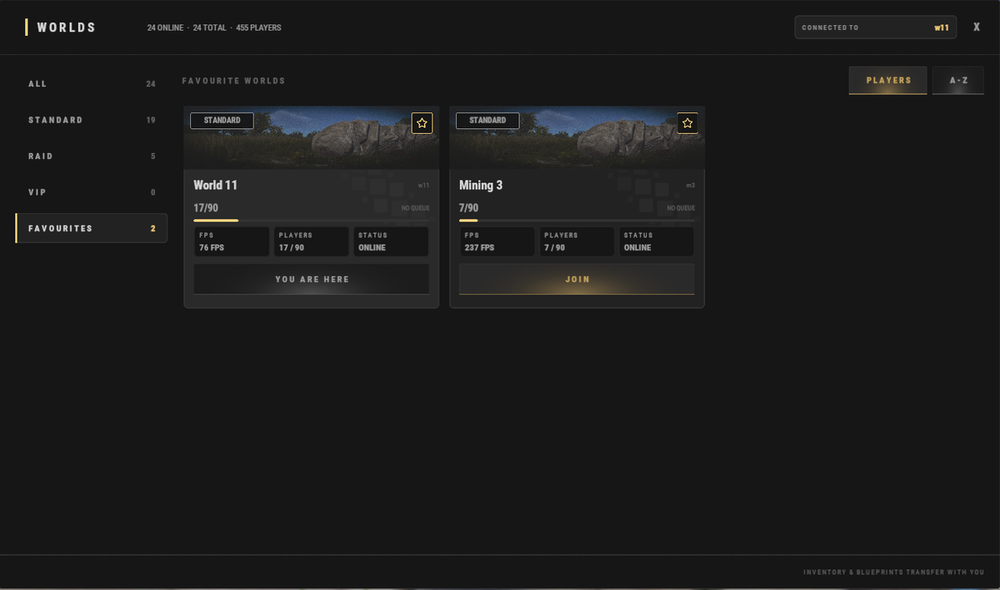

# Guía para principiantes (Beginner Guide)

¡Bienvenido a **Brits PvE Worlds**! Esta guía cubre lo que un jugador nuevo necesita para empezar y no sentirse perdido en los primeros minutos en el servidor.

> **Resumen rápido:**
>
> - **Tiempo estimado**: 10-20 minutos.
> - **Dificultad:** ⭐☆☆☆☆
> - **Objetivo principal:** construye tu primera base, completa las misiones iniciales y desbloquea tu propio Recycler.

---

## Primeros pasos

Al entrar por primera vez, apareces en uno de los mundos normales o en el HUB.

Todos los mundos forman parte de la misma red del servidor, y puedes cambiar de uno a otro en cualquier momento con **`/w`**:

| Mundo | Para qué sirve |
|---|---|
| **HUB** | Punto de encuentro central: tiendas de jugadores, el mercado y los portales a los Raid Worlds |
| **World 1-15** | Los mundos normales. Elige uno para construir tu base |
| **Mining World 1-3** | Mapas más pequeños, **sin construcción y sin monumentos**. Como nada ocupa el espacio de aparición, los nodos de mineral y los árboles salen mucho más densos. El sitio recomendado para farmear nodos y árboles |
| **Raid World 1-5** | Bases raideables, Dungeons y seis islas de Bradley (**Brad 1-6**) cada uno |

### El HUB

El HUB es el punto de encuentro central del servidor.

Desde aquí puedes:

- Comprar en las tiendas de otros jugadores (mira **[Tiendas de jugadores](/wiki/player-shops)**).
- Usar el mercado principal de jugadores con **`/s`**.
- Llegar a los Raid Worlds por los portales rojos (o a cualquier mundo con **`/w`**).

Puedes volver al HUB en cualquier momento con **`/hub`**.

---

### Elige tu mundo

Elige el mundo donde quieres construir tu base principal. Todos los mundos usan el mismo mapa, así que tu elección no cambia mucho la partida. Cada mundo admite hasta **90 jugadores**.

**No olvides marcar como favorito el mundo que elegiste (la estrella de la esquina superior derecha de su tarjeta) para encontrarlo fácil en Favourites.**

> 💡 **Tu inventario y tus blueprints viajan contigo** cuando cambias de mundo. Puedes farmear en un Mining World y llevarte todo de vuelta al mundo de tu base.

---

### Completa las misiones iniciales

Abre el menú de misiones con **`/q`** o **`/quest`** (en la página de **[Misiones](/wiki/quests)** está cada línea de misiones) y acepta estas:

- **Getting Started 1**.
- **Getting Started 2**.
- **Getting Started 3**.

Estas misiones te piden recoger:

- 5,000 Stone.
- 5,000 Wood.
- 1,000 Metal Ore.

Al completarlas recibes materiales de construcción iniciales, XP y RP.

---

### Construye tu primera base

Después de las misiones iniciales, deberías tener recursos suficientes para colocar una base pequeña de inicio.

Usa **`/sethome <name>`** (o **`/home add <name>`**) para crear un punto de teletransporte de vuelta a tu base, y **`/home <name>`** para volver a ella.

No tienes que preocuparte por puertas ni cerraduras: solo tú y tus compañeros pueden usar lo que colocas. Si quieres dar acceso a otra persona, usa los comandos de compartir de la página de **[Comandos](/wiki/commands)**.

---

### Sigue progresando

Cuando tu base esté lista, vuelve al menú de misiones y acepta:

- **Virtual Oil Baron**.
- **Barrel Basher**.

Estas misiones piden:

- Recoger **10 Diesel**.
- Destruir **75 Yellow or Blue Barrels**.

Cuando las termines, no olvides **reclamar las recompensas de las misiones**.

Ya deberías tener RP suficiente para comprar tu propio **[Recycler](/wiki/recyclers)** en **`/s`**. Te va a servir durante todo el wipe. Al principio puedes usarlo para reciclar objetos que no quieres y desbloquear blueprints valiosos.

También puedes usar **`/sell`** para cambiar objetos valiosos, como componentes, por RP extra.

---

## Consejos para principiantes

> 💡 **Kits iniciales**
>
> Usa **`/kit`** para reclamar recursos iniciales gratis, como suministros médicos, wood, stone y más. Vincular o autenticar tu cuenta por Discord desbloquea kits adicionales.

> 💡 **Equipo gratis**
>
> ¿Buscas tus primeras armas o explosivos? Ve a los Raid Worlds con **`/hub`** y entra en uno de los portales rojos (**Raid World 1-5**). Dentro hay seis islas de Bradley (**Brad 1-6**). Los jugadores con experiencia suelen dejar equipo que no quieren, y los nuevos pueden recogerlo. 

> 💡 **Comandos útiles**
>
> - **`/w`** muestra todos los mundos disponibles.
> - **`/wa`** abre tu alijo y tus logros.
>
> La lista completa está en la página de **[Comandos](/wiki/commands)**.

---

## Sigue leyendo

Cuando completes estos pasos, sigue con la guía de **[Progresión y niveles](/wiki/progression-levels)** para ver las formas más rápidas de subir de nivel, desbloquear habilidades y avanzar en el servidor.
