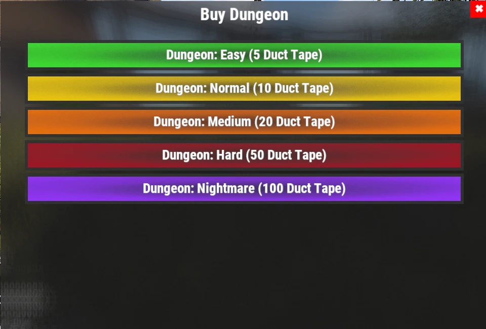

# Guía de Dungeons (Dungeon Guide)

Los Dungeons son desafíos PvE generados por procedimiento, llenos de enemigos personalizados, defensas automáticas y botín valioso. Cada run es distinta, y por eso son una de las actividades repetibles que más compensan en el servidor.

## Resumen rápido

- **Recomendado para:** de mitad a final de la partida
- **Dificultad:** ⭐⭐⭐⭐☆
- **Objetivo principal:** limpia el dungeon, derrota a los jefes y reclama las recompensas.

---

## Equipo recomendado

### Imprescindible

- Muchos suministros médicos
- HV Rockets
- Rocket Launcher
- M249 (M2)
  
### Muy recomendado

- **[Ashmaker](/wiki/legendary-weapons)**
- HQM o **[Leviathan Armor](/wiki/legendary-sets)**
- Habilidad **Extra Rounds** (cargadores más grandes, árbol Combat en **[`/st`](/wiki/skills)**)

> 💡 **Consejo**
>
> El **Ashmaker** es una de las mejores armas para Dungeons. Sus HV Rockets te permiten eliminar grupos de enemigos rápido y destruir torretas desde una distancia segura.

---

## Cómo empezar un Dungeon

1. Usa **`/worlds`**.
2. Entra en uno de los **Raid Worlds (1-5)**.
3. Entra en el portal de **Dungeon**.
4. Usa **`/buydungeon`**.
5. Elige una dificultad y págalo en **Duct Tape** (precios abajo).
6. Cuando aparezca, interactúa con la puerta de entrada (**E**) para entrar.

### Precios de Dungeon

| Dificultad | Precio |
|---|---:|
| **Easy** | 5 Duct Tape |
| **Normal** | 10 Duct Tape |
| **Medium** | 20 Duct Tape |
| **Hard** | 50 Duct Tape |
| **Nightmare** | 100 Duct Tape |

El botín mejora con la dificultad (mira **[Drops de objetos](/loot-tables)**).

> ⚠ **Atención**
>
> Si mueres durante tu run de dungeon, no te preocupes: tu cuerpo se teletransporta fuera de la puerta del dungeon.
>
> Luego puedes lootearlo y volver a entrar como siempre.

---

## Cómo funcionan los Dungeons

Cada dungeon se **genera al azar**, así que no hay dos runs exactamente iguales.

Dentro te vas a encontrar:

- NPCs personalizados con armas de fuego.
- Torretas automáticas.
- Varias salas de combate separadas por Garage Doors.
- Botín valioso por todo el Dungeon.

Cada garage door lleva a una sección nueva. Limpia cada sala antes de abrir la siguiente.

---

## Estrategia de combate

Lo más seguro es avanzar despacio.

1. Abre una Garage Door.
2. Elimina a todos los enemigos de la sala.
3. Destruye las torretas antes de avanzar.
4. Lootea la sala.
5. Sigue a la siguiente sección.

> 💡 **Consejo**
>
> Lootea mientras avanzas por el Dungeon, en lugar de esperar al final.

---

## Fase de botín

Cuando todas las salas están limpias, el Dungeon entra en su fase final de botín.

Tienes unos **5 minutos** antes de que el Dungeon se cierre y te eche.

> ⚠ **Importante**
>
> Cinco minutos no suelen bastar para recogerlo todo.
>
> Para el mejor resultado, lootea cada sala justo después de limpiarla, en lugar de guardarlo todo para el final.

---

## Enfriamientos

Después de terminar un Dungeon, interactúa otra vez con la puerta de entrada para salir.

Igual que en los **[raids](/wiki/tackling-raiding)** y los **[Bradleys](/wiki/tackling-bradleys)**, los enfriamientos de Dungeon se cuentan por separado en cada Raid World.

> 💡 **Consejo**
>
> Cambia entre **Raid Worlds 1-5** para seguir haciendo Dungeons sin esperar tus enfriamientos.

---

## Sigue leyendo

¿Necesitas ayuda para elegir el mejor equipo para tu próximo Dungeon?

Sigue con **[Armas legendarias](/wiki/legendary-weapons)** y **[Sets legendarios](/wiki/legendary-sets)** para ver el equipo que mejor encaja en encuentros PvE difíciles, o mira la página de **[Misiones](/wiki/quests)** para la línea Dungeon Crawler.
