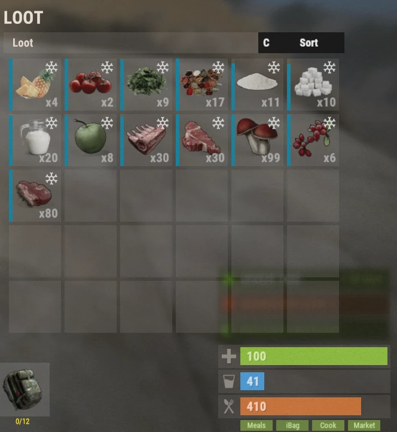

# Sistema de comida (Food System)

El sistema de comida añade decenas de comidas e ingredientes personalizados que dan bonificaciones potentes para recolectar, combatir, farmear, pescar, craftear y muchas otras actividades. Elegir la comida adecuada puede subir mucho tu eficiencia, y es una parte importante de la progresión en Brits PvE Worlds.

## Resumen rápido

- **Recomendado para:** todos los jugadores
- **Objetivo principal:** usar comidas para ganar bonificaciones temporales según la actividad.
- **Importante:** las comidas se estropean con el tiempo, salvo que las guardes en una nevera o en tu **iBag**.

> 💡 **Consejo**
>
> Las bonificaciones de comida se acumulan con muchas bonificaciones del **[árbol de habilidades](/wiki/skills)**. Por eso las comidas son una parte importante de la progresión.

---

## Bases del sistema de comida

Al abrir el inventario, verás cuatro botones verdes en la esquina inferior derecha:

| Botón | Qué hace | Comando |
|---|---|---|
| **Meals** | Muestra tus buffs de comida activos | (sin comando) |
| **iBag** | Tu bolsa de ingredientes (también funciona como nevera) | `/ibag` |
| **Cook** | El menú de cocina, donde crafteas comidas | `/cook` |
| **Market** | El Farmers Market, donde los jugadores compran y venden ingredientes | `/fmarket` |

Cada uno se explica abajo.

### Meals

El menú **Meals** muestra todos los buffs de comida activos que afectan a tu personaje.

Este botón solo está disponible mientras llevas al menos una comida cocinada.

### iBag

El **iBag** guarda automáticamente ingredientes de comida, como milk, verduras, carne y otros materiales de cocina.

Entre sus ventajas:

- Guarda automáticamente los ingredientes que recoges.
- Funciona como nevera.
- Evita que los ingredientes se estropeen.

### Cook

El menú **Cook** es donde creas comidas personalizadas. Tiene cuatro secciones:

**Recipes** muestra cada comida que puedes craftear. Al elegir una comida se ve:

- Ingredientes necesarios
- Coste de crafteo
- Efectos de la comida
- Duración del buff

**Ingredients** muestra cada ingrediente disponible en el servidor y explica dónde se consigue.

**Favourites** lista las comidas que marcaste con estrella para llegar rápido. Haz clic en la ⭐ dentro de una receta para marcarla como favorita.

**Settings** contiene varias opciones de cocina. Todos los ajustes vienen activados por defecto.

### Market

El **Farmers Market** permite a los jugadores comprar y vender ingredientes de cocina, por ejemplo:

- Bread
- Sugar
- Cloth
- Otros materiales de cocina

Comprar cuesta **Scrap**, y vender ingredientes te da **Scrap**.

> 💡 **Importante**
>
> El Farmers Market solo tiene stock si otros jugadores le han vendido objetos.

---

## Qué comida para cada actividad

Referencia rápida de las actividades más habituales del servidor.

| Actividad | Comida recomendada |
|-----------|------------------|
| Quartermaster (Stone, Metal, Sulfur) / minería | Bangers and Mash |
| Quartermaster (Wood) / farmeo de madera | Grilled Pork Kebab |
| Crafteo | Pork Omelette |
| Farmeo (cultivos plantados por el jugador) | Mushroom Soup |
| Farmeo de animales / Bone Fragments | Succulent Chicken Sandwich |
| Bradley | Chocolate Calzone |
| Patrol Helis | Steak Dinner |
| Harbinger | French Toast |
| Deep Sea | Pumpkin Pie |
| Pesca | Baked Trout |
| Raids | Pancakes |
| Curación | Pumpkin Pie |
| Radiación | Chernobyl Casserole |
| Jefes de grupo | Berry Cobbler |

> 💡 **Consejo**
>
> La habilidad **Skilled Chef** (árbol Survivalcraft, sección Farming) duplica la velocidad de cocina y la **duración del buff de la comida**, así que tus buffs duran el doble.

---

## Comidas recomendadas

Estas son las comidas que más vas a usar a lo largo de tu progresión.

<strong>⏬ Mostrar las comidas recomendadas ⏫</strong>

### Recolección y progresión

La mejor comida para las misiones Quartermaster de Stone, Metal y Sulfur.

---

La mejor comida para las misiones Quartermaster de Wood.

---

La mejor comida para las misiones de crafteo.

---

La mejor comida para cosechar cultivos plantados por el jugador.

---

La mejor comida para farmear animales y Bone Fragments.

---

La mejor comida al enfrentarte a Bradleys.

---

## Comidas útiles

Estas comidas no se usan tan a menudo, pero valen mucho en ciertas situaciones.

<strong>🔽 Mostrar las comidas útiles 🔼</strong>

La mejor comida para pescar.

---

Excelente para Patrol Helis y encuentros PvE difíciles.

---

Cura de forma excepcional.

---

La única comida que da protección contra la radiación.

---

Gran comida de preparación antes de contenido difícil.

---

Excelente para raids.

---

Gran comida de preparación antes de Harbinger o Patrol Helis.

---

Excelente comida de apoyo para actividades en grupo, gracias a sus efectos de curación.

---

## Ingredientes

Cada comida pide ingredientes recogidos por el servidor.

Puedes ver de dónde sale cada ingrediente en la sección **Ingredients** del menú de cocina.

<strong>🔽 Mostrar todos los ingredientes 🔼</strong>

---

---

---

---

---

---

---

---

---

---

---

---

---

---

---

---

---

---

---

---

---

---

---

---

---

---

---

## Otras comidas

Las comidas de abajo tienen usos más concretos y, en general, se craftean menos, pero cada una sigue teniendo su propósito.

<strong>⤵️ Mostrar todas las demás comidas ⤴️</strong>

---

---

---

---

---

---

---

---

---

---

---

---

---

---

---

---

---

---

---

---

---

---

---

---

---

---

---

---

---

---

---

---

---

---

---

---

## Sigue leyendo

Las comidas se vuelven todavía más fuertes si las combinas con el **árbol de habilidades**.

Sigue con la página de **[Habilidades](/wiki/skills)** para ver qué ventajas combinan mejor con la cocina y los buffs de comida.
