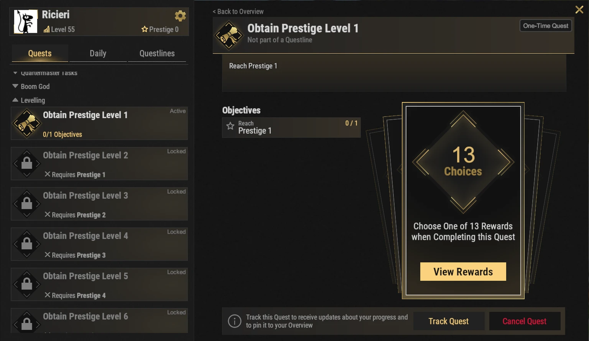
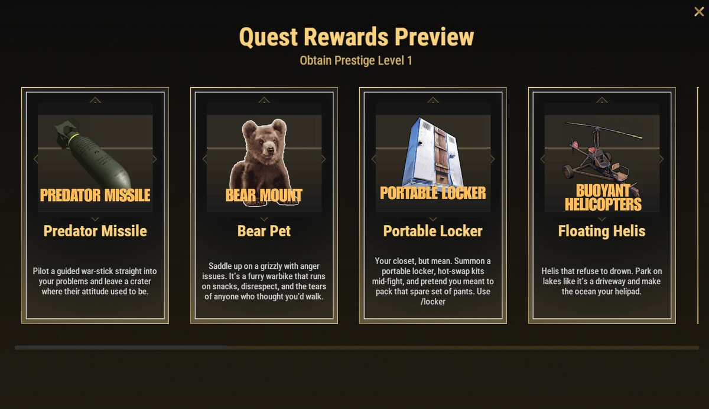

# Ventajas de prestigio (Prestige Perks)

Las ventajas de prestigio son desbloqueos especiales que dan mejoras potentes de comodidad, impulsos de progresión, funciones de automatización y mecánicas de juego únicas. Ninguna es obligatoria, pero muchas pueden mejorar bastante tu experiencia en Brits PvE Worlds.

## Resumen rápido

- **Recomendado para:** de mitad a final de la partida
- **Objetivo principal:** elegir las ventajas que mejor encajan con tu forma de jugar

> 💡 **Ventajas recomendadas**
>
> - 5 Starting SP
> - Nightvision
> - 20% XP Boost

---

## Cómo funcionan las ventajas de prestigio

- Puedes hacer prestigio cuando tu nivel de jugador llega a **100** (mira **[Progresión y niveles](/wiki/progression-levels)**). Hay **10 niveles de prestigio**.
- Cada nivel de prestigio tiene una misión en la línea **Levelling** de **`/q`**. Completarla te deja **elegir una ventaja** de la lista de abajo.
- Hay **13 ventajas** pero solo 10 niveles de prestigio, así que no puedes desbloquearlas todas. Elige las que encajen con tu forma de jugar.
- Las ventajas de prestigio se conservan durante todo el ciclo de XP. No se pierden en los wipes de mapa.

---

## Ventajas de progresión

Estas ventajas te ayudan a subir de nivel más rápido y a avanzar por el servidor con más eficiencia.

### Five Starting Skill Points

Empiezas cada prestigio con **5 Skill Points globales extra**, y así desbloqueas habilidades útiles mucho antes. Esta bonificación se añade **una sola vez a tu reserva compartida**, y puedes gastarla en cualquiera de los árboles.

---

### 20% XP Boost

Aumenta toda la XP ganada un **20%**, así que subir de nivel y progresar va bastante más rápido.

---

## Ventajas de utilidad

Estas ventajas mejoran la comodidad y reducen el tiempo muerto.

### Portable Recycler

Invoca un Recycler personal donde lo necesites con **`/rec`**.

Perfecto para rutas de monumentos, viajes de farmeo y sesiones largas lejos de la base.

---

### Portable Locker

Invoca un locker portátil en cualquier sitio con **`/locker`** para cambiar de kit en mitad de una pelea.

Muy útil durante raids y eventos PvE.

---

### 5 Second Teleport

Reduce la cuenta atrás del teletransporte de **20 segundos** a **5 segundos**.

Excelente si viajas a menudo entre bases y eventos.

> ⚠ La descripción del juego avisa: **no elijas esta si tu cuenta atrás de teletransporte ya es 0** (algunos rangos ya no tienen cuenta atrás).

---

## Ventajas de automatización

### Auto Sell to Server

Desbloquea el Item Bank y el sistema Auto Sell, y permite vender automáticamente los recursos guardados en tu Item Bank. Puedes guardar hasta **4 objetos distintos de venta al servidor por mundo**, con hasta **6 stacks de cada uno**.

Mira la página de **[Banco de objetos y Auto-Sell](/wiki/auto-sell)** para una guía completa de configuración.

---

### Terminal

Desbloquea el sistema Terminal, que permite equipo de almacenamiento avanzado y automatización industrial.

Mira la página del **[Terminal](/wiki/terminal)** para más información.

---

## Combate y movilidad

### Predator Missile

Pilota un misil guiado para ataques devastadores.

---

### Double Jump

Ganas la capacidad de hacer un segundo salto mientras estás en el aire.

Útil para moverte, explorar y llegar a sitios que de otra forma no alcanzas.

---

### Nightvision

Fija tu hora personal en **12:00**, así que ves luz de día incluso a medianoche, sin tinte verde. Actívala o desactívala con **`/nv`**.

Especialmente útil para farmear y para actividades PvE de noche.

---

### Pilot Assistance

Añade varias ayudas de helicóptero, entre ellas:

- Auto-hover
- Auto-land
- Asistencia de vuelo
- Prevención de choques

Una de las mejores ventajas si vuelas a menudo.

---

### Floating Helis

Permite que los helicópteros aterricen y se queden flotando en el agua.

Perfecto para explorar **[Deep Sea](/wiki/deep-sea)** y los monumentos del océano.

---

## Ventajas de compañero

### Bear Pet

Desbloquea un oso compañero (en el juego se muestra como **Bear Mount**) que puede:

- Recolectar recursos
- Dejarse montar
- Llevar objetos en su propio inventario

Excelente para farmear y para rutas largas de recursos.

---

## Sigue leyendo

Muchas de estas ventajas desbloquean mecánicas completamente nuevas.

Sigue con las guías del **[Terminal](/wiki/terminal)** y del **[Banco de objetos y Auto-Sell](/wiki/auto-sell)** para sacarles el máximo partido a estas dos ventajas.
