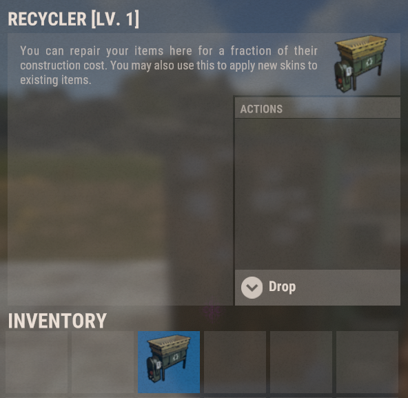
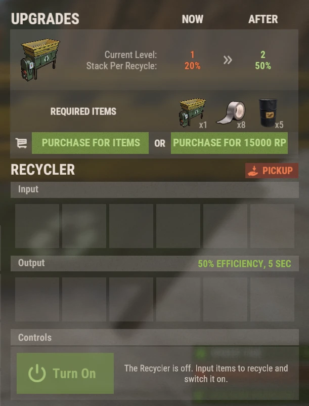

# Recyclers

Los Recyclers de Brits PvE Worlds son **objetos colocables** con sus propios niveles de mejora, así que no tienes que correr a un monumento cada vez que quieres reciclar.

## Resumen rápido

- **Recomendado para:** todos los jugadores
- **Objetivo principal:** reciclar en casa el botín que no quieres, más rápido y con stacks más grandes a medida que mejoras.

> 💡 **Consejo**
>
> Comprar tu propio Recycler es el objetivo de las misiones iniciales de la **[guía para principiantes](/wiki/beginner-guide)**. Al principio convierte botín no deseado en scrap para blueprints. Más adelante alimenta los métodos de RP de **[Mejores métodos de RP](/wiki/best-rp-methods)**.

---

## Conseguir un Recycler

- Cómpralo con RP en **`/s`**.
- También cae como botín en algunos sitios.

El Recycler es un objeto de inventario: colócalo como cualquier deployable. La descripción del objeto en el juego es el texto vainilla del banco de reparación, así que ignórala. Recicla.

> ⚠ **No recicles en Outpost ni en Bandit Camp** si estás haciendo el método de Tactical Gloves (mira **[Mejores métodos de RP](/wiki/best-rp-methods)**). Usa un recycler de monumento o el tuyo.

---

## Cómo usarlo

Abre el Recycler colocado:

- Mete objetos en las ranuras de **Input**.
- Pulsa **Turn On**. Los materiales reciclados aparecen en las ranuras de **Output**.
- **Pickup** devuelve el Recycler a tu inventario.

Un Recycler de nivel 1 funciona al **50% de eficiencia**, con un ciclo de **5 segundos**, y procesa el **20% de un stack por ciclo**.

> 💡 **Árbol de habilidades**
>
> La habilidad **Rapid Recycle** (árbol Gathercraft, sección Gathering & Fishing, 1 SP) recorta el tiempo de ciclo en 2.5 segundos. Mira **[Habilidades](/wiki/skills)**.

---

## Mejoras

Los Recyclers tienen niveles. Cada nivel aumenta el **stack por reciclado**, es decir, cuánto de un stack se procesa en cada ciclo. El panel de mejora está arriba en la interfaz del Recycler y se puede pagar **con objetos o con RP**.

| Nivel | Stack por reciclado | Coste de mejora para llegar a este nivel |
|---|---:|---|
| 1 | 20% | Nivel inicial |
| 2 | 50% | 1 Recycler + 8 Duct Tape + 5 barriles (mira la captura), **o 15,000 RP** |
| 3+ | ? | ? |

Los costes y valores de los niveles más altos todavía no están documentados. Si tienes un Recycler de nivel 2 o superior, haz una captura del panel de mejora y añádela aquí (mira **[Contribuir](/contribute/contribute)**).

---

## Sigue leyendo

Sigue con **[Mejores métodos de RP](/wiki/best-rp-methods)** para ver cómo un Recycler convierte Tactical Gloves en cloth y RP, o con **[Canteras virtuales](/wiki/virtual-quarry)** para el otro gran sistema de recursos pasivos.
