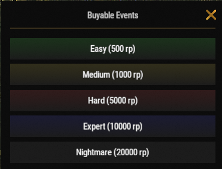

# Cómo hacer raids

Raidear es una de las actividades que más compensan en Brits PvE Worlds. Al comprar bases de raid ya construidas, puedes ganar botín valioso y grandes cantidades de RP mientras pones a prueba tu habilidad para raidear.

## Resumen rápido

- **Recomendado para:** de mitad a final de la partida
- **Dificultad:** ⭐⭐⭐☆☆
- **Objetivo principal:** completar bases de raid con eficiencia y maximizar tu ganancia.

---

## Equipo recomendado

### Imprescindible

- Muchos Rockets o C4
- Las habilidades de **Explosives** del árbol Combat (**[`/st`](/wiki/skills)**)

### Muy recomendado

- **[Brits Boom Stick](/wiki/legendary-weapons)**
- **[Ashmaker](/wiki/legendary-weapons)**

> 💡 **Consejo**
>
> Los lanzadores legendarios reducen mucho el tiempo necesario para completar bases de raid más difíciles y hacen que limpiarlas sea mucho más seguro.

---

## Cómo empezar un raid

1. Usa **`/worlds`**.
2. Entra en uno de los **Raid Worlds (1-5)**.
3. Usa **`/buyraid`**, elige una dificultad y compra la base de raid con RP.

---

## Dificultades de raid

Las bases de raid se compran con RP desde el menú **Buyable Events** (`/buyraid`). La XP por raid completado sale de la página de **[Progresión y niveles](/wiki/progression-levels)** y va a tu nivel de jugador compartido.

| Dificultad | Precio | Material de la base | XP | Recomendado para |
|------------|------:|---------------|---:|-----------------|
| **Easy** | 500 RP | Wood | 1,000 | Jugadores nuevos |
| **Medium** | 1,000 RP | Metal | 2,500 | Mitad de la partida |
| **Hard** | 5,000 RP | HQM | 5,000 | Jugadores con experiencia |
| **Expert** | 10,000 RP | HQM | 7,000 | Final de la partida |
| **Nightmare** | 20,000 RP | HQM | 12,000 | Final de la partida |

Las dificultades más altas piden bastantes más explosivos, pero ofrecen recompensas mucho mejores.

---

## Estrategia de combate

Antes de intentar bases de raid más difíciles, asegúrate de haber desbloqueado la sección **Explosives** del árbol Combat en **`/st`** (Shockwave, Chain Reaction, Reliable Fuses, Aerodynamically Sound, Blastproof y Orbital Strike).

Mientras limpias un raid:

- Muévete despacio y revisa cada sala.
- Vigila las trampas escondidas.
- Lleva explosivos suficientes para terminar antes de que expire el temporizador del raid.
- Si mueres, recuperar tu equipo puede ser difícil por cómo están colocadas las trampas.

> ⚠ **Importante**
>
> Las bases de raid tienen tiempo. Si no las terminas antes de que expire el temporizador, la base desaparece.

---

## Orbital Strike

Si usas la habilidad **Orbital Strike** del árbol Combat (genera una flare en tu hotbar; lánzala donde quieres el ataque):

> ⚠ **Importante**
>
> Destruye siempre los **SAM Sites** antes de lanzar la flare.
>
> Cuando empiece a salir humo de los SAM Sites, están desactivados y tu ataque puede impactar la base con seguridad.

---

## Potencial de ganancia

Raidear es ahora mismo una de las mejores actividades para hacer RP del servidor.

Un **Nightmare Raid** cuesta **20,000 RP** comprarlo, pero puede recompensar **alrededor de 100,000 RP** al completarlo, y por eso es una de las actividades PvE de mayor ganancia. La línea de misiones de raid de la página de **[Misiones](/wiki/quests)** paga encima de eso.

---

## Enfriamientos

Los enfriamientos de raid se cuentan por separado en cada Raid World.

> 💡 **Consejo**
>
> Igual que en las **[islas de Bradley](/wiki/tackling-bradleys)**, puedes cambiar entre **Raid Worlds 1-5** para seguir raideando sin esperar a que expire tu enfriamiento.

---

## Sigue leyendo

¿Buscas ayuda o necesitas reportar un bug durante un raid?

Sigue con **[Tickets de soporte](/wiki/support-tickets)** para saber cuándo y cómo contactar al staff.
