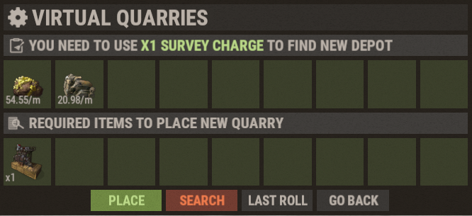

# Canteras virtuales (Virtual Quarries)

Las Virtual Quarries son uno de los mejores sistemas de recursos pasivos de Brits PvE Worlds. Te permiten generar recursos mientras estás offline o lejos de tu base.

## Resumen rápido

- **Recomendado para:** de principio a final de la partida
- **Objetivo principal:** generar recursos pasivos con el mínimo mantenimiento.

| Cantera | Produce | Mejor para |
|--------|----------|----------|
| Mining Quarry | HQM, Metal Ore, Sulfur Ore | Farmeo de recursos |
| Pump Jack | Crude Oil | Producción de combustible |
| Wood Generator | Wood | Construcción y fundición |

---

## Cómo empezar

1. Abre la tienda con **`/s`**.
2. Compra **Survey Charges**.
3. Compra la Virtual Quarry que quieras.
4. Abre el menú de Virtual Quarry con **`/vq`** (o **`/qr`**).
5. Prospecta un depósito hasta conseguir una tirada buena (mira abajo).
6. Coloca tu cantera.
7. Mantenla abastecida con **Diesel Fuel**.

### Prospectar un depósito

Cada cantera se asienta sobre un **depósito**, y cada depósito se encuentra gastando **una Survey Charge**. Una tirada muestra qué recursos contiene el depósito y su **rendimiento base por minuto** (en la captura: dos recursos a 54.55/min y 20.98/min). Los rendimientos son aleatorios, así que sigue tirando hasta conseguir uno que te convenza:

- **Search** gasta otra Survey Charge y tira un depósito nuevo.
- **Last Roll** recupera la tirada anterior.
- **Place** construye la cantera sobre la tirada actual (también cuesta el objeto de cantera que se muestra bajo *Required items*).

Los multiplicadores de nivel de las tablas de abajo se aplican al rendimiento base que te salió, así que una buena tirada compensa en cada nivel. Los jugadores con experiencia apuntan a unos **48 HQM/min** en una Mining Quarry y **53 a 55 Crude Oil/min** en un Pump Jack antes de colocar (mira **[Mejores métodos de RP](/wiki/best-rp-methods)**).

> 💡 **Importante**
>
> Cada Virtual Quarry consume **Diesel Fuel** mientras funciona. El diesel se puede comprar en **Outpost** con Low Grade Fuel, y la misión inicial **Virtual Oil Baron** te pide recoger 10.

---

## Tipos de cantera

### Mining Quarry

La Mining Quarry produce los tres minerales más valiosos del juego, y por eso es la mejor opción a largo plazo para la mayoría de los jugadores.

Las salidas de abajo asumen una buena tirada de unos **49 HQM, 75 Metal Ore y 75 Sulfur Ore por minuto** en el nivel 1. Tus números escalan desde lo que te haya salido.

**Salida máxima (nivel 6, 8.5x):**

- HQM: 416.5/min
- Metal Ore: 637.5/min
- Sulfur Ore: 637.5/min

**Producción por nivel:**

| Nivel | Multiplicador | Salida por minuto |
|---|---:|---|
| 1 | 1.0x | 49 HQM, 75 Metal Ore, 75 Sulfur Ore |
| 2 | 2.25x | 110.25 HQM, 168.75 Metal Ore, 168.75 Sulfur Ore |
| 3 | 3.75x | 183.75 HQM, 281.25 Metal Ore, 281.25 Sulfur Ore |
| 4 | 5.0x | 245 HQM, 375 Metal Ore, 375 Sulfur Ore |
| 5 | 7.0x | 343 HQM, 525 Metal Ore, 525 Sulfur Ore |
| 6 | 8.5x | 416.5 HQM, 637.5 Metal Ore, 637.5 Sulfur Ore |

**Costes de mejora:**

| Nivel | Coste |
|---|---|
| 1 | 1 Mining Quarry |
| 2 | 6,000 Metal Ore + 1 Duct Tape + 1 Quarry |
| 3 | 1,000 HQM + 1 Bleach + 1 Quarry |
| 4 | 2,000 HQM + 5 Bleach + 2 Quarries |
| 5 | 3,000 HQM + 7 Bleach + 3 Quarries |
| 6 | 5,000 HQM + 5 Batteries + 3 Quarries |

---

### Pump Jack

El Pump Jack produce Crude Oil, y así puedes alimentar tus otras Virtual Quarries y crear un ciclo de recursos que se sostiene solo.

Las salidas de abajo asumen una buena tirada de unos **55 Crude Oil por minuto** en el nivel 1.

**Salida máxima (nivel 6, 8.5x):**

- Crude Oil: 467.5/min

**Producción por nivel:**

| Nivel | Multiplicador | Salida por minuto |
|---|---:|---|
| 1 | 1.0x | 55 Crude Oil |
| 2 | 2.25x | 123.75 Crude Oil |
| 3 | 3.75x | 206.25 Crude Oil |
| 4 | 5.0x | 275 Crude Oil |
| 5 | 7.0x | 385 Crude Oil |
| 6 | 8.5x | 467.5 Crude Oil |

**Costes de mejora:**

| Nivel | Coste |
|---|---|
| 1 | 1 Pumpjack |
| 2 | 1 Duct Tape + 1 Pumpjack |
| 3 | 1,000 HQM + 2 Bleach + 2 Pumpjacks |
| 4 | 2,000 HQM + 5 Bleach + 2 Pumpjacks |
| 5 | 3,000 HQM + 2 Batteries + 3 Pumpjacks |
| 6 | 5,000 HQM + 5 Batteries + 3 Pumpjacks |

---

### Wood Generator

El Wood Generator da un suministro constante de Wood, y por eso va bien para hornos, construcción y fundición a gran escala.

**Salida máxima (nivel 6, 5x):**

- Wood: 5,000/min

**Producción por nivel:**

| Nivel | Multiplicador | Salida por minuto |
|---|---:|---|
| 1 | 1.0x | 1,000 Wood |
| 2 | 1.25x | 1,250 Wood |
| 3 | 1.5x | 1,500 Wood |
| 4 | 2.0x | 2,000 Wood |
| 5 | 3.0x | 3,000 Wood |
| 6 | 5.0x | 5,000 Wood |

**Costes de mejora:**

| Nivel | Coste |
|---|---|
| 1 | 5 Chainsaws |
| 2 | 2,000 Metal + 15 Metal Blades + 1 Duct Tape + 5 Chainsaws |
| 3 | 4,000 Metal + 25 Metal Blades + 5 Duct Tape + 10 Chainsaws |
| 4 | 200 HQM + 35 Metal Blades + 1 Bleach + 15 Chainsaws |
| 5 | 1,000 HQM + 50 Metal Blades + 5 Bleach + 20 Chainsaws |
| 6 | 5,000 HQM + 60 Metal Blades + 5 Batteries + 20 Chainsaws |

---

## El ciclo de combustible que se sostiene solo

El motivo para empezar con un Pump Jack: el crude oil paga su propio diesel, y cada diesel extra que hagas puede luego hacer funcionar una Mining Quarry con ganancia.

1. Compra **Diesel Fuel** en **Outpost** con **Low Grade Fuel**.
2. Mete el diesel en un **Pump Jack**, que extrae **Crude Oil**.
3. Refina el crude oil en una **Small Refinery** para obtener **Low Grade Fuel**.
4. Usa ese low grade para comprar más diesel en Outpost. Repite.
5. Cuando tengas un **excedente de diesel**, úsalo para hacer funcionar una **Mining Quarry** y sacar **HQM**.
6. Vende el HQM en **`/s` → Stock Market → Resources**.

> 💡 **Vende en el mundo adecuado**
>
> Los precios de venta cambian entre mundos. Antes de vender HQM, cloth, scrap o sheet metal, usa **`/pc <item>`** (por ejemplo `/pc hqm`) para ver qué mundo paga más, y vende allí.

Mira **[Mejores métodos de RP](/wiki/best-rp-methods)** para saber cuánto RP da esto con canteras mejoradas del todo.

---

## Progresión recomendada

- **Principio de la partida:** empieza con un Pump Jack para crear el ciclo de combustible de arriba.
- **Mitad de la partida:** añade Mining Quarries y llévalas al nivel 3-4.
- **Final de la partida:** lleva todos los tipos de cantera al máximo y farmea Batteries para las mejoras finales.

> ⚠ **Las mejoras cuestan recursos, no RP**
>
> Los niveles de cantera solo se pueden comprar con los recursos de las tablas de arriba. No hay opción de RP para las canteras (a diferencia de los **[Recyclers](/wiki/recyclers)**).

---

## Comparación de salida (nivel 6)

| Tipo | Por minuto | Por hora |
|---|---:|---:|
| Wood Generator | 5,000 Wood | 300,000 Wood |
| Mining Quarry (Metal Ore) | 637.5 Metal Ore | 38,250 Metal Ore |
| Mining Quarry (Sulfur Ore) | 637.5 Sulfur Ore | 38,250 Sulfur Ore |
| Pump Jack (Crude Oil) | 467.5 Crude Oil | 28,050 Crude Oil |
| Mining Quarry (HQM) | 416.5 HQM | 24,990 HQM |

> Nota del multiplicador: Mining Quarry y Pump Jack llegan ambos a 8.5x en el nivel 6.

---

> 💡 **Referencia rápida**
>
> - Abre el menú de canteras con **`/vq`** o **`/qr`**
> - Compra canteras y Survey Charges en **`/s`**
> - Todas las canteras necesitan **Diesel Fuel**
> - Prospecta una buena tirada de depósito antes de colocar una cantera
> - Los Pump Jacks van bien para montajes que se alimentan solos
> - Nivel máximo de cantera: **6**

---

## Sigue leyendo

¿Quieres maximizar tus ingresos pasivos?

Sigue con **[Banco de objetos y Auto-Sell](/wiki/auto-sell)** para aprender a automatizar la venta de recursos y ganar RP incluso offline, o mira **[Mejores métodos de RP](/wiki/best-rp-methods)** para las cuentas de cuánto RP pueden dar las canteras mejoradas del todo.
