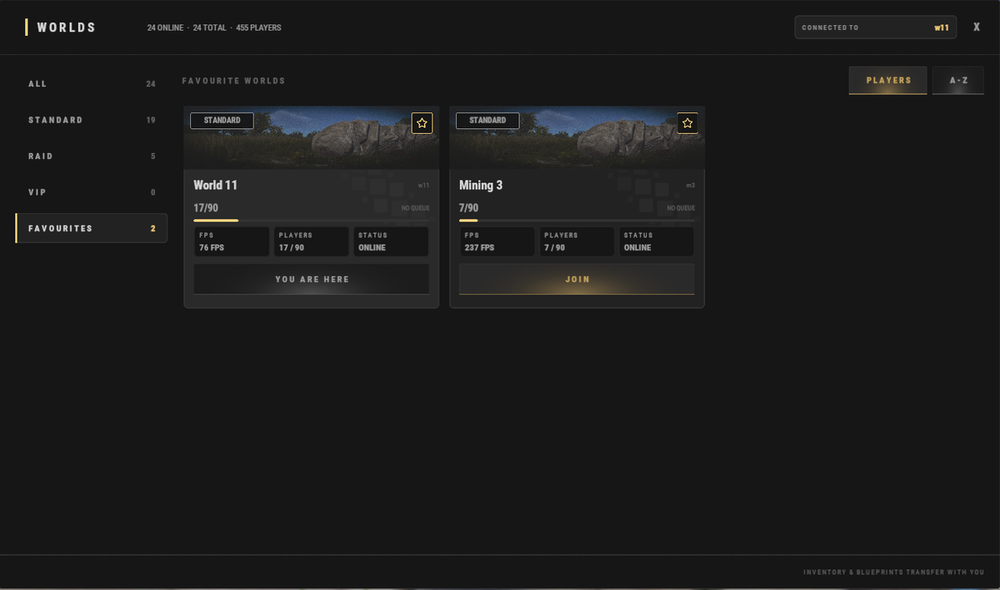

# Guide du débutant

Bienvenue sur **Brits PvE Worlds** ! Ce guide couvre tout ce qu'un nouveau joueur doit savoir pour démarrer et ne pas se sentir perdu pendant ses premières minutes sur le serveur.

> **Aperçu rapide :**
>
> - **Temps estimé** : 10-20 minutes.
> - **Difficulté :** ⭐☆☆☆☆
> - **Objectif principal :** construire votre première base, terminer les quêtes de départ et débloquer votre propre Recycler.

---

## Premiers pas

Quand vous rejoignez le serveur pour la première fois, vous apparaissez soit dans l'un des mondes normaux, soit dans le HUB.

Tous les mondes font partie du même réseau de serveurs. Vous pouvez passer de l'un à l'autre à tout moment avec **`/w`** :

| Monde | À quoi il sert |
|---|---|
| **HUB** | Point de rencontre central : boutiques de joueurs, marché, et portails vers les Raid Worlds |
| **World 1-15** | Les mondes normaux. Choisissez-en un pour y construire votre base |
| **Mining World 1-3** | Maps plus petites, **sans construction et sans monuments**. Comme rien n'occupe l'espace d'apparition, les nodes de minerai et les arbres apparaissent bien plus densément. L'endroit recommandé pour récolter les nodes et les arbres |
| **Raid World 1-5** | Bases à raider, Dungeons, et six îles Bradley (**Brad 1-6**) chacune |

### Le HUB

Le HUB est le point de rencontre central du serveur.

Depuis ici, vous pouvez :

- Acheter dans les boutiques des autres joueurs (voir **[Boutiques de joueurs](/wiki/player-shops)**).
- Utiliser le marché principal des joueurs avec **`/s`**.
- Rejoindre les Raid Worlds par les portails rouges (ou n'importe quel monde avec **`/w`**).

Vous pouvez revenir au HUB à tout moment avec **`/hub`**.

---

### Choisissez votre monde

Choisissez le monde où vous voulez construire votre base principale. Tous les mondes utilisent la même map, donc votre choix ne change pas vraiment le gameplay. Chaque monde accueille jusqu'à **90 joueurs**.

**N'oubliez pas de mettre en favori le monde choisi (l'étoile en haut à droite de sa carte) pour le retrouver facilement sous Favourites.**

> 💡 **Votre inventaire et vos blueprints vous suivent** quand vous changez de monde. Vous pouvez donc récolter dans un Mining World et tout ramener dans le monde de votre base.

---

### Terminez les quêtes de départ

Ouvrez le menu des quêtes avec **`/q`** ou **`/quest`** (voir la page **[Quêtes](/wiki/quests)** pour chaque série de quêtes) et acceptez les quêtes suivantes :

- **Getting Started 1**.
- **Getting Started 2**.
- **Getting Started 3**.

Ces quêtes vous demandent de collecter :

- 5,000 Stone.
- 5,000 Wood.
- 1,000 Metal Ore.

Les terminer vous rapporte des matériaux de construction de début de partie, de l'XP et des RP.

---

### Construisez votre première base

Après les quêtes de départ, vous devriez avoir assez de ressources pour poser une petite base de départ.

Utilisez **`/sethome <name>`** (ou **`/home add <name>`**) pour créer un point de téléportation vers votre base, et **`/home <name>`** pour y revenir.

Vous n'avez pas à vous soucier des portes ni des serrures : seuls vous et vos coéquipiers pouvez accéder à ce que vous placez. Si vous voulez donner l'accès à quelqu'un d'autre, utilisez les commandes de partage de la page **[Commandes](/wiki/commands)**.

---

### Continuez à progresser

Une fois votre base prête, retournez au menu des quêtes et acceptez :

- **Virtual Oil Baron**.
- **Barrel Basher**.

Ces quêtes demandent :

- De collecter **10 Diesel**.
- De détruire **75 Yellow or Blue Barrels**.

Après les avoir terminées, n'oubliez pas de **récupérer vos récompenses de quête**.

Vous devriez maintenant avoir assez de RP pour acheter votre propre **[Recycler](/wiki/recyclers)** dans **`/s`**. Il sera très utile pendant tout votre wipe. Au début, vous pouvez l'utiliser pour recycler les objets dont vous ne voulez pas et débloquer des blueprints précieux.

Vous pouvez aussi utiliser **`/sell`** pour échanger des objets de valeur, comme les composants, contre des RP supplémentaires.

---

## Conseils de débutant

> 💡 **Kits de départ**
>
> Utilisez **`/kit`** pour récupérer des ressources de départ gratuites : fournitures médicales, wood, stone, et d'autres. Lier ou authentifier votre compte via Discord débloque des kits supplémentaires.

> 💡 **Équipement gratuit**
>
> Vous cherchez vos premières armes ou vos premiers explosifs ? Allez dans les Raid Worlds avec **`/hub`**, puis entrez dans l'un des portails rouges (**Raid World 1-5**). À l'intérieur, vous trouverez six îles Bradley (**Brad 1-6**). Les joueurs expérimentés y laissent souvent de l'équipement dont ils ne veulent plus, et les nouveaux joueurs peuvent le ramasser.

> 💡 **Commandes utiles**
>
> - **`/w`** affiche tous les mondes disponibles.
> - **`/wa`** ouvre votre réserve et vos succès.
>
> La liste complète est sur la page **[Commandes](/wiki/commands)**.

---

## Continuer la lecture

Une fois ces étapes terminées, continuez avec le guide **[Progression et niveaux](/wiki/progression-levels)** pour les façons les plus rapides de monter de niveau, de débloquer des compétences et de progresser sur le serveur.
