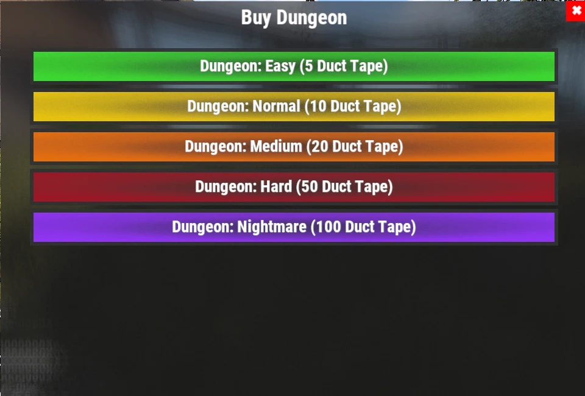

# Guide des donjons (Dungeons)

Les Dungeons sont des défis PvE générés de façon procédurale, remplis d'ennemis personnalisés, de défenses automatiques et de butin précieux. Chaque run est différent. C'est l'une des activités répétables les plus rentables du serveur.

## Aperçu rapide

- **Recommandé pour :** milieu à fin de partie
- **Difficulté :** ⭐⭐⭐⭐☆
- **Objectif principal :** vider le donjon, vaincre les boss et récupérer les récompenses.

---

## Équipement recommandé

### Indispensable

- Beaucoup de fournitures médicales
- HV Rockets
- Rocket Launcher
- M249 (M2)

### Fortement recommandé

- **[Ashmaker](/wiki/legendary-weapons)**
- HQM ou **[armure Leviathan](/wiki/legendary-sets)**
- Compétence **Extra Rounds** (chargeurs plus grands, arbre Combat dans **[`/st`](/wiki/skills)**)

> 💡 **Astuce**
>
> L'**Ashmaker** est l'une des meilleures armes pour les Dungeons. Ses HV Rockets vous permettent d'éliminer vite des groupes d'ennemis et de détruire les tourelles à distance sûre.

---

## Lancer un donjon

1. Utilisez **`/worlds`**.
2. Entrez dans l'un des **Raid Worlds (1-5)**.
3. Entrez dans le portail **Dungeon**.
4. Utilisez **`/buydungeon`**.
5. Choisissez une difficulté et payez-la en **Duct Tape** (prix ci-dessous).
6. Une fois apparu, interagissez avec la porte d'entrée (**E**) pour entrer.

### Prix des donjons

| Difficulté | Prix |
|---|---:|
| **Easy** | 5 Duct Tape |
| **Normal** | 10 Duct Tape |
| **Medium** | 20 Duct Tape |
| **Hard** | 50 Duct Tape |
| **Nightmare** | 100 Duct Tape |

Le butin s'améliore avec la difficulté (voir **[Butin des objets](/loot-tables)**).

> ⚠ **Attention**
>
> Si vous mourez pendant votre run de donjon, pas d'inquiétude : votre corps est téléporté à l'extérieur de la porte du donjon.
>
> Vous pouvez ensuite le fouiller et y retourner normalement.

---

## Fonctionnement des donjons

Chaque donjon est **généré aléatoirement**. Deux runs ne sont donc jamais exactement pareils.

À l'intérieur, vous rencontrerez :

- Des PNJ personnalisés avec des armes à feu.
- Des tourelles automatiques.
- Plusieurs salles de combat séparées par des Garage Doors.
- Du butin précieux dans tout le donjon.

Chaque Garage Door mène à une nouvelle section. Videz chaque salle avant d'ouvrir la suivante.

---

## Stratégie de combat

L'approche la plus sûre est d'avancer lentement.

1. Ouvrez une Garage Door.
2. Éliminez chaque ennemi dans la salle.
3. Détruisez les tourelles avant d'avancer.
4. Fouillez la salle.
5. Passez à la section suivante.

> 💡 **Astuce**
>
> Fouillez au fur et à mesure dans le donjon, au lieu d'attendre la fin.

---

## Phase de butin

Une fois toutes les salles vidées, le donjon entre dans sa phase de butin finale.

Vous avez environ **5 minutes** avant que le donjon se ferme et vous expulse.

> ⚠ **Important**
>
> Cinq minutes ne suffisent en général pas pour ramasser chaque objet.
>
> Pour le meilleur résultat, fouillez chaque salle juste après l'avoir vidée, plutôt que de tout garder pour la fin.

---

## Temps de recharge

Après avoir terminé un donjon, interagissez de nouveau avec la porte d'entrée pour sortir.

Comme pour les **[raids](/wiki/tackling-raiding)** et les **[Bradleys](/wiki/tackling-bradleys)**, les temps de recharge des donjons sont suivis séparément pour chaque Raid World.

> 💡 **Astuce**
>
> Passez d'un **Raid World 1-5** à l'autre pour enchaîner les donjons sans attendre vos temps de recharge.

---

## Continuer la lecture

Vous avez besoin d'aide pour choisir le meilleur équipement pour votre prochain donjon ?

Continuez avec **[Armes légendaires](/wiki/legendary-weapons)** et **[Ensembles légendaires](/wiki/legendary-sets)** pour l'équipement le mieux adapté aux rencontres PvE difficiles, ou consultez la page **[Quêtes](/wiki/quests)** pour la série Dungeon Crawler.
