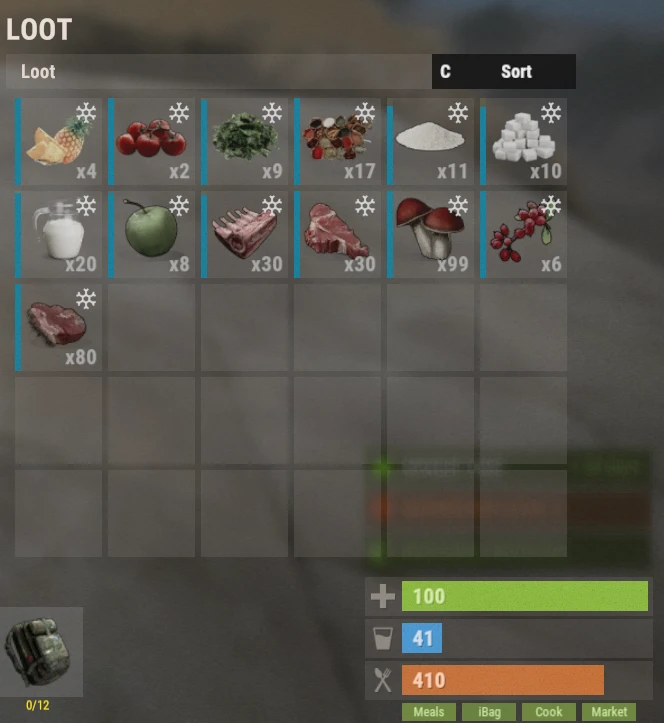

# Système de nourriture (Food System)

Le système de nourriture ajoute des dizaines de repas et d'ingrédients personnalisés, qui donnent de puissants bonus pour la récolte, le combat, le farm, la pêche, la fabrication et beaucoup d'autres activités. Choisir le bon repas peut fortement augmenter votre efficacité, et c'est une part importante de la progression sur Brits PvE Worlds.

## Aperçu rapide

- **Recommandé pour :** tous les joueurs
- **Objectif principal :** utiliser des repas pour gagner des bonus temporaires selon les activités.
- **Important :** les repas se gâtent avec le temps, sauf s'ils sont stockés dans un réfrigérateur ou dans votre **iBag**.

> 💡 **Astuce**
>
> Les bonus de nourriture se cumulent avec beaucoup de bonus de l'**[arbre de compétences](/wiki/skills)**. Les repas sont donc une part importante de la progression.

---

## Bases du système de nourriture

En ouvrant votre inventaire, vous remarquerez quatre boutons verts dans le coin inférieur droit :

| Bouton | Ce qu'il fait | Commande |
|---|---|---|
| **Meals** | Affiche vos bonus de nourriture actifs | (aucune commande) |
| **iBag** | Votre sac d'ingrédients (sert aussi de frigo) | `/ibag` |
| **Cook** | Le menu de cuisine, où vous fabriquez les repas | `/cook` |
| **Market** | Le Farmers Market, où les joueurs achètent et vendent des ingrédients | `/fmarket` |

Chacun est expliqué ci-dessous.

### Meals

Le menu **Meals** affiche tous les bonus de nourriture actifs qui affectent actuellement votre personnage.

Ce bouton ne devient disponible que pendant que vous portez au moins un repas cuisiné.

### iBag

L'**iBag** stocke automatiquement les ingrédients alimentaires comme le lait, les légumes, la viande et les autres matériaux de cuisine.

Les avantages incluent :

- Il stocke automatiquement les ingrédients que vous collectez.
- Il fonctionne comme un réfrigérateur.
- Il empêche les ingrédients de se gâter.

### Cook

Le menu **Cook** est l'endroit où vous créez des repas personnalisés. Il contient quatre sections :

**Recipes** affiche chaque repas que vous pouvez fabriquer. Choisir un repas montre :

- Les ingrédients requis
- Le coût de fabrication
- Les effets du repas
- La durée du bonus

**Ingredients** montre chaque ingrédient disponible sur le serveur et explique où il peut être obtenu.

**Favourites** liste les repas que vous avez marqués d'une étoile pour un accès rapide. Cliquez sur le ⭐ dans une recette pour la mettre en favori.

**Settings** contient diverses options liées à la cuisine. Tous les réglages sont activés par défaut.

### Market

Le **Farmers Market** permet aux joueurs d'acheter et de vendre des ingrédients de cuisine, par exemple :

- Bread
- Sugar
- Cloth
- D'autres matériaux de cuisine

Acheter coûte du **Scrap**, et vendre des ingrédients vous récompense en **Scrap**.

> 💡 **Important**
>
> Le Farmers Market n'a du stock que si d'autres joueurs lui ont vendu des objets.

---

## Quel repas pour quelle activité

Référence rapide pour les activités les plus courantes du serveur.

| Activité | Repas recommandé |
|-----------|------------------|
| Quartermaster (Stone, Metal, Sulfur) / minage | Bangers and Mash |
| Quartermaster (Wood) / farm de wood | Grilled Pork Kebab |
| Fabrication | Pork Omelette |
| Farm (cultures plantées par le joueur) | Mushroom Soup |
| Farm d'animaux / Bone Fragments | Succulent Chicken Sandwich |
| Bradley | Chocolate Calzone |
| Patrol Helis | Steak Dinner |
| Harbinger | French Toast |
| Deep Sea | Pumpkin Pie |
| Pêche | Baked Trout |
| Raid | Pancakes |
| Soin | Pumpkin Pie |
| Radiation | Chernobyl Casserole |
| Boss de groupe | Berry Cobbler |

> 💡 **Astuce**
>
> La compétence **Skilled Chef** (arbre Survivalcraft, section Farming) double la vitesse de cuisine et la **durée des bonus de repas**. Vos bonus durent donc deux fois plus longtemps.

---

## Repas recommandés

Ce sont les repas que vous utiliserez le plus souvent tout au long de votre progression.

<strong>⏬ Afficher les repas recommandés ⏫</strong>

### Récolte et progression

Meilleur repas pour les quêtes Quartermaster de Stone, Metal et Sulfur.

---

Meilleur repas pour les quêtes Quartermaster de Wood.

---

Meilleur repas pour les quêtes de fabrication.

---

Meilleur repas pour récolter les cultures plantées par le joueur.

---

Meilleur repas pour farmer les animaux et les Bone Fragments.

---

Meilleur repas pour affronter les Bradleys.

---

## Repas utiles

Ces repas ne sont pas utilisés aussi souvent, mais ils sont extrêmement précieux dans certaines situations.

<strong>🔽 Afficher les repas utiles 🔼</strong>

Meilleur repas pour la pêche.

---

Excellent pour les Patrol Helis et les rencontres PvE difficiles.

---

Donne un soin exceptionnel.

---

Seul repas qui donne une protection contre la radiation.

---

Excellent repas de préparation avant d'affronter du contenu difficile.

---

Excellent pour le raid.

---

Excellent repas de préparation avant Harbinger ou les Patrol Helis.

---

Excellent repas de soutien pour les activités de groupe, grâce à ses effets de soin.

---

## Ingrédients

Chaque repas demande des ingrédients récoltés à travers le serveur.

Vous pouvez découvrir d'où vient chaque ingrédient dans la section **Ingredients** du menu de cuisine.

<strong>🔽 Afficher tous les ingrédients 🔼</strong>

---

---

---

---

---

---

---

---

---

---

---

---

---

---

---

---

---

---

---

---

---

---

---

---

---

---

---

## Autres repas

Les repas ci-dessous ont des usages plus spécialisés et sont en général fabriqués moins souvent, mais chacun a toujours son propre rôle.

<strong>⤵️ Afficher tous les autres repas ⤴️</strong>

---

---

---

---

---

---

---

---

---

---

---

---

---

---

---

---

---

---

---

---

---

---

---

---

---

---

---

---

---

---

---

---

---

---

---

---

## Continuer la lecture

Les repas deviennent encore plus forts quand ils sont combinés à l'**arbre de compétences**.

Continuez avec la page **[Compétences](/wiki/skills)** pour savoir quels avantages se combinent le mieux avec la cuisine et les bonus de nourriture.
