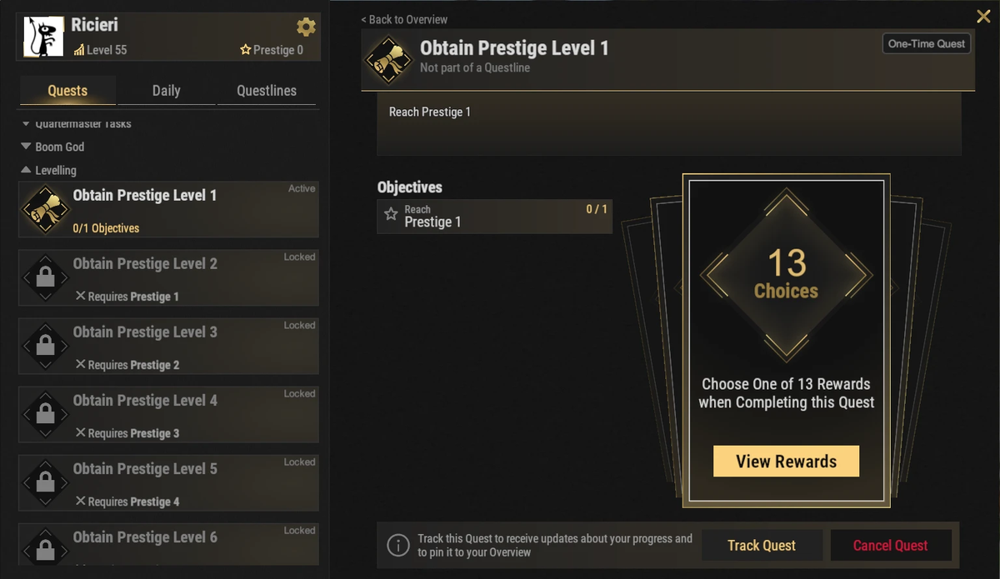
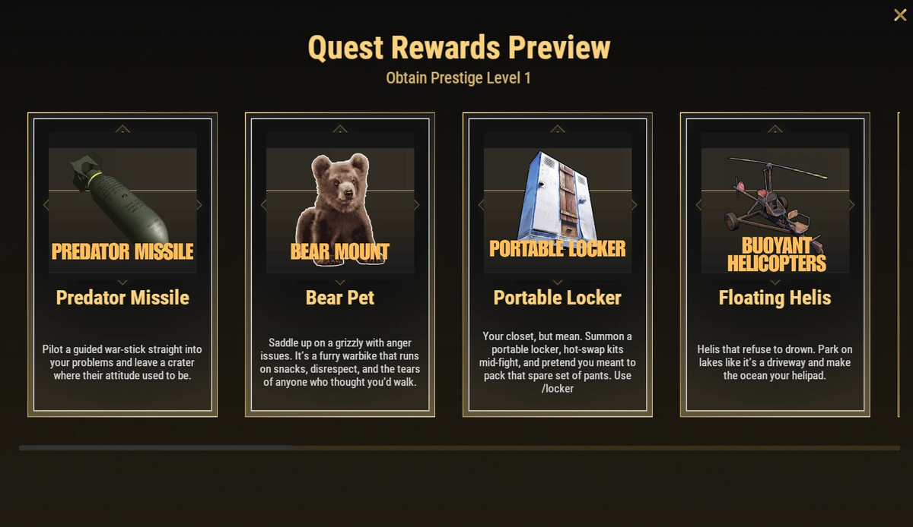

# Avantages de Prestige (Prestige Perks)

Les avantages de Prestige sont des déblocages spéciaux. Ils apportent de fortes améliorations de confort, des accélérations de progression, des fonctions d'automatisation et des mécaniques de jeu uniques. Aucun n'est obligatoire, mais beaucoup peuvent nettement améliorer votre expérience sur Brits PvE Worlds.

## Aperçu rapide

- **Recommandé pour :** milieu à fin de partie
- **Objectif principal :** choisir les avantages qui correspondent le mieux à votre façon de jouer

> 💡 **Avantages recommandés**
>
> - 5 Starting SP
> - Nightvision
> - 20% XP Boost

---

## Fonctionnement des avantages de Prestige

- Vous pouvez passer Prestige une fois que votre niveau de joueur atteint **100** (voir **[Progression et niveaux](/wiki/progression-levels)**). Il y a **10 niveaux de Prestige**.
- Chaque niveau de Prestige a une quête dans la série **Levelling** de **`/q`**. La terminer vous permet de **choisir un avantage** dans la liste ci-dessous.
- Il y a **13 avantages** mais seulement 10 niveaux de Prestige. Vous ne pouvez donc pas tous les débloquer. Choisissez ceux qui correspondent à votre façon de jouer.
- Les avantages de Prestige sont conservés pendant tout le cycle d'XP. Ils ne sont pas perdus lors des wipes de map.

---

## Avantages de progression

Ces avantages vous aident à monter de niveau plus vite et à progresser plus efficacement sur le serveur.

### Five Starting Skill Points

Vous commencez chaque Prestige avec **5 points de compétence globaux supplémentaires**. Vous débloquez ainsi des compétences utiles bien plus tôt. Ce bonus est ajouté **une seule fois à votre réserve partagée**, et vous pouvez le dépenser dans n'importe lequel des arbres.

---

### 20% XP Boost

Augmente toute l'XP gagnée de **20%**. La montée de niveau et la progression deviennent nettement plus rapides.

---

## Avantages utilitaires

Ces avantages améliorent le confort et réduisent les temps morts.

### Portable Recycler

Invoquez un Recycler personnel là où vous en avez besoin avec **`/rec`**.

Parfait pour les passages de monuments, les sorties de récolte et les longues sessions loin de la base.

---

### Portable Locker

Invoquez un casier portable n'importe où avec **`/locker`** pour changer de kit en plein combat.

Très utile pendant les raids et les événements PvE.

---

### 5 Second Teleport

Réduit le compte à rebours de téléportation de **20 secondes** à **5 secondes**.

Excellent pour les joueurs qui voyagent souvent entre les bases et les événements.

> ⚠ La description en jeu prévient : **ne choisissez pas ceci si votre compte à rebours de téléportation est déjà à 0** (certains rangs n'ont déjà aucun compte à rebours).

---

## Avantages d'automatisation

### Auto Sell to Server

Débloque la Item Bank et le système Auto Sell. Les ressources stockées dans votre Item Bank peuvent être vendues automatiquement. Vous pouvez stocker jusqu'à **4 objets de vente au serveur différents par monde**, avec jusqu'à **6 piles de chacun**.

Voir la page **[Banque d'objets et vente automatique](/wiki/auto-sell)** pour un guide d'installation complet.

---

### Terminal

Débloque le système Terminal, qui permet un équipement de stockage avancé et une automatisation industrielle.

Voir la page **[Terminal](/wiki/terminal)** pour plus d'informations.

---

## Combat et mobilité

### Predator Missile

Pilotez un missile guidé pour des attaques dévastatrices.

---

### Double Jump

Gagnez la possibilité de faire un second saut en l'air.

Utile pour le déplacement, l'exploration et l'accès à des endroits autrement inaccessibles.

---

### Nightvision

Règle votre heure personnelle sur **12:00**. Vous voyez donc le jour même à minuit, sans teinte verte. Activez-la ou coupez-la avec **`/nv`**.

Particulièrement utile pour la récolte et les activités PvE de nuit.

---

### Pilot Assistance

Ajoute plusieurs aides pour l'hélicoptère, dont :

- Le vol stationnaire automatique
- L'atterrissage automatique
- L'aide au vol
- La prévention des crashs

L'un des meilleurs avantages pour les joueurs qui volent souvent.

---

### Floating Helis

Permet aux hélicoptères de se poser et de rester à flot sur l'eau.

Parfait pour l'exploration de la **[haute mer](/wiki/deep-sea)** et les monuments océaniques.

---

## Avantages de compagnon

### Bear Pet

Débloque un ours compagnon (affiché en jeu sous le nom **Bear Mount**) qui peut :

- Récolter des ressources
- Être monté
- Porter des objets dans son propre inventaire

Excellent pour le farm et les longues sorties de ressources.

---

## Continuer la lecture

Beaucoup de ces avantages débloquent des mécaniques entièrement nouvelles.

Continuez avec les guides **[Terminal](/wiki/terminal)** et **[Banque d'objets et vente automatique](/wiki/auto-sell)** pour tirer le meilleur parti de ces deux avantages.
