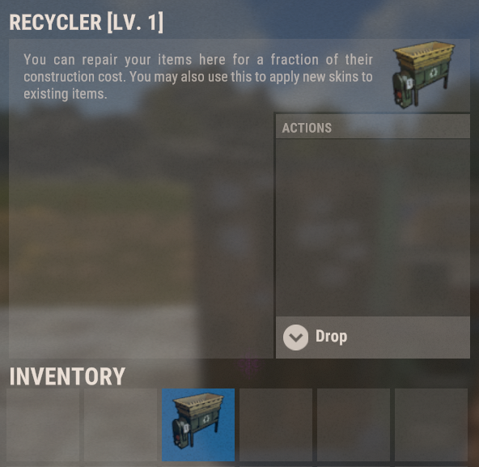
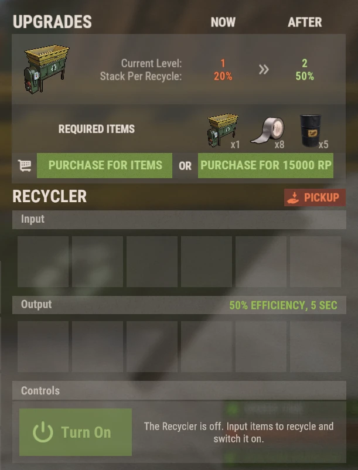

# Recycleurs (Recyclers)

Les Recyclers sur Brits PvE Worlds sont des **objets plaçables**, avec leurs propres niveaux d'amélioration. Vous n'avez donc pas à courir jusqu'à un monument à chaque fois que vous voulez recycler.

## Aperçu rapide

- **Recommandé pour :** tous les joueurs
- **Objectif principal :** recycler le butin dont vous ne voulez pas, chez vous, plus vite et avec de plus grosses piles à mesure que vous améliorez le Recycler.

> 💡 **Astuce**
>
> Acheter votre propre Recycler est l'objectif des quêtes de départ du **[guide du débutant](/wiki/beginner-guide)**. Au début, il transforme le butin dont vous ne voulez pas en scrap pour les blueprints. Plus tard, il alimente les méthodes de RP de **[Meilleures méthodes de RP](/wiki/best-rp-methods)**.

---

## Obtenir un Recycler

- Achetez-en un avec des RP dans **`/s`**.
- Ils tombent aussi en butin à certains endroits.

Le Recycler est un objet d'inventaire : placez-le comme n'importe quel déployable. La description de l'objet en jeu est le texte vanilla de l'établi de réparation. Ignorez-la : il recycle.

> ⚠ **Ne recyclez pas à Outpost ni à Bandit Camp** si vous faites la méthode des Tactical Gloves (voir **[Meilleures méthodes de RP](/wiki/best-rp-methods)**). Utilisez un recycler de monument ou le vôtre.

---

## Utilisation

Ouvrez le Recycler placé :

- Mettez les objets dans les emplacements **Input**.
- Appuyez sur **Turn On**. Les matériaux recyclés apparaissent dans les emplacements **Output**.
- **Pickup** reprend le Recycler dans votre inventaire.

Un Recycler de niveau 1 tourne à **50% d'efficacité**, avec un cycle de **5 secondes**, et traite **20% d'une pile par cycle**.

> 💡 **Arbre de compétences**
>
> La compétence **Rapid Recycle** (arbre Gathercraft, section Gathering & Fishing, 1 SP) réduit le temps de cycle de 2.5 secondes. Voir **[Compétences](/wiki/skills)**.

---

## Amélioration

Les Recyclers ont des niveaux. Chaque niveau augmente la **pile par recyclage**, c'est-à-dire la part d'une pile traitée à chaque cycle. Le panneau d'amélioration est en haut de l'interface du Recycler. Vous pouvez payer **avec des objets ou avec des RP**.

| Niveau | Pile par recyclage | Coût d'amélioration pour atteindre ce niveau |
|---|---:|---|
| 1 | 20% | Niveau de départ |
| 2 | 50% | 1 Recycler + 8 Duct Tape + 5 barrels (voir la capture), **ou 15,000 RP** |
| 3+ | ? | ? |

Les coûts et les valeurs des niveaux supérieurs ne sont pas encore documentés. Si vous avez un Recycler de niveau 2 ou plus, faites une capture du panneau d'amélioration et ajoutez-la ici (voir **[Contribuer](/contribute/contribute)**).

---

## Continuer la lecture

Continuez avec **[Meilleures méthodes de RP](/wiki/best-rp-methods)** pour voir comment un Recycler transforme des Tactical Gloves en cloth et en RP, ou **[Carrières virtuelles](/wiki/virtual-quarry)** pour l'autre grand système de ressources passives.
