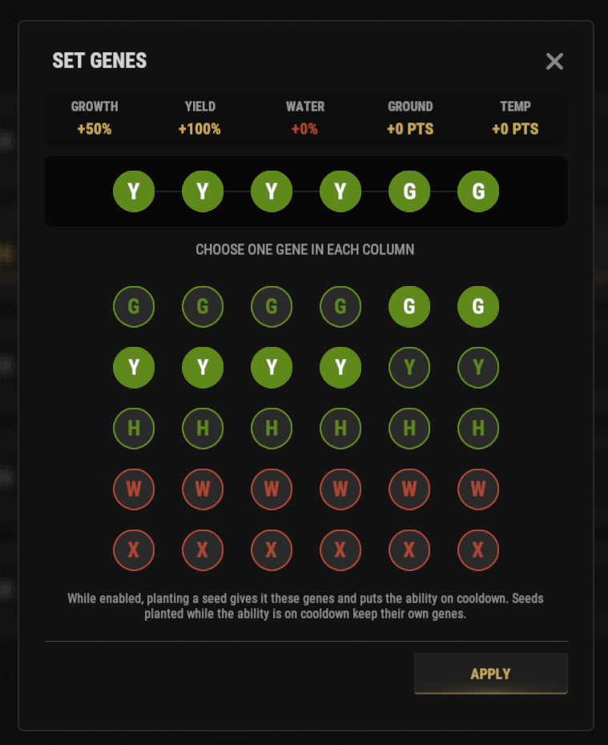

# Guide du Geneticist

La compétence Geneticist vous permet de choisir la combinaison exacte de gènes d'une graine. Le farm devient ainsi beaucoup plus rapide et plus régulier.

## Aperçu rapide

- **Recommandé pour :** les joueurs qui ont débloqué la compétence **Geneticist** (arbre Survivalcraft, section Farming, 5 SP).
- **Objectif principal :** appliquer la combinaison de gènes exacte que vous voulez, sans dépendre de la génétique aléatoire.

> 💡 **Astuce**
>
> Cette compétence est particulièrement utile pour monter de grandes fermes pour les **[meilleures méthodes de RP](/wiki/best-rp-methods)** décrites ailleurs dans le wiki.

---

## Guide vidéo

@[youtube](https://www.youtube.com/watch?v=E7c142tDCtQ){width=960 height=540}

---

## Avant de commencer

Avant d'utiliser la compétence, assurez-vous d'avoir :

- Une graine normale dans votre barre d'actions.
- La compétence Geneticist hors temps de recharge (elle a un temps de recharge de **3 heures**).

> ⚠ **Important**
>
> Si les étapes ci-dessous ne sont pas suivies dans le bon ordre, la compétence peut passer en temps de recharge sans appliquer les gènes choisis.

---

## Guide pas à pas

1. Placez une **graine normale** dans votre barre d'actions.
2. Ouvrez l'arbre de compétences avec **`/st`**.
3. Cliquez sur l'icône d'éclairage en haut à droite.
4. Cherchez le **geneticist ultimate** et cliquez sur **activate**.
5. Choisissez la combinaison de gènes voulue dans le menu.

6. Fermez le menu avec le **X** en haut à droite.
7. Plantez **une graine** dans un bac. *remarque : **NE FAITES PAS MAJ+CLIC SUR VOS GRAINES***
8. Votre graine plantée doit maintenant avoir la combinaison de gènes choisie.

---

## Dépannage

Si cela ne fonctionne pas :

- Vérifiez qu'une graine normale est dans votre barre d'actions.
- Vérifiez que vous avez choisi la bonne combinaison de gènes.
- Fermez le menu avant de planter la graine.

---

## Continuer la lecture

Vous voulez tirer le maximum de vos cultures ?

Continuez avec **[Meilleures méthodes de RP](/wiki/best-rp-methods)** pour utiliser des gènes parfaits dans le farm à grande échelle et la génération de RP.
