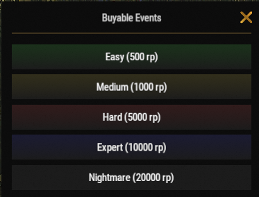

# Affronter les raids

Le raid est l'une des activités les plus rentables sur Brits PvE Worlds. En achetant des bases de raid déjà construites, vous pouvez gagner un butin précieux et de grandes quantités de RP, tout en mettant vos compétences de raid à l'épreuve.

## Aperçu rapide

- **Recommandé pour :** milieu à fin de partie
- **Difficulté :** ⭐⭐⭐☆☆
- **Objectif principal :** terminer les bases de raid efficacement tout en maximisant votre profit.

---

## Équipement recommandé

### Indispensable

- Beaucoup de Rockets ou de C4
- Les compétences **Explosives** de l'arbre Combat (**[`/st`](/wiki/skills)**)

### Fortement recommandé

- **[Brits Boom Stick](/wiki/legendary-weapons)**
- **[Ashmaker](/wiki/legendary-weapons)**

> 💡 **Astuce**
>
> Les lanceurs légendaires réduisent fortement le temps nécessaire pour terminer les bases de raid plus difficiles, et les rendent bien plus sûres à vider.

---

## Lancer un raid

1. Utilisez **`/worlds`**.
2. Entrez dans l'un des **Raid Worlds (1-5)**.
3. Utilisez **`/buyraid`**, choisissez une difficulté et achetez la base de raid avec des RP.

---

## Difficultés de raid

Les bases de raid s'achètent avec des RP dans le menu **Buyable Events** (`/buyraid`). L'XP par raid terminé vient de la page **[Progression et niveaux](/wiki/progression-levels)** et entre dans votre niveau de joueur partagé.

| Difficulté | Prix | Matériau de la base | XP | Recommandé pour |
|------------|------:|---------------|---:|-----------------|
| **Easy** | 500 RP | Wood | 1,000 | Nouveaux joueurs |
| **Medium** | 1,000 RP | Metal | 2,500 | Milieu de partie |
| **Hard** | 5,000 RP | HQM | 5,000 | Joueurs expérimentés |
| **Expert** | 10,000 RP | HQM | 7,000 | Fin de partie |
| **Nightmare** | 20,000 RP | HQM | 12,000 | Fin de partie |

Les difficultés plus élevées demandent nettement plus d'explosifs, mais offrent de bien meilleures récompenses.

---

## Stratégie de combat

Avant de tenter des bases de raid plus difficiles, assurez-vous d'avoir débloqué la section **Explosives** de l'arbre Combat via **`/st`** (Shockwave, Chain Reaction, Reliable Fuses, Aerodynamically Sound, Blastproof et Orbital Strike).

Pendant que vous videz un raid :

- Avancez lentement et vérifiez chaque salle.
- Surveillez les pièges cachés.
- Apportez assez d'explosifs pour finir avant la fin du minuteur du raid.
- Si vous mourez, récupérer votre équipement peut être difficile à cause du placement des pièges.

> ⚠ **Important**
>
> Les bases de raid sont minutées. Si vous ne les terminez pas avant la fin du minuteur, la base disparaît.

---

## Orbital Strike

Si vous utilisez la compétence **Orbital Strike** de l'arbre Combat (elle fait apparaître une fusée éclairante dans votre barre d'actions ; lancez-la là où vous voulez la frappe) :

> ⚠ **Important**
>
> Détruisez toujours les **SAM Sites** avant de lancer la fusée éclairante.
>
> Dès que de la fumée sort des SAM Sites, elles sont désactivées et votre frappe peut toucher la base sans risque.

---

## Potentiel de profit

Le raid est actuellement l'une des meilleures activités pour gagner des RP sur le serveur.

Un **Nightmare Raid** coûte **20,000 RP** à l'achat, mais peut rapporter **environ 100,000 RP** une fois terminé. C'est l'une des activités PvE au profit le plus élevé. La série de quêtes de raid de la page **[Quêtes](/wiki/quests)** paie en plus de cela.

---

## Temps de recharge

Les temps de recharge des raids sont suivis séparément pour chaque Raid World.

> 💡 **Astuce**
>
> Comme pour les **[îles Bradley](/wiki/tackling-bradleys)**, vous pouvez passer d'un **Raid World 1-5** à l'autre pour continuer à raider sans attendre la fin de votre temps de recharge.

---

## Continuer la lecture

Vous cherchez de l'aide, ou vous devez signaler un bug pendant un raid ?

Continuez avec **[Tickets de support](/wiki/support-tickets)** pour savoir quand et comment contacter l'équipe.
