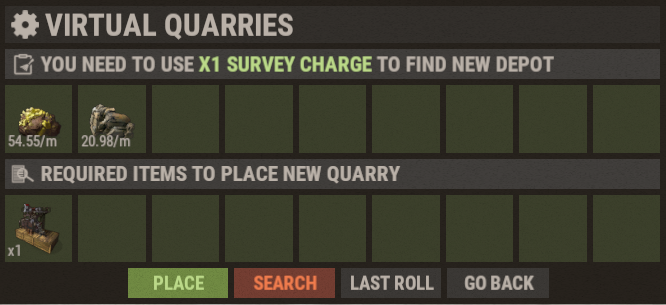

# Carrières virtuelles (Virtual Quarries)

Les carrières virtuelles sont l'un des meilleurs systèmes de ressources passives sur Brits PvE Worlds. Elles vous permettent de générer des ressources pendant que vous êtes hors ligne ou loin de votre base.

## Aperçu rapide

- **Recommandé pour :** début à fin de partie
- **Objectif principal :** générer des ressources passives avec un entretien minimal.

| Carrière | Produit | Idéal pour |
|--------|----------|----------|
| Mining Quarry | HQM, Metal Ore, Sulfur Ore | Farm de ressources |
| Pump Jack | Crude Oil | Production de carburant |
| Wood Generator | Wood | Construction et fonte |

---

## Pour commencer

1. Ouvrez la boutique avec **`/s`**.
2. Achetez des **Survey Charges**.
3. Achetez la carrière virtuelle que vous voulez.
4. Ouvrez le menu des carrières virtuelles avec **`/vq`** (ou **`/qr`**).
5. Sondez pour un gisement jusqu'à obtenir un bon tirage (voir ci-dessous).
6. Placez votre carrière.
7. Gardez-la alimentée en **Diesel Fuel**.

### Sonder pour un gisement

Chaque carrière repose sur un **gisement**, et chaque gisement se trouve en dépensant **une Survey Charge**. Un tirage montre quelles ressources le gisement contient et leur **rendement de base par minute** (sur la capture : deux ressources à 54.55/min et 20.98/min). Les rendements sont aléatoires. Continuez donc à tirer jusqu'à en obtenir un qui vous convient :

- **Search** dépense une autre Survey Charge et tire un nouveau gisement.
- **Last Roll** ramène le tirage précédent.
- **Place** construit la carrière sur le tirage actuel (cela coûte aussi l'objet de carrière affiché sous *Required items*).

Les multiplicateurs de niveau des tableaux ci-dessous s'appliquent au rendement de base que vous avez tiré. Un bon tirage paie donc à chaque niveau. Les joueurs expérimentés visent environ **48 HQM/min** sur une Mining Quarry et **53 à 55 Crude Oil/min** sur un Pump Jack avant de placer (voir **[Meilleures méthodes de RP](/wiki/best-rp-methods)**).

> 💡 **Important**
>
> Chaque carrière virtuelle consomme du **Diesel Fuel** pendant qu'elle fonctionne. Le diesel peut s'acheter à **Outpost** avec du Low Grade Fuel, et la quête de départ **Virtual Oil Baron** vous demande d'en collecter 10.

---

## Types de carrières

### Mining Quarry

La Mining Quarry produit les trois minerais les plus précieux du jeu. C'est le meilleur choix de long terme pour la plupart des joueurs.

Les rendements ci-dessous supposent un bon tirage d'environ **49 HQM, 75 Metal Ore et 75 Sulfur Ore par minute** au niveau 1. Vos propres chiffres évoluent à partir de ce que vous avez tiré.

**Rendement maximum (niveau 6, 8.5x) :**

- HQM : 416.5/min
- Metal Ore : 637.5/min
- Sulfur Ore : 637.5/min

**Production par niveau :**

| Niveau | Multiplicateur | Rendement par minute |
|---|---:|---|
| 1 | 1.0x | 49 HQM, 75 Metal Ore, 75 Sulfur Ore |
| 2 | 2.25x | 110.25 HQM, 168.75 Metal Ore, 168.75 Sulfur Ore |
| 3 | 3.75x | 183.75 HQM, 281.25 Metal Ore, 281.25 Sulfur Ore |
| 4 | 5.0x | 245 HQM, 375 Metal Ore, 375 Sulfur Ore |
| 5 | 7.0x | 343 HQM, 525 Metal Ore, 525 Sulfur Ore |
| 6 | 8.5x | 416.5 HQM, 637.5 Metal Ore, 637.5 Sulfur Ore |

**Coûts d'amélioration :**

| Niveau | Coût |
|---|---|
| 1 | 1 Mining Quarry |
| 2 | 6,000 Metal Ore + 1 Duct Tape + 1 Quarry |
| 3 | 1,000 HQM + 1 Bleach + 1 Quarry |
| 4 | 2,000 HQM + 5 Bleach + 2 Quarries |
| 5 | 3,000 HQM + 7 Bleach + 3 Quarries |
| 6 | 5,000 HQM + 5 Batteries + 3 Quarries |

---

### Pump Jack

Le Pump Jack produit du Crude Oil. Il vous permet d'alimenter vos autres carrières virtuelles et de créer une boucle de ressources autonome.

Les rendements ci-dessous supposent un bon tirage d'environ **55 Crude Oil par minute** au niveau 1.

**Rendement maximum (niveau 6, 8.5x) :**

- Crude Oil : 467.5/min

**Production par niveau :**

| Niveau | Multiplicateur | Rendement par minute |
|---|---:|---|
| 1 | 1.0x | 55 Crude Oil |
| 2 | 2.25x | 123.75 Crude Oil |
| 3 | 3.75x | 206.25 Crude Oil |
| 4 | 5.0x | 275 Crude Oil |
| 5 | 7.0x | 385 Crude Oil |
| 6 | 8.5x | 467.5 Crude Oil |

**Coûts d'amélioration :**

| Niveau | Coût |
|---|---|
| 1 | 1 Pumpjack |
| 2 | 1 Duct Tape + 1 Pumpjack |
| 3 | 1,000 HQM + 2 Bleach + 2 Pumpjacks |
| 4 | 2,000 HQM + 5 Bleach + 2 Pumpjacks |
| 5 | 3,000 HQM + 2 Batteries + 3 Pumpjacks |
| 6 | 5,000 HQM + 5 Batteries + 3 Pumpjacks |

---

### Wood Generator

Le Wood Generator fournit un approvisionnement constant de Wood. Il est idéal pour les fours, la construction et la fonte à grande échelle.

**Rendement maximum (niveau 6, 5x) :**

- Wood : 5,000/min

**Production par niveau :**

| Niveau | Multiplicateur | Rendement par minute |
|---|---:|---|
| 1 | 1.0x | 1,000 Wood |
| 2 | 1.25x | 1,250 Wood |
| 3 | 1.5x | 1,500 Wood |
| 4 | 2.0x | 2,000 Wood |
| 5 | 3.0x | 3,000 Wood |
| 6 | 5.0x | 5,000 Wood |

**Coûts d'amélioration :**

| Niveau | Coût |
|---|---|
| 1 | 5 Chainsaws |
| 2 | 2,000 Metal + 15 Metal Blades + 1 Duct Tape + 5 Chainsaws |
| 3 | 4,000 Metal + 25 Metal Blades + 5 Duct Tape + 10 Chainsaws |
| 4 | 200 HQM + 35 Metal Blades + 1 Bleach + 15 Chainsaws |
| 5 | 1,000 HQM + 50 Metal Blades + 5 Bleach + 20 Chainsaws |
| 6 | 5,000 HQM + 60 Metal Blades + 5 Batteries + 20 Chainsaws |

---

## La boucle de carburant autonome

La raison de commencer par un Pump Jack : le crude oil paie son propre diesel, et chaque diesel supplémentaire que vous produisez peut ensuite faire tourner une Mining Quarry pour le profit.

1. Achetez du **Diesel Fuel** à **Outpost** avec du **Low Grade Fuel**.
2. Mettez le diesel dans un **Pump Jack**, qui extrait du **Crude Oil**.
3. Raffinez le crude oil dans une **Small Refinery** en **Low Grade Fuel**.
4. Utilisez ce low grade pour acheter plus de diesel à Outpost. Répétez.
5. Une fois que vous avez un **surplus de diesel**, utilisez-le pour faire tourner une **Mining Quarry** pour du **HQM**.
6. Vendez le HQM dans **`/s` → Stock Market → Resources**.

> 💡 **Vendez dans le bon monde**
>
> Les prix de vente diffèrent selon les mondes. Avant de vendre du HQM, du cloth, du scrap ou du sheet metal, utilisez **`/pc <item>`** (par exemple `/pc hqm`) pour voir quel monde paie le plus, puis vendez là-bas.

Voir **[Meilleures méthodes de RP](/wiki/best-rp-methods)** pour la quantité de RP que cela rapporte avec des carrières entièrement améliorées.

---

## Progression recommandée

- **Début de partie :** commencez par un Pump Jack pour créer la boucle d'auto-alimentation ci-dessus.
- **Milieu de partie :** ajoutez des Mining Quarries et poussez jusqu'au niveau 3-4.
- **Fin de partie :** mettez tous les types de carrières au maximum et farmez des Batteries pour les améliorations finales.

> ⚠ **Les améliorations coûtent des ressources, pas des RP**
>
> Les niveaux de carrière ne peuvent s'acheter qu'avec les ressources des tableaux ci-dessus. Il n'y a pas d'option en RP pour les carrières (contrairement aux **[Recyclers](/wiki/recyclers)**).

---

## Comparaison des rendements (niveau 6)

| Type | Par minute | Par heure |
|---|---:|---:|
| Wood Generator | 5,000 Wood | 300,000 Wood |
| Mining Quarry (Metal Ore) | 637.5 Metal Ore | 38,250 Metal Ore |
| Mining Quarry (Sulfur Ore) | 637.5 Sulfur Ore | 38,250 Sulfur Ore |
| Pump Jack (Crude Oil) | 467.5 Crude Oil | 28,050 Crude Oil |
| Mining Quarry (HQM) | 416.5 HQM | 24,990 HQM |

> Note sur le multiplicateur : la Mining Quarry et le Pump Jack atteignent tous les deux 8.5x au niveau 6.

---

> 💡 **Référence rapide**
>
> - Ouvrez le menu des carrières avec **`/vq`** ou **`/qr`**
> - Achetez les carrières et les Survey Charges via **`/s`**
> - Toutes les carrières demandent du **Diesel Fuel**
> - Sondez pour un bon tirage de gisement avant de placer une carrière
> - Les Pump Jacks sont idéaux pour les installations qui s'alimentent elles-mêmes
> - Niveau maximum de carrière : **6**

---

## Continuer la lecture

Vous voulez maximiser votre revenu passif ?

Continuez avec **[Banque d'objets et vente automatique](/wiki/auto-sell)** pour automatiser vos ventes de ressources et gagner des RP même hors ligne, ou consultez **[Meilleures méthodes de RP](/wiki/best-rp-methods)** pour les calculs de RP que peuvent rapporter des carrières entièrement améliorées.
