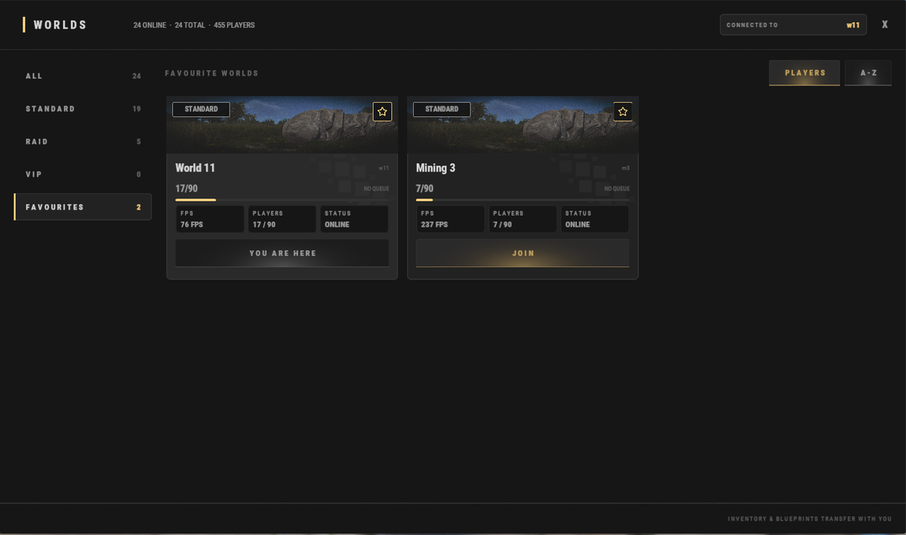

# Гайд для новичков (Beginner Guide)

Добро пожаловать на **Brits PvE Worlds**! Это руководство расскажет обо всём, что нужно знать новому игроку в первые минуты на сервере, чтобы уверенно стартовать и не растеряться.

> **Быстрый обзор:**
>
> - **Время прохождения:** 10–20 минут.
> - **Сложность:** ⭐☆☆☆☆
> - **Главная цель:** Построить первую базу, выполнить начальные квесты и купить персональный переработчик (Recycler).

---

## Первые шаги

При первом подключении к серверу вы появитесь либо в одном из обычных миров, либо в центральном ХАБе (HUB).

Все миры объединены в общую сеть, и вы можете мгновенно перемещаться между ними в любой момент командой **`/w`**:

| Мир | Назначение |
|---|---|
| **HUB** | Центральный узел: магазины игроков, рынок и порталы в Рейд-миры |
| **World 1-15** | Обычные миры для жизни. Выберите любой из них для постройки своей постоянной базы |
| **Mining World 1-3** | Шахтерские карты **без построек и без монументов**. Из-за отсутствия баз деревья и руда спавнятся с невероятной плотностью. Лучшее место для фарма |
| **Raid World 1-5** | Рейдовые миры: покупные рейд-базы, Данжи и шесть островов Брэдли (**Brad 1-6**) |

### Центральный ХАБ (The HUB)

ХАБ — главное место торговли и встреч на сервере.

Здесь вы можете:
- Покупать товары в реальных магазинах других игроков (см. **[Магазины игроков](/wiki/player-shops)**).
- Пользоваться общим магазином сервера через команду **`/s`**.
- Переходить в Рейд-миры через красные порталы (или через меню **`/w`**).

Вернуться в ХАБ из любого мира можно командой **`/hub`**.

---

### Выберите свой мир для базы

Выберите мир, где хотите построить дом. Во всех мирах используется одинаковая карта, так что выбирайте любой свободный мир. Каждый мир вмещает до 90 игроков.

**Обязательно нажмите звездочку в углу карточки выбранного мира, чтобы добавить его в Избранное (Favourites) и не потерять!**

> 💡 **Инвентарь и изученные чертежи сохраняются** при перемещении между мирами. Вы можете пойти фармить в Mining World и вернуться с полным инвентарем ресурсов на свою базу в основной мир.

---

### Выполните стартовые квесты

Откройте меню квестов командой **`/q`** или **`/quest`** (подробнее см. страницу **[Задания](/wiki/quests)**) и примите начальные задания:

- **Getting Started 1**
- **Getting Started 2**
- **Getting Started 3**

В них требуется добыть:
- 5,000 Камня
- 5,000 Дерева
- 1,000 Металлической руды

Завершение этих квестов даст вам первые строительные ресурсы, опыт (XP) и первые очки RP.

---

### Постройте первую базу

После сдачи начальных квестов у вас будет достаточно ресурсов на небольшую стартовую базу 2х2.

Установите точку телепорта домой командой **`/sethome <название>`** (или **`/home add <название>`**), а для возвращения используйте **`/home <название>`**.

На Brits PvE не нужно беспокоиться о замках и дверях: **никто, кроме вас и ваших тиммейтов, не может открыть ваши сундуки, двери и печи!**

---

### Дальнейшее развитие

Обустроив базу, снова откройте меню **`/q`** и возьмите следующие квесты:

- **Virtual Oil Baron** (собрать 10 дизельного топлива)
- **Barrel Basher** (разбить 75 желтых или синих бочек)

После их выполнения **обязательно нажмите кнопку забрать награду (Claim)** в меню квестов.

Теперь у вас накопится достаточно RP, чтобы купить в магазине **`/s`** собственный **[Переработчик (Recycler)](/wiki/recyclers)**. Его можно поставить прямо у себя дома! Он сэкономит вам часы беготни по монументам.

Ненужные компоненты можно также продать за RP командой **`/sell`**.

---

## Советы для новичков

> 💡 **Бесплатные наборы (Starter Kits)**
>
> Напишите **`/kit`**, чтобы забрать бесплатные стартовые ресурсы, медикаменты и инструменты. Привязка Discord к аккаунту открывает дополнительные бесплатные киты!

> 💡 **Бесплатный лут на островах Брэдли**
>
> Ищете первое огнестрельное оружие? Перейдите в ХАБ (**`/hub`**), зайдите в один из красных порталов (**Raid World 1-5**) и переместитесь на острова Брэдли (**Brad 1-6**). Опытные игроки фармят танки сотнями и часто оставляют лишнее оружие и броню прямо на земле для новичков.

> 💡 **Полезные быстрые команды**
>
> - **`/w`** — меню выбора миров
> - **`/wa`** — достижения вайпа и награды
>
> Полный список команд смотрите на странице **[Команды](/wiki/commands)**.

---

## Что читать дальше?

Обустроившись на сервере, переходите к гайду **[Система прокачки и уровни](/wiki/progression-levels)**, чтобы узнать, как быстрее всего прокачать 100 уровень и открыть лучшие навыки.
