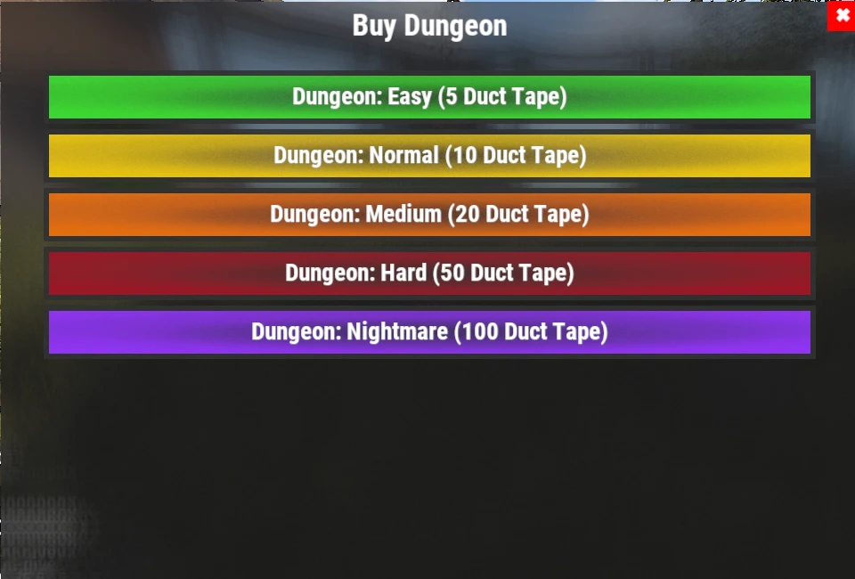

# Гайд по подземельям (Dungeons)

Подземелья (Dungeons) — это процедурно генерируемые PvE-испытания, наполненные кастомными врагами, автоматическими турелями и ценной добычей. Каждое прохождение уникально, что делает подземелья одной из самых увлекательных и доходных регулярных активностей на сервере.

## Краткий обзор

- **Рекомендуется для:** Средней и поздней стадии игры (Mid / End Game)
- **Сложность:** ⭐⭐⭐⭐☆
- **Главная цель:** Зачистить подземелье комната за комнатой, уничтожить боссов и забрать награды.

---

## Рекомендуемое снаряжение

### Обязательное

- Большой запас медицинских средств (шприцы, аптечки)
- Скоростные ракеты (HV Rockets)
- Ракетница (Rocket Launcher)
- Пулемет M249 (M2)

### Крайне рекомендуется

- **[Ashmaker](/wiki/legendary-weapons)**
- Комплект МВК или **[Броня Левиафана (Leviathan Armor)](/wiki/legendary-sets)**
- Навык **Extra Rounds** (увеличенный магазин, ветка «Бой» в **[`/st`](/wiki/skills)**)

> 💡 **Совет**
>
> **Ashmaker** — одно из лучших оружий для прохождения подземелий. Его скоростные ракеты позволяют мгновенно сметать группы врагов и разбивать опасные турели с безопасного расстояния.

---

## Как запустить подземелье

1. Введите команду **`/worlds`**.
2. Перейдите в один из **Рейд-миров (Raid Worlds 1–5)**.
3. Войдите в портал **Dungeon**.
4. Введите команду **`/buydungeon`**.
5. Выберите сложность и оплатите вход **изолентой (Duct Tape)** (цены указаны ниже).
6. Когда подземелье сгенерируется, подойдите ко входной двери и нажмите клавишу взаимодействия (**E**), чтобы войти.

### Стоимость подземелий

| Сложность | Стоимость |
|---|---:|
| **Easy (Легкая)** | 5 шт. Duct Tape |
| **Normal (Обычная)** | 10 шт. Duct Tape |
| **Medium (Средняя)** | 20 шт. Duct Tape |
| **Hard (Тяжелая)** | 50 шт. Duct Tape |
| **Nightmare (Кошмар)** | 100 шт. Duct Tape |

Качество лута возрастает пропорционально уровню сложности.

> ⚠ **Внимание**
>
> Если вы погибнете внутри подземелья — не переживайте: ваше тело будет автоматически телепортировано наружу перед входной дверью.
>
> Вы сможете спокойно забрать свои вещи и продолжить прохождение.

---

## Как устроены подземелья

Каждое подземелье создается **случайным образом**, поэтому двух одинаковых заходов не бывает.

Внутри вас ждут:

- Кастомные NPC с огнестрельным оружием.
- Автоматические турели.
- Несколько боевых комнат, разделенных гаражными воротами (Garage Doors).
- Ценный лут, разбросанный по всему подземелью.

Каждые гаражные ворота ведут в следующую секцию. Обязательно полностью зачищайте текущую комнату перед открытием следующих ворот.

---

## Тактика боя

Самый надежный способ прохождения — осторожное и поэтапное продвижение:

1. Откройте очередные гаражные ворота.
2. Уничтожьте всех противников внутри комнаты.
3. Разбейте все турели перед тем, как зайти внутрь.
4. Соберите весь лут в комнате.
5. Переходите к следующей секции.

> 💡 **Совет**
>
> Собирайте лут сразу по мере прохождения каждой комнаты, не откладывая все на самый конец.

---

## Фаза сбора лута (Loot Phase)

После того как последняя комната зачищена, подземелье переходит в финальную фазу сбора добычи.

У вас будет примерно **5 минут** до того, как подземелье закроется и автоматически выдворит вас наружу.

> ⚠ **Важно**
>
> Пяти минут обычно недостаточно, чтобы обежать и облутать все закоулки огромного подземелья с нуля.
>
> Поэтому лутайте каждую комнату сразу после её зачистки, оставляя на финальный таймер лишь дорогу к выходу.

---

## Перезарядка (Кулдауны)

Завершив подземелье, подойдите ко входной двери и нажмите клавишу взаимодействия, чтобы выйти.

Как и в случае с **[Рейдами](/wiki/tackling-raiding)** и **[Брэдли](/wiki/tackling-bradleys)**, кулдаун на вызов подземелий отслеживается отдельно для каждого рейд-мира.

> 💡 **Совет**
>
> Переключайтесь между **Raid Worlds 1–5**, чтобы проходить подземелья без пауз на ожидание завершения кулдауна.

---

## Читайте далее

Выбираете наилучшее снаряжение для следующего похода в подземелье?

Ознакомьтесь с разделами **[Легендарное оружие](/wiki/legendary-weapons)** и **[Легендарные комплекты брони](/wiki/legendary-sets)**, чтобы подобрать идеальную экипировку для тяжелых PvE-боев, а также посетите страницу **[Квесты](/wiki/quests)** для цепочки заданий Dungeon Crawler.
