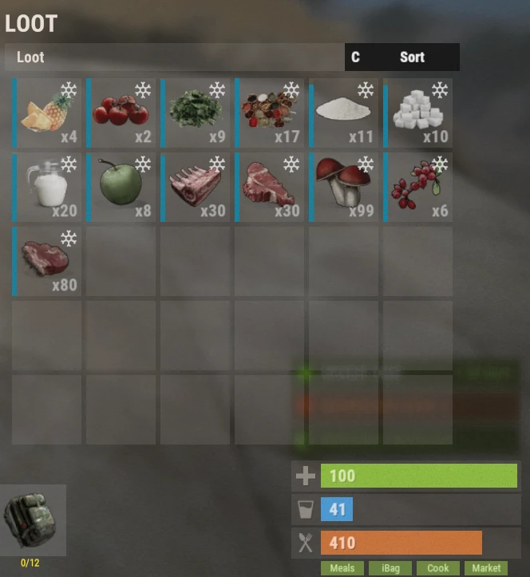

# Система еды и блюд (Food System)

Система кулинарии добавляет десятки кастомных блюд и ингредиентов, дающих мощные временные усиления (баффы) к добыче ресурсов, бою, фермерству, рыбалке, крафту и многим другим активностям. Выбор правильного блюда многократно повышает вашу продуктивность и является важнейшей частью развития на Brits PvE Worlds.

## Краткий обзор

- **Рекомендуется для:** Всех игроков
- **Главная цель:** Использовать блюда для получения мощных временных бонусов к различным игровым механикам.
- **Важно:** Приготовленная еда со временем портится, если только она не хранится в холодильнике или специальной сумке **iBag**.

> 💡 **Совет**
>
> Баффы от еды суммируются со многими бонусами из **[Древа навыков](/wiki/skills)**, превращая блюда в неотъемлемую часть комфортной игры.

---

## Основы системы кулинарии

Открыв инвентарь, вы увидите четыре зеленые кнопки в правом нижнем углу экрана:

| Кнопка | Что делает | Команда |
|---|---|---|
| **Meals** | Отображает ваши активные эффекты от съеденной пищи | (нет команды) |
| **iBag** | Ваша сумка для ингредиентов (работает как холодильник) | `/ibag` |
| **Cook** | Меню готовки, где создаются блюда | `/cook` |
| **Market** | Фермерский рынок, где игроки торгуют ингредиентами | `/fmarket` |

Подробнее о каждом разделе:

### Меню Meals (Эффекты блюд)

В меню **Meals** отображаются все активные пищевые баффы, действующие на вашего персонажа в данный момент.

Кнопка становится активной только тогда, когда у вас с собой есть хотя бы одно готовое блюдо.

### Сумка iBag

Сумка **iBag** автоматически собирает и сохраняет ингредиенты для блюд: молоко, овощи, мясо, рыбу и другие кулинарные компоненты.

Преимущества сумки:

- Автоматически поглощает подобранные ингредиенты, экономя место в обычном инвентаре.
- Выполняет функцию портативного холодильника.
- Полностью останавливает процесс порчи продуктов.

### Меню готовки Cook

В меню **Cook** создаются все кулинарные шедевры. Оно состоит из четырех вкладок:

- **Recipes (Рецепты)** — список всех доступных блюд. При нажатии на блюдо выводятся:
  - Необходимые ингредиенты
  - Стоимость приготовления
  - Эффекты и баффы блюда
  - Длительность действия баффа
- **Ingredients (Ингредиенты)** — каталог всех ингредиентов сервера с подсказками, где и как их можно добыть.
- **Favourites (Избранное)** — блюда, отмеченные звездочкой для быстрого доступа. Нажмите ⭐ в рецепте, чтобы добавить его в избранное.
- **Settings (Настройки)** — различные кулинарные параметры (по умолчанию все настройки включены).

### Рынок ингредиентов Market

**Фермерский рынок (Farmers Market)** позволяет игрокам покупать и продавать базовые ингредиенты:

- Хлеб (Bread)
- Сахар (Sugar)
- Ткань (Cloth)
- Другие кулинарные материалы

Покупка производится за **скрап**, а продажа лишних продуктов приносит вам **скрап**.

> 💡 **Важно**
>
> На фермерском рынке есть в наличии только те товары, которые туда сдали другие игроки.

---

## Какое блюдо выбрать под конкретную задачу

Быстрая шпаргалка по самым распространенным активностям на сервере:

| Активность | Рекомендуемое блюдо |
|---|---|
| Задания интенданта (Камень, Металл, Сера) / Добыча руды | Bangers and Mash (Сосиски с пюре) |
| Задания интенданта (Дерево) / Рубка леса | Grilled Pork Kebab (Свиной шашлык) |
| Крафт предметов | Pork Omelette (Омлет со свининой) |
| Сбор урожая на грядках (Фермерство) | Mushroom Soup (Грибной суп) |
| Охота на животных / Сбор костей | Succulent Chicken Sandwich (Сэндвич с сочной курочкой) |
| Битва с Брэдли | Chocolate Calzone (Шоколадный кальцоне) |
| Сбивание патрульных вертолетов | Steak Dinner (Стейк) |
| Босс Предвестник (Harbinger) | French Toast (Французский тост) |
| Зачистка кораблей Deep Sea | Pumpkin Pie (Тыквенный пирог) |
| Рыбалка | Baked Trout (Запеченная форель) |
| Рейды баз | Pancakes (Блины) |
| Мгновенное лечение | Pumpkin Pie (Тыквенный пирог) |
| Защита от радиации | Chernobyl Casserole (Чернобыльская запеканка) |
| Групповые боссы | Berry Cobbler (Ягодный коблер) |

> 💡 **Совет**
>
> Навык **Skilled Chef** (ветка Выживание / Survivalcraft, раздел Фермерство) удваивает скорость готовки и **длительность действия баффов от еды** — они будут действовать в два раза дольше.

---

## Основные рекомендуемые блюда

Блюда, которые вы будете готовить и употреблять чаще всего на протяжении всей игры.

<strong>⏬ Показать рекомендуемые блюда ⏫</strong>

### Добыча и развитие

Лучшее блюдо для квестов интенданта на камень, металл и серу.

---

Лучшее блюдо для квестов интенданта на добычу дерева.

---

Лучшее блюдо для выполнения заданий на крафт предметов.

---

Лучшее блюдо для сбора урожая со своих грядок.

---

Лучшее блюдо для охоты на животных и масштабного сбора костяных фрагментов.

---

Лучшее блюдо для уничтожения танков Брэдли.

---

## Ситуативные и полезные блюда

Эти блюда готовятся реже, однако в определенных сценариях им просто нет равных.

<strong>🔽 Показать полезные блюда 🔼</strong>

Идеальный выбор для успешной рыбалки.

---

Великолепно подходит для битв с патрульными вертолетами и сложными PvE-боссами.

---

Обеспечивает исключительное мгновенное восстановление здоровья (100% HP).

---

Единственное блюдо в игре, дающее мощную защиту от радиации.

---

Превосходное подготовительное блюдо перед тяжелыми походами.

---

Отличное блюдо для проведения рейдов.

---

Отличное блюдо перед битвой с Harbinger или патрульным вертолетом.

---

Превосходное блюдо поддержки для групповых активностей благодаря эффекту командного исцеления.

---

## Ингредиенты

Каждое блюдо требует определенных компонентов, добываемых в разных уголках сервера.

Узнать источник любого ингредиента можно в разделе **Ingredients** внутри меню готовки.

<strong>🔽 Показать все ингредиенты 🔼</strong>

---

---

---

---

---

---

---

---

---

---

---

---

---

---

---

---

---

---

---

---

---

---

---

---

---

---

---

## Остальные блюда

Ниже представлены блюда более узкого применения — их готовят реже, однако каждое из них обладает своим полезным набором характеристик.

<strong>⤵️ Показать все остальные блюда ⤴️</strong>

---

---

---

---

---

---

---

---

---

---

---

---

---

---

---

---

---

---

---

---

---

---

---

---

---

---

---

---

---

---

---

---

---

---

---

---

## Читайте далее

Блюда становятся еще мощнее при грамотной прокачке навыков.

Перейдите на страницу **[Навыки](/wiki/skills)**, чтобы узнать, какие таланты лучше всего сочетаются с кулинарией и усиливают эффекты от съеденной пищи.
