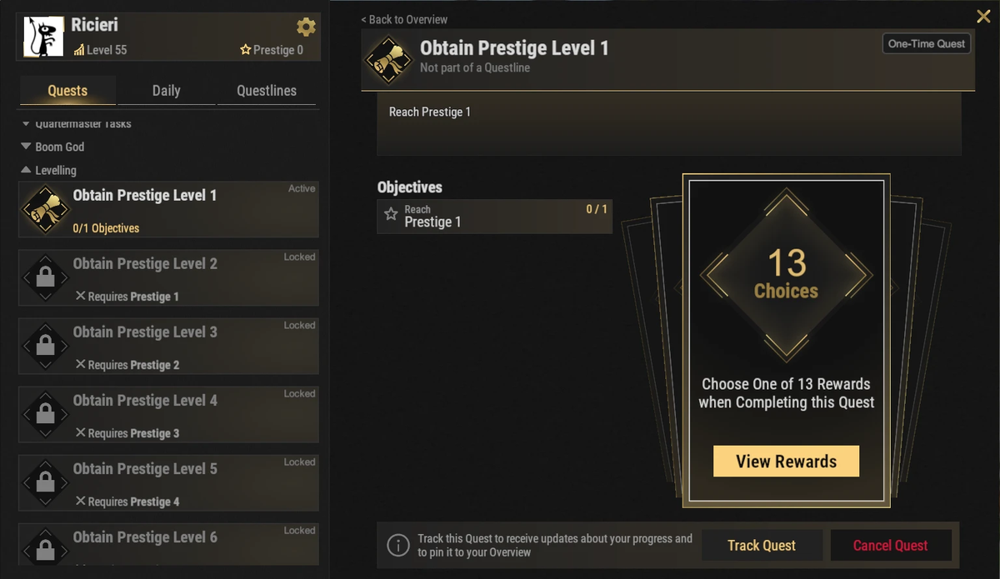
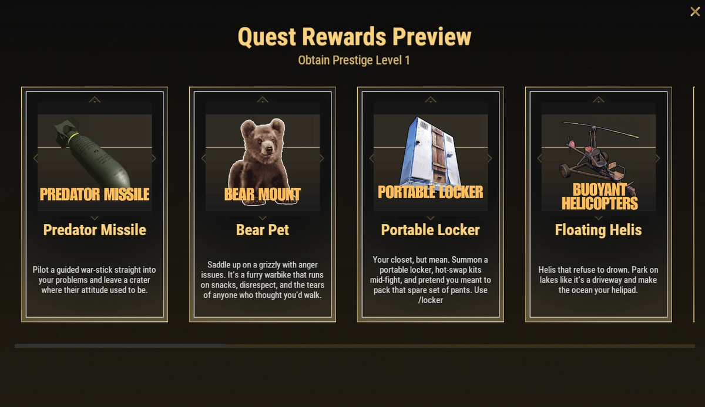

# Перки престижа (Prestige Perks)

Перки престижа — это специальные разблокируемые улучшения, дающие значительное повышение комфорта игры (QoL), ускорение прокачки, автоматизацию рутины и уникальные игровые механики. Хотя ни один из них не является строго обязательным, многие перки кардинально преображают геймплей на Brits PvE Worlds.

## Краткий обзор

- **Рекомендуется для:** Средней и поздней стадии игры (Mid / End Game)
- **Главная цель:** Выбрать перки, наилучшим образом дополняющие ваш стиль игры.

> 💡 **Рекомендуемые универсальные перки:**
>
> - 5 стартовых очков навыков (5 Starting SP)
> - Ночное видение (Nightvision)
> - Бонус +20% к опыту (20% XP Boost)

---

## Как работают перки престижа

- Вы можете совершить Престиж (Prestige), как только ваш уровень персонажа достигнет **100** (см. **[Прогресс и уровни](/wiki/progression-levels)**). Всего в игре **10 уровней престижа**.
- Каждый ранг престижа открывает соответствующее задание в ветке **Levelling** в меню **`/q`**. Завершение квеста позволяет **выбрать один перк** из списка ниже.
- Всего доступно **13 перков**, но уровней престижа только 10, поэтому разблокировать абсолютно все невозможно. Выбирайте с умом под свой стиль игры.
- Перки престижа сохраняются на протяжении всего сезона XP-вайпа (они не сбрасываются при обычных вайпах карты).

---

## Перки прокачки и прогресса

Эти улучшения помогают быстрее развиваться и получать уровни.

### Пять стартовых очков навыков (Five Starting Skill Points)

Каждый новый престиж вы начинаете с **5 дополнительными глобальными очками навыков (SP)**, что позволяет моментально открыть ключевые таланты в самом начале. Бонус начисляется **один раз в ваш общий пул**, и вы можете распределить его по любым веткам древа.

---

### +20% к получаемому опыту (20% XP Boost)

Увеличивает весь зарабатываемый опыт (XP) на **20%**, ускоряя достижение новых уровней и последующих престижей.

---

## Утилитарные перки (Удобство)

Перки, экономящие уйму времени и устраняющие лишнюю рутину.

### Портативный переработчик (Portable Recycler)

Позволяет вызывать персональный переработчик в любое место командой **`/rec`**.

Незаменимая вещь во время зачистки монументов, длительных фарм-рейдов и дальних вылазок вдали от дома.

---

### Портативный шкафчик экипировки (Portable Locker)

Вызывает переносной шкафчик в любое место по команде **`/locker`**, позволяя мгновенно сменить боевой комплект прямо во время перестрелки.

Крайне полезен на рейдах и сложных PvE-ивентах.

---

### Телепортация за 5 секунд (5 Second Teleport)

Сокращает время ожидания телепортации с **20 секунд** до **5 секунд**.

Идеально для игроков, регулярно перемещающихся между базами и точками событий.

> ⚠ В описании игры есть предупреждение: **не выбирайте этот перк, если у вас уже 0 секунд кд телепортации** (некоторые донат-ранги уже дают мгновенный тп).

---

## Перки автоматизации

### Автопродажа серверу (Auto Sell to Server)

Открывает доступ к Банку предметов (Item Bank) и системе автоматической продажи ресурсов. Позволяет автоматически сдавать ресурсы серверу. Вы можете настроить до **4 различных продаваемых предметов на каждый мир**, до **6 стаков каждого ресурса**.

Подробное руководство по настройке смотрите на странице **[Банк предметов и автопродажа](/wiki/auto-sell)**.

---

### Терминал (Terminal)

Открывает доступ к системе Терминалов, позволяющей использовать продвинутые промышленные хранилища и автоматизировать логистику базы.

Подробности смотрите на странице **[Терминал](/wiki/terminal)**.

---

## Бой и мобильность

### Ракета «Хищник» (Predator Missile)

Дает возможность запускать управляемую вручную ракету для нанесения сокрушительного урона с воздуха.

---

### Двойной прыжок (Double Jump)

Позволяет совершать второй прыжок прямо в воздухе.

Значительно повышает мобильность, облегчает паркур, исследование местности и доступ к труднодоступным уступам.

---

### Ночное видение (Nightvision)

Устанавливает ваше персональное игровое время на **12:00**, благодаря чему даже глухой ночью вы видите все при ярком дневном свете без зеленого оттенка ПНВ. Включается и выключается командой **`/nv`**.

Невероятно полезно при ночном фарме и участии в боевых событиях.

---

### Помощник пилота (Pilot Assistance)

Добавляет ряд функций автопилота для вертолетов:

- Авто-зависание в воздухе (Auto-hover)
- Автоматическая плавная посадка (Auto-land)
- Стабилизация полета
- Защита от крушений

Один из лучших перков для игроков, проводящих много времени за штурвалом коптера или вертолета.

---

### Плавающие вертолеты (Floating Helis)

Позволяет вертолетам садиться прямо на поверхность воды и держаться на плаву без повреждений.

Идеально для исследования зоны **[Deep Sea](/wiki/deep-sea)** и морских монументов.

---

## Спутники (Маунты)

### Ручной медведь (Bear Pet)

Призывает верного медведя (в игре отображается как **Bear Mount**), который умеет:

- Добывать ресурсы
- Служить ездовым животным для быстрых поездок
- Перевозить предметы в собственном вместительном инвентаре

Великолепный спутник для масштабных фарм-вылазок.

---

## Читайте далее

Многие из этих перков открывают совершенно новые игровые механики.

Ознакомьтесь с подробными руководствами по системам **[Терминал](/wiki/terminal)** и **[Банк предметов и автопродажа](/wiki/auto-sell)**, чтобы раскрыть весь потенциал автоматизации.
