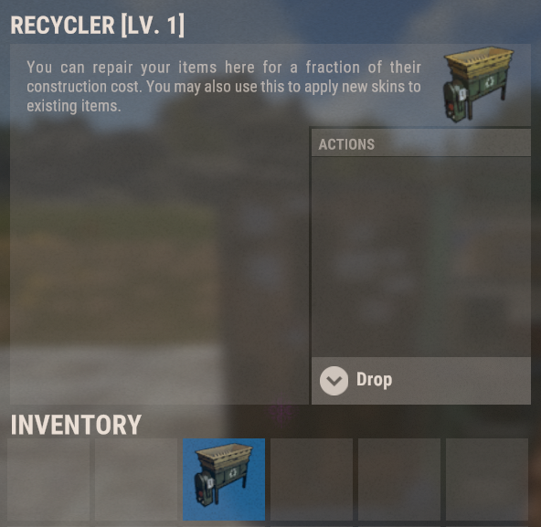
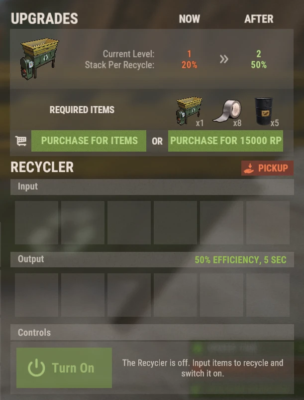

# Переработчики (Recyclers)

Переработчики на серверах Brits PvE Worlds являются **размещаемыми предметами** с собственной системой уровней прокачки, поэтому вам больше не нужно каждый раз бегать на монументы, чтобы переработать лут.

## Краткий обзор

- **Рекомендуется для:** Всех игроков
- **Главная цель:** Перерабатывать ненужный лут прямо у себя дома — быстрее и более крупными пачками по мере прокачки уровней.

> 💡 **Совет**
>
> Покупка собственного персонального переработчика — главная цель начальной цепочки квестов в **[Гайде для новичков](/wiki/beginner-guide)**. На раннем этапе он снабжает вас скрапом для изучения чертежей, а позже становится ключевым звеном для заработка RP по схеме из **[Лучших способов заработка RP](/wiki/best-rp-methods)**.

---

## Как получить переработчик

- Купить за очки RP в магазине сервера **`/s`**.
- Также переработчик изредка выпадает в качестве лута в высокоуровневых событиях.

Переработчик хранится в вашем инвентаре как предмет: его можно поставить в доме точно так же, как верстак или ящик. Описание предмета в игре временно заимствует текст ванильного ремонтного верстака — не обращайте внимания, это полноценный переработчик.

> ⚠ **Не перерабатывайте ресурсы в Мирном городе (Outpost) или Лагере бандитов (Bandit Camp)**, если занимаетесь переработкой тактических перчаток (см. **[Лучшие способы заработка RP](/wiki/best-rp-methods)**). Используйте переработчики на обычных монументах или свой собственный домашний аппарат.

---

## Использование

Откройте установленный переработчик:

- Положите предметы в слоты **Input** (Вход).
- Нажмите **Turn On** (Включить). Переработанные ресурсы появятся в слотах **Output** (Выход).
- Кнопка **Pickup** позволяет забрать переработчик обратно в инвентарь.

Переработчик 1-го уровня работает с **эффективностью 50%**, продолжительность одного цикла переработки составляет **5 секунд**, и за цикл обрабатывается **20% от стака**.

> 💡 **Древо навыков**
>
> Перк **Rapid Recycle** (ветка Сбор и ремесло / Gathercraft, раздел Сбор и рыбалка, 1 очко SP) срезает длительность цикла на 2.5 секунды. См. **[Навыки](/wiki/skills)**.

---

## Улучшение переработчика

У переработчиков есть уровни. Каждый уровень увеличивает **процент стака за цикл (stack per recycle)** — то есть объем предметов, перерабатываемых за один раз. Панель апгрейда расположена в верхней части интерфейса переработчика; улучшение можно оплатить **ресурсами или очками RP**.

| Уровень | Объем стака за цикл | Стоимость перехода на этот уровень |
|---|---:|---|
| 1 | 20% | Начальный уровень |
| 2 | 50% | 1 переработчик + 8 изолент + 5 бочек (см. скриншот) **или 15 000 RP** |
| 3+ | ? | ? |

Точные затраты и характеристики для 3-го уровня и выше в данный момент собираются сообществом. Если вы улучшили свой аппарат выше 2-го уровня, сделайте скриншот панели и помогите вики (см. **[Как внести вклад](/contribute/contribute)**).

---

## Читайте далее

Переходите к статье **[Лучшие способы заработка RP](/wiki/best-rp-methods)**, чтобы узнать, как переработчик превращает тактические перчатки в миллионы очков RP, либо изучите **[Виртуальные карьеры](/wiki/virtual-quarry)** для организации пассивного притока ресурсов.
