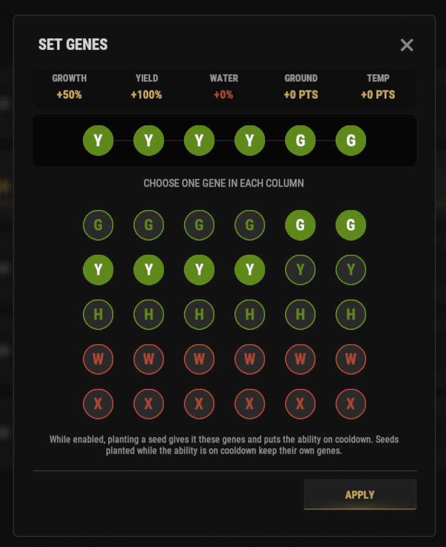

# Гайд генетика (Навык Geneticist)

Навык генетика позволяет вам задать точную комбинацию генов для любого семени, избавляя от долгого скрещивания и случайных неудачных генов в фермерстве.

## Краткий обзор

- **Кому подходит:** Игрокам, открывшим навык **Geneticist** (ветка Survivalcraft, раздел Farming, 5 SP).
- **Главная цель:** Получить идеальный набор генов (например, `GGGGYY` для конопли/ягод) без ожидания и рулетки.

> 💡 **Совет**
>
> Этот навык незаменим при создании автоматизированных ферм конопли для заработка сотен тысяч RP по гайду **[Лучшие методы фарма RP](/wiki/best-rp-methods)**.

---

## Видеогайд

@[youtube](https://www.youtube.com/watch?v=E7c142tDCtQ){width=960 height=540}

---

## Подготовка перед использованием

Перед активацией способности убедитесь, что:

- В вашем хотбаре (быстром доступе) лежит **обычное семечко**.
- Навык Geneticist не находится на перезарядке (кулдаун составляет **3 часа**).

> ⚠ **Важно**
>
> Если нарушить последовательность действий, способность может уйти в 3-часовой кулдаун без применения выбранных генов к семени!

---

## Пошаговая инструкция

1. Положите **обычное семечко** (любое: конопля, ягоды, тыква) в свой хотбар.
2. Откройте древо навыков командой **`/st`**.
3. Нажмите на иконку молнии в правом верхнем углу меню.
4. Найдите ультимейт **geneticist ultimate** и нажмите **activate**.
5. В открывшемся интерфейсе кликами выберите нужную комбинацию генов (например, `G-G-G-G-Y-Y`).

6. Закройте меню крестиком **X** в правом верхнем углу.
7. Посадите **одно семечко** в грядку (Planter Box). *Внимание: **НЕ ИСПОЛЬЗУЙТЕ SHIFT-КЛИК ПРИ ПОСАДКЕ!***
8. Посаженное растение мгновенно получит ровно те гены, которые вы настроили. Срежьте с него клоны, чтобы размножить идеальный сорт!

---

## Возможные проблемы и решения

Если гены не применились:

- Убедитесь, что семечко перед активацией лежало именно в хотбаре, а не в глубине инвентаря.
- Проверьте, закрыли ли вы окно настройки генов крестиком перед посадкой.
- Не сажайте семена через Shift (сажайте строго вручную по одной штуке).

---

## Что читать дальше?

Хотите выжать максимум прибыли из своих идеальных семян?
Переходите к разделу **[Лучшие методы фарма RP](/wiki/best-rp-methods)**, чтобы узнать, как продавать ткань и получать рекордный доход.
