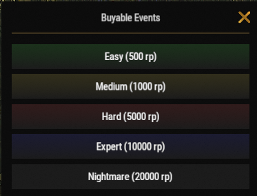

# Рейды баз

Рейды покупных баз (Raid Bases) — одно из самых прибыльных занятий на серверах Brits PvE Worlds. Покупая готовые базы для рейда, вы можете заполучить ценный лут и огромное количество RP, одновременно тренируя свои навыки рейдинга.

## Краткий обзор

- **Рекомендуется для:** Средней и поздней стадии игры (Mid / End Game)
- **Сложность:** ⭐⭐⭐☆☆
- **Главная цель:** Эффективно зарейдить базу и получить максимальную прибыль в ресурсах и RP.

---

## Рекомендуемое снаряжение

### Обязательное

- Большое количество ракет или взрывчатки C4
- Навыки ветки **Взрывчатка** (ветка «Бой» в **[`/st`](/wiki/skills)**)

### Крайне рекомендуется

- **[Brits Boom Stick](/wiki/legendary-weapons)**
- **[Ashmaker](/wiki/legendary-weapons)**

> 💡 **Совет**
>
> Легендарные ракетницы значительно сокращают время прохождения сложных баз и делают процесс рейда намного безопаснее.

---

## Как начать рейд

1. Введите команду **`/worlds`**.
2. Перейдите в один из **Рейд-миров (Raid Worlds 1–5)**.
3. Введите **`/buyraid`**, выберите уровень сложности и приобретите базу за очки RP.

---

## Сложности рейдов

Рейдовые базы приобретаются за RP в меню **Buyable Events** (`/buyraid`). Опыт (XP) за каждую успешно пройденную базу начисляется в общий уровень игрока в соответствии с таблицей на странице **[Прогресс и уровни](/wiki/progression-levels)**.

| Сложность | Цена | Материал базы | Опыт (XP) | Рекомендуется для |
|-----------|-----:|---------------|----------:|-------------------|
| **Easy (Легкая)** | 500 RP | Дерево | 1 000 | Новичков |
| **Medium (Средняя)** | 1 000 RP | Металл | 2 500 | Средней стадии игры |
| **Hard (Тяжелая)** | 5 000 RP | МВК (HQM) | 5 000 | Опытных игроков |
| **Expert (Эксперт)** | 10 000 RP | МВК (HQM) | 7 000 | Поздней стадии игры |
| **Nightmare (Кошмар)** | 20 000 RP | МВК (HQM) | 12 000 | Поздней стадии игры |

Высокие уровни сложности требуют существенно больше взрывчатки, но гарантируют несоизмеримо более ценную добычу.

---

## Тактика прохождения

Перед вызовом баз высокой сложности убедитесь, что у вас открыты ключевые перки раздела **Взрывчатка** ветки «Бой» через **`/st`** (Shockwave, Chain Reaction, Reliable Fuses, Aerodynamically Sound, Blastproof и Orbital Strike).

Во время рейда базы:

- Продвигайтесь не торопясь и осматривайте каждую комнату.
- Остерегайтесь скрытых ловушек (турелей, мин, дробовиков).
- Берите с собой достаточный запас взрывчатки, чтобы успеть до истечения таймера рейда.
- В случае гибели забрать свои вещи бывает непросто из-за коварно расставленных ловушек.

> ⚠ **Важно**
>
> Рейдовые базы ограничены по времени. Если вы не успеете зарейдить базу до окончания таймера, она просто исчезнет (деспавнится).

---

## Орбитальный удар (Orbital Strike)

Если вы используете перк **Orbital Strike** из ветки «Бой» (он создает сигнальный фаер в панели быстрого доступа; бросьте его в место, куда должен прийти удар):

> ⚠ **Важно**
>
> Обязательно уничтожьте все **зенитные комплексы ПВО (SAM Sites)** перед броском фаера.
>
> Когда от установок ПВО пойдет густой дым — они выведены из строя, и ваш орбитальный удар сможет беспрепятственно поразить базу.

---

## Потенциал заработка RP

Рейды баз — один из самых прибыльных способов заработка RP на сервере.

Покупка рейда сложности **Nightmare** стоит **20 000 RP**, однако успешное завершение приносит **около 100 000 RP**, что делает эту активность лидером по доходности. Кроме того, за рейды начисляются дополнительные награды по квестам на странице **[Квесты](/wiki/quests)**.

---

## Перезарядка (Кулдауны)

Кулдауны на покупку рейдов действуют независимо для каждого рейд-мира.

> 💡 **Совет**
>
> Как и в случае с **[Островами Брэдли](/wiki/tackling-bradleys)**, вы можете переключаться между **Raid Worlds 1–5**, чтобы продолжать рейдить базы без ожидания окончания таймера кулдауна.

---

## Читайте далее

Столкнулись с проблемой или хотите сообщить о баге во время рейда?

Перейдите в раздел **[Тикеты поддержки](/wiki/support-tickets)**, чтобы узнать, когда и как связаться с администрацией сервера.
