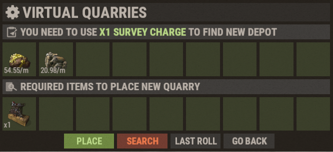

# Виртуальные карьеры (Virtual Quarries)

Виртуальные карьеры — одна из лучших систем пассивной добычи ресурсов на Brits PvE Worlds, позволяющая вам непрерывно генерировать материалы, даже пока вы находитесь офлайн или занимаетесь другими делами.

## Краткий обзор

- **Рекомендуется для:** Любого этапа игры (от ранней до поздней стадии)
- **Главная цель:** Пассивный сбор огромных объемов ресурсов с минимальным обслуживанием.

| Карьер | Что производит | Для чего лучше всего подходит |
|---|---|---|
| Mining Quarry (Горнорудный) | HQM (МВК), железную и серную руду | Фарм руды и высококачественного металла |
| Pump Jack (Нефтекачка) | Сырую нефть (Crude Oil) | Производство топлива |
| Wood Generator (Лесопилка) | Дерево | Строительство и переплавка в печах |

---

## С чего начать

1. Откройте магазин сервера командой **`/s`**.
2. Купите **геологические заряды (Survey Charges)**.
3. Приобретите нужный виртуальный карьер.
4. Откройте интерфейс виртуальных карьеров командой **`/vq`** (или **`/qr`**).
5. Проводите разведку месторождения (Survey), пока не выпадут отличные базовые показатели (см. ниже).
6. Установите карьер на найденное месторождение (Place).
7. Заправляйте установку **дизельным топливом (Diesel Fuel)**.

### Разведка месторождения

Каждый карьер устанавливается на **месторождение (depot)**. Каждая попытка поиска расходует **один геологический заряд (Survey Charge)**. На экране отображаются ресурсы жилы и их **базовая добыча в минуту** (на скриншоте: два ресурса с добычей 54.55/мин и 20.98/мин). Значения генерируются случайно, поэтому крутите роллы до тех пор, пока не выпадет жила с высоким показателем:

- **Search** — расходует еще один геологический заряд и ищет новое месторождение.
- **Last Roll** — возвращает предыдущий удачный результат, если вы случайно прокрутили его.
- **Place** — возводит карьер на текущей разведанной жиле (для постройки требуется соответствующий предмет карьера, указанный в *Required items*).

Множители уровней из таблиц ниже умножают базовую добычу найденной вами жилы, поэтому хороший стартовый ролл окупается на каждом уровне прокачки. Опытные игроки перед установкой стараются выбить как минимум **~48 HQM/мин** для Mining Quarry и **53–55 сырой нефти/мин** для Pump Jack (см. **[Лучшие способы заработка RP](/wiki/best-rp-methods)**).

> 💡 **Важно**
>
> Каждый виртуальный карьер потребляет **дизельное топливо (Diesel Fuel)** во время работы. Дизель можно покупать в **Outpost** за топливо низкого качества (ТНК), а начальный квест **Virtual Oil Baron** как раз предлагает собрать первые 10 канистр дизеля.

---

## Типы карьеров

### Горнорудный карьер (Mining Quarry)

Добывает три самых ценных вида руды в игре, являясь главным выбором для большинства игроков.

Цифры добычи ниже приведены для хорошего базового ролла: около **49 HQM, 75 железной руды и 75 серной руды в минуту** на 1-м уровне.

**Максимальная производительность (Уровень 6, множитель 8.5x):**

- HQM (МВК): 416.5/мин
- Железная руда: 637.5/мин
- Серная руда: 637.5/мин

**Производительность по уровням:**

| Уровень | Множитель | Добыча в минуту |
|---|---:|---|
| 1 | 1.0x | 49 HQM, 75 железной руды, 75 серной руды |
| 2 | 2.25x | 110.25 HQM, 168.75 железной руды, 168.75 серной руды |
| 3 | 3.75x | 183.75 HQM, 281.25 железной руды, 281.25 серной руды |
| 4 | 5.0x | 245 HQM, 375 железной руды, 375 серной руды |
| 5 | 7.0x | 343 HQM, 525 железной руды, 525 серной руды |
| 6 | 8.5x | 416.5 HQM, 637.5 железной руды, 637.5 серной руды |

**Стоимость улучшений:**

| Уровень | Требуемые материалы |
|---|---|
| 1 | 1 шт. Mining Quarry |
| 2 | 6 000 железной руды + 1 изолента (Duct Tape) + 1 карьер |
| 3 | 1 000 HQM + 1 отбеливатель (Bleach) + 1 карьер |
| 4 | 2 000 HQM + 5 отбеливателей + 2 карьера |
| 5 | 3 000 HQM + 7 отбеливателей + 3 карьера |
| 6 | 5 000 HQM + 5 аккумуляторов (Batteries) + 3 карьера |

---

### Нефтяная вышка (Pump Jack)

Добывает сырую нефть, позволяя полностью обеспечивать топливом остальные ваши карьеры и создавать вечный замкнутый цикл ресурсов.

Значения ниже приведены для хорошего базового ролла около **55 сырой нефти в минуту** на 1-м уровне.

**Максимальная производительность (Уровень 6, множитель 8.5x):**

- Сырая нефть: 467.5/мин

**Производительность по уровням:**

| Уровень | Множитель | Добыча в минуту |
|---|---:|---|
| 1 | 1.0x | 55 сырой нефти |
| 2 | 2.25x | 123.75 сырой нефти |
| 3 | 3.75x | 206.25 сырой нефти |
| 4 | 5.0x | 275 сырой нефти |
| 5 | 7.0x | 385 сырой нефти |
| 6 | 8.5x | 467.5 сырой нефти |

**Стоимость улучшений:**

| Уровень | Требуемые материалы |
|---|---|
| 1 | 1 шт. Pumpjack |
| 2 | 1 изолента (Duct Tape) + 1 Pumpjack |
| 3 | 1 000 HQM + 2 отбеливателя (Bleach) + 2 Pumpjacks |
| 4 | 2 000 HQM + 5 отбеливателей + 2 Pumpjacks |
| 5 | 3 000 HQM + 2 аккумулятора (Batteries) + 3 Pumpjacks |
| 6 | 5 000 HQM + 5 аккумуляторов + 3 Pumpjacks |

---

### Лесопилка (Wood Generator)

Обеспечивает постоянный и обильный приток дерева, необходимого для масштабного строительства и работы плавильных печей.

**Максимальная производительность (Уровень 6, множитель 5.0x):**

- Дерево: 5 000/мин

**Производительность по уровням:**

| Уровень | Множитель | Добыча в минуту |
|---|---:|---|
| 1 | 1.0x | 1 000 дерева |
| 2 | 1.25x | 1 250 дерева |
| 3 | 1.5x | 1 500 дерева |
| 4 | 2.0x | 2 000 дерева |
| 5 | 3.0x | 3 000 дерева |
| 6 | 5.0x | 5 000 дерева |

**Стоимость улучшений:**

| Уровень | Требуемые материалы |
|---|---|
| 1 | 5 бензопил (Chainsaws) |
| 2 | 2 000 фрагментов металла + 15 лезвий (Metal Blades) + 1 изолента + 5 бензопил |
| 3 | 4 000 фрагментов металла + 25 лезвий + 5 изолент + 10 бензопил |
| 4 | 200 HQM + 35 лезвий + 1 отбеливатель + 15 бензопил |
| 5 | 1 000 HQM + 50 лезвий + 5 отбеливателей + 20 бензопил |
| 6 | 5 000 HQM + 60 лезвий + 5 аккумуляторов + 20 бензопил |

---

## Замкнутый топливный цикл

Главная причина начинать развитие с нефтекачки (Pump Jack): добываемая сырая нефть полностью окупает затраченный дизель, а каждый лишний баррель превращается в топливо для карьеров HQM, генерирующих чистую прибыль.

1. Купите **дизельное топливо** в **Outpost** за **топливо низкого качества (ТНК)**.
2. Заправьте дизель в **нефтекачку (Pump Jack)**, добывающую **сырую нефть**.
3. Переработайте сырую нефть в **маленьком НПЗ (Small Refinery)** в **топливо низкого качества (ТНК)**.
4. Обменяйте часть полученного ТНК на новую партию дизеля в Outpost. Повторяйте круг.
5. Когда у вас образуется **стабильный избыток дизеля**, заправляйте им **карьер HQM (Mining Quarry)**.
6. Продавайте добытый высококачественный металл через меню **`/s` → Stock Market → Resources**.

> 💡 **Продавайте в правильном мире**
>
> Закупочные цены на ресурсы различаются в разных мирах. Перед продажей HQM, ткани, скрапа или листового металла используйте команду **`/pc <предмет>`** (например, `/pc hqm`), чтобы увидеть, в каком мире курс наивысший, и продавайте ресурсы именно там.

Подробные расчеты доходности смотрите на странице **[Лучшие способы заработка RP](/wiki/best-rp-methods)**.

---

## Рекомендуемый порядок развития

- **Ранняя игра:** Начните с нефтекачки (Pump Jack), чтобы выстроить самоокупаемый цикл снабжения дизелем.
- **Средняя стадия:** Добавьте карьеры HQM и улучшите их до 3–4 уровня.
- **Поздняя стадия:** Прокачайте все карьеры до 6 уровня и целенаправленно фармите аккумуляторы (Batteries) для финальных апгрейдов.

> ⚠ **Улучшения покупаются за ресурсы, а не за RP**
>
> Уровни карьеров можно прокачивать только за ресурсы, указанные в таблицах выше. В отличие от **[Переработчиков](/wiki/recyclers)**, опции апгрейда за RP здесь нет.

---

## Сравнение производительности (6-й уровень)

| Установка | Добыча в минуту | Добыча в час |
|---|---:|---:|
| Лесопилка (Дерево) | 5 000 дерева | 300 000 дерева |
| Карьер (Железная руда) | 637.5 руды | 38 250 руды |
| Карьер (Серная руда) | 637.5 руды | 38 250 руды |
| Нефтекачка (Сырая нефть) | 467.5 нефти | 28 050 нефти |
| Карьер (HQM / МВК) | 416.5 HQM | 24 990 HQM |

> Примечание: и Mining Quarry, и Pump Jack достигают множителя 8.5x на максимальном 6-м уровне.

---

> 💡 **Краткая шпаргалка:**
>
> - Меню карьеров: **`/vq`** или **`/qr`**
> - Покупка карьеров и геологических зарядов: магазин **`/s`**
> - Для работы всех установок требуется **дизельное топливо (Diesel Fuel)**
> - Обязательно ищите жилу с высоким базовым роллом перед установкой
> - Нефтекачки — основа автономного снабжения топливом
> - Максимальный уровень прокачки карьера: **6**

---

## Читайте далее

Хотите автоматизировать продажи пассивного дохода?

Переходите к руководству **[Банк предметов и автопродажа](/wiki/auto-sell)**, чтобы научиться продавать ресурсы в автоматическом режиме и зарабатывать RP даже в офлайне, либо ознакомьтесь со статьей **[Лучшие способы заработка RP](/wiki/best-rp-methods)** с подробными расчетами прибыли.
