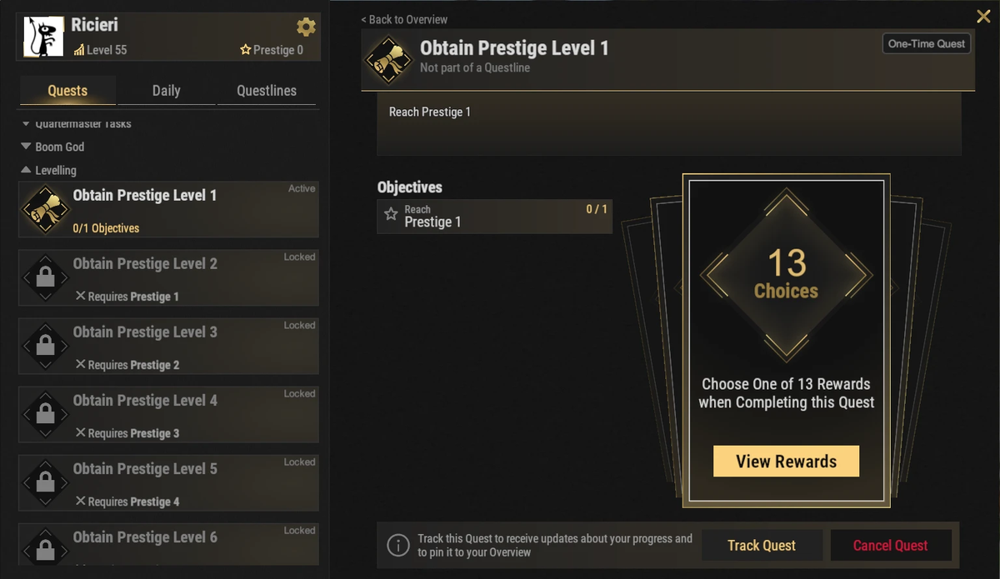
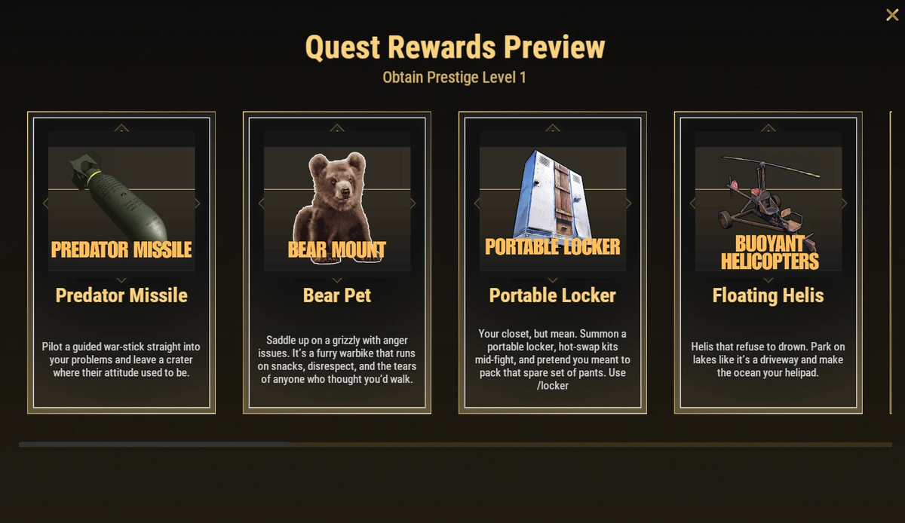

# Prestige Kademeleri (Prestige Perks)

Prestige kademeleri; oyun kalitesini artıran, ilerlemeyi hızlandıran, otomasyon sağlayan ve benzersiz oyun mekanikleri sunan özel kalıcı kilit açımlarıdır. Hiçbiri zorunlu olmasa da Brits PvE Dünyaları'ndaki oyun deneyiminizi olağanüstü derecede iyileştirir.

## Hızlı Genel Bakış

- **Önerilen Aşama:** Orta - Son Aşama (Mid to End Game)
- **Ana Hedef:** Oyun tarzınıza en uygun kademeleri seçmek.

> 💡 **En Çok Önerilen İlk 3 Kademe:**
>
> 1. **5 Starting SP** (Başlangıçta +5 Beceri Puanı)
> 2. **Nightvision** (Gece Görüşü / Daimi Gündüz)
> 3. **20% XP Boost** (%20 Ekstra Deneyim Puanı)

---

## Prestige Sistemi Nasıl Çalışır?

- Oyuncu seviyeniz **100** olduğunda Prestige atabilirsiniz (ayrıntılar için **[İlerleme & Seviyeler](/wiki/progression-levels)** sayfasına bakın). Toplamda **10 Prestige seviyesi** vardır.
- Her Prestige seviyesinde, **`/q`** menüsündeki **Levelling** sekmesinde özel bir görev açılır. Bu görevi tamamlamak aşağıdaki listeden **1 adet kademe seçmenizi** sağlar.
- Toplam **13 kademe** varken yalnızca 10 Prestige seviyesi bulunur; bu nedenle hepsini aynı anda açamazsınız. Kendi stratejinize en uygun olanları seçmelisiniz.
- Prestige kademeleri **tüm XP sezonu boyunca kalıcıdır**; harita (map) sıfırlanmalarında (wipe) asla kaybolmazlar!

---

## İlerleme (Progression) Kademeleri

Daha hızlı seviye atlamanızı ve gelişmenizi sağlayan kademeler:

### Five Starting Skill Points (+5 Başlangıç SP'si)

Her prestige başında ortak havuza fazladan **5 küresel Beceri Puanı (SP)** ekler; böylece güçlü yetenekleri çok daha erken açabilirsiniz.

---

### 20% XP Boost (%20 XP Takviyesi)

Kazanılan tüm XP miktarını **%20 artırır**; seviye atlamayı ve karakter gelişimini muazzam derecede hızlandırır.

---

## Kolaylık (Utility) Kademeleri

Zaman kazandıran ve angaryayı bitiren kademeler:

### Portable Recycler (Taşınabilir Geri Dönüştürücü)

**`/rec`** komutu ile istediğiniz her yerde kişisel geri dönüştürücünüzü çağırın!
Monument turları, maden seferleri ve üsten uzak maceralar için mükemmeldir.

---

### Portable Locker (Taşınabilir Dolap)

**`/locker`** komutu ile nerede olursanız olun anında bir dolap açın ve savaşın ortasında zırh/silah setinizi değiştirin!

---

### 5 Second Teleport (5 Saniyelik Işınlanma)

Işınlanma geri sayım süresini **20 saniyeden 5 saniyeye** düşürür. Sürekli üsler ve etkinlikler arasında seyahat edenler için vazgeçilmezdir.

> ⚠ VIP veya mevcut rütbeniz nedeniyle ışınlanma süreniz zaten sıfırsa (beklemesizse) bu kademeyi seçmeyin!

---

## Otomasyon (Automation) Kademeleri

### Auto Sell to Server (Sunucuya Otomatik Satış)

Eşya Bankasını (Item Bank) ve Otomatik Satış sistemini açar; bankaya koyduğunuz maden ve kaynakların çevrimdışıyken bile Borsaya satılmasını sağlar. Dünya başına 4 farklı eşya türünü (her birinden 6 yığına kadar) depolayabilirsiniz.

Detaylı kurulum için **[Eşya Bankası & Otomatik Satış](/wiki/auto-sell)** rehberine bakın.

---

### Terminal

Terminal sistemini açarak kablosuz depolama ve gelişmiş endüstriyel fabrika otomasyonuna erişim sağlar.

Detaylı bilgi için **[Terminal Rehberi](/wiki/terminal)** sayfasına göz atın.

---

## Savaş & Hareket Kabiliyeti Kademeleri

### Predator Missile (Güdümlü Füze)

Ölümcül hava saldırıları yapmak için kontrol edilebilir güdümlü bir füze fırlatın.

---

### Double Jump (Çift Zıplama)

Havadayken ikinci kez zıplama yeteneği kazandırır. Hareket kabiliyeti, keşif ve ulaşılamaz çatılara tırmanmak için harikadır.

---

### Nightvision (Daimi Gündüz Görüşü)

Kişisel saatinizi daima **12:00 (öğle vakti)** olarak sabitler! Gece yarısı bile zifiri karanlık yerine öğle aydınlığı görürsünüz (yeşil filtre olmadan, gerçek gündüz gibi!). **`/nv`** komutu ile açılıp kapatılır.

---

### Pilot Assistance (Helikopter Pilot Asistanı)

Mini helikopter ve scrap heli için gelişmiş uçuş asistanı özellikleri sunar:
- Otomatik havada asılı kalma (Auto-hover)
- Otomatik iniş (Auto-land)
- Denge desteği ve kaza önleme

---

### Floating Helis (Suda Yüzen Helikopterler)

Helikopterlerin suya inmesine ve suyun üzerinde yüzmesine izin verir. **[Deep Sea](/wiki/deep-sea)** kargo gemisi ve okyanus etkinlikleri için mükemmeldir.

---

## Yoldaş (Companion) Kademeleri

### Bear Pet (Evcil Ayı Bineği)

Oyun içinde **Bear Mount** olarak geçen özel bir yoldaş ayı çağırır:
- Kaynak toplayabilir
- Üzerine binilip sürülebilir
- Kendi çantasında eşya taşıyabilir

---

## Okumaya Devam Et

Bu kademelerin nasıl çalıştığını derinlemesine öğrenmek için **[Terminal Rehberi](/wiki/terminal)** ve **[Eşya Bankası & Otomatik Satış](/wiki/auto-sell)** sayfalarını inceleyebilirsiniz.
