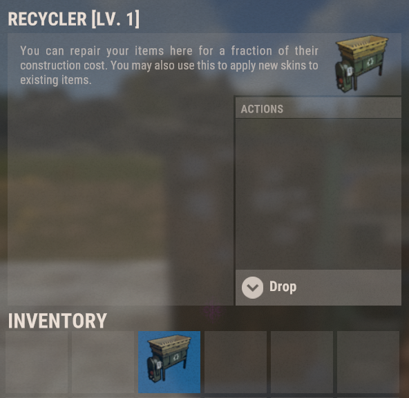
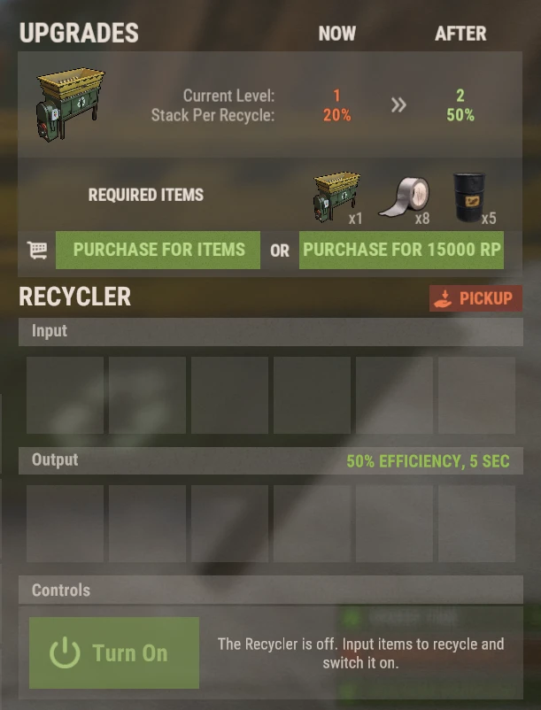

# Geri Dönüştürücüler (Recyclers)

Brits PvE Dünyaları'ndaki Geri Dönüştürücüler (Recyclers), kendi evinize yerleştirebileceğiniz ve seviyesini yükseltebileceğiniz **taşınabilir eşyalardır**. Böylece eşya öğütmek için her seferinde anıtlara (monument) veya Outpost'a koşmak zorunda kalmazsınız.

## Hızlı Genel Bakış

- **Önerilen Kitle:** Tüm Oyuncular
- **Ana Hedef:** İstenmeyen ganimetleri evinizde güvenle, çok daha hızlı ve yükselttikçe dev yığınlar halinde geri dönüştürmek.

> 💡 **İpucu**
>
> Kendi Geri Dönüştürücünüzü satın almak, **[Başlangıç Rehberi](/wiki/beginner-guide)** sayfasındaki başlangıç görevlerinin nihai amacıdır. Erken aşamada hurda ve parça ihtiyacınızı karşılarken, ilerleyen aşamalarda **[En İyi RP Yöntemleri](/wiki/best-rp-methods)** sayfasındaki taktik eldiven yöntemini besler.

---

## Geri Dönüştürücü Nasıl Alınır?

- **`/s`** mağazasından RP karşılığında satın alınabilir.
- Bazı özel etkinlik sandıklarından nadir ganimet olarak da düşebilir.

Geri Dönüştürücü envanterinizde bir eşya olarak görünür; herhangi bir mobilya gibi evinizin içine yerleştirin (oyun içi açıklamasında standart tamir masası yazısı yazabilir, aldırmayın; tam teşekküllü bir öğütücüdür).

> ⚠ **Taktik Eldiven Yöntemi Yaparken Outpost veya Bandit Camp'te Geri Dönüştürmeyin!**
>
> Güvenli bölgelerdeki dönüştürücüler kumaş iadesini kısıtlar. Yalnızca kendi evinizdeki veya haritadaki diğer anıtlardaki dönüştürücüleri kullanın (**[En İyi RP Yöntemleri](/wiki/best-rp-methods)** sayfasına bakın).

---

## Kullanımı

Yerleştirilen Geri Dönüştürücüyü açın:

- Öğütmek istediğiniz eşyaları **Input (Giriş)** yuvalarına koyun.
- **Turn On (Çalıştır)** butonuna basın. Geri dönüştürülen kaynaklar **Output (Çıkış)** yuvalarında belirir.
- **Pickup** butonu cihazı tekrar envanterinize toplar.

Seviye 1 bir Recycler, döngü başına **5 saniyede** çalışır ve döngü başına **yığının %20'sini** işler.

> 💡 **Yetenek Ağacı Desteği**
>
> Gathercraft ağacındaki **Rapid Recycle** yeteneği (Gathering & Fishing bölümü, 1 SP), dönüştürme döngü süresini 2.5 saniye kısaltır! Detaylar için **[Yetenekler](/wiki/skills)** sayfasına bakın.

---

## Seviye Yükseltme (Upgrading)

Geri Dönüştürücülerin seviyeleri vardır. Her yeni seviye, döngü başına eritilen **yığın yüzdesini (stack per recycle)** artırır. Yükseltme paneli arayüzün en üstünde yer alır ve **eşyalarla veya doğrudan RP ile** ödenebilir.

| Seviye | Döngü Başına İşlenen Yığın | Yükseltme Maliyeti |
|---|---:|---|
| 1 | %20 | Başlangıç Seviyesi |
| 2 | %50 | 1 Recycler + 8 Duct Tape + 5 Varil, **veya 15,000 RP** |
| 3+ | ? | ? |

---

## Okumaya Devam Et

Bir Geri Dönüştürücü kullanarak Taktik Eldivenleri (Tactical Gloves) nasıl kumaşa ve yüz binlerce RP'ye dönüştüreceğinizi görmek için **[En İyi RP Yöntemleri](/wiki/best-rp-methods)** sayfasına veya bir diğer dev pasif kaynak sistemi için **[Sanal Maden Ocakları](/wiki/virtual-quarry)** sayfasına göz atın.
